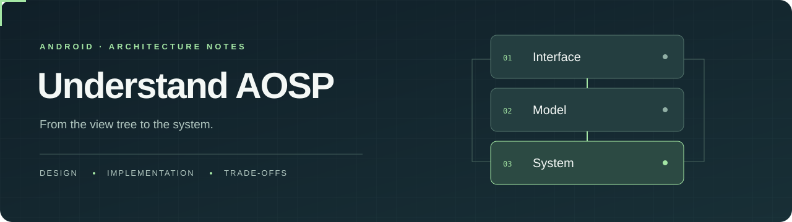

<p align="center">
  
</p>

<p align="center">
  <strong>读懂 Android 的设计，也读懂设计背后的取舍。</strong><br>
  应用架构 · 数据模型 · 系统服务 · 交互与动画
</p>

<p align="center">
  <a href="app/launcher3/README.md">开始阅读 Launcher3</a> ·
  <a href="app/README.md">应用设计</a> ·
  <a href="system/README.md">系统设计</a> ·
  <a href="CONTRIBUTING.md">文档约定</a>
</p>

---

这里存放我的 AOSP 系统技术文档：从 App 的界面、状态和数据模型，到跨进程协议、窗口管理与系统协作。重点记录实现链路、设计取舍、源码依据，以及结论的适用边界。

首批收录 **Launcher3 专题的 5 篇文档、62 张架构与时序图**，整理自个人飞书笔记。文中同时涉及 AOSP 与 OSLauncher3 定制实现；每篇保留自己的源码基线，具体行为以对应版本和配置为准。

## 从这里开始

| 专题 | 你将读到 | 入口 |
| :--- | :--- | :--- |
| **Launcher3** | View 层级、状态机、Workspace 数据、图标、SystemUI 与 Overview | [进入专题 →](app/launcher3/README.md) |
| **应用设计** | 按应用归档架构、交互与数据设计 | [应用目录 →](app/README.md) |
| **系统设计** | 系统服务、进程通信、窗口与平台机制，后续补充 | [系统目录 →](system/README.md) |

## Launcher3 阅读路线

| 顺序 | 文档 | 核心问题 |
| :---: | :--- | :--- |
| 01 | [View 层级与状态机](app/launcher3/view-and-state.md) | 同一棵 View 树如何呈现桌面、抽屉与最近任务？ |
| 02 | [Workspace 数据库](app/launcher3/workspace-database.md) | 用户布局如何持久化、迁移、恢复与保持一致？ |
| 03 | [图标加载与动态图标](app/launcher3/icon-loading.md) | 图标如何经过缓存、规范化、动态渲染抵达界面？ |
| 04 | [Launcher 与 SystemUI 协作](app/launcher3/systemui-integration.md) | 两个进程如何协同完成导航、任务与窗口动画？ |
| 05 | [Overview 实现全景](app/launcher3/overview.md) | 任务、截图与真实应用 Surface 如何组成连续交互？ |

## 阅读方式

- **直接在 GitHub 阅读**：Markdown 正文、表格、代码与 Mermaid 图，无需安装工具。
- **按问题查阅**：专题页提供场景索引，每篇开头提供可折叠章节目录。
- **保留上下文**：页首与页尾可切换文章；[来源记录](app/launcher3/SOURCES.md)保留飞书原文、文档版本及源码基线。

## 仓库结构

```text
understandAOSP/
├── app/
│   └── launcher3/       # Launcher3 专题与来源记录
├── system/             # 系统设计文档入口
├── assets/             # 文档本地图片
└── CONTRIBUTING.md     # 内容组织与维护约定
```

部分原文源码链接指向需要权限的内部仓库，飞书原文也保留原有访问权限；正文和图表可直接在本仓库阅读。源码分析、设计建议与实机验收结论分别记录，不将某一版本的定制实现泛化为所有 AOSP 版本的行为。
