[首页](../../README.md) / [应用设计](../README.md) / [Launcher3](README.md)

[← Workspace 数据库](workspace-database.md) · [专题目录](README.md) · [与 SystemUI 协作 →](systemui-integration.md)

# OSLauncher3 图标加载架构与动态图标设计

> 文档日期：2026-11-20  
> 源码仓库：`OSCore/SeewoOS/OSLauncher3`  
> 分支：`em-stable`  
> 基线：`ae97ee43360d19569eb056613f9ec97060343984`  
> 说明：本文基于远端实际源码分析，描述当前能力，并给出面向后续图标扩展的统一设计方案。

<details>
<summary><strong>章节目录</strong></summary>

- [1. 目标与范围](#1-目标与范围)
- [2. 总体架构](#2-总体架构)
- [3. 完整加载流程](#3-完整加载流程)
- [4. 图标规范化与统一视觉](#4-图标规范化与统一视觉)
- [5. 各类动态图标的现有机制与设计方案](#5-各类动态图标的现有机制与设计方案)
- [6. 当前源码默认启用状态](#6-当前源码默认启用状态)
- [7. 渠道图标设计与隔离](#7-渠道图标设计与隔离)
- [8. 统一动态图标扩展架构](#8-统一动态图标扩展架构)
- [9. 性能设计原则](#9-性能设计原则)
- [10. 测试与验收方案](#10-测试与验收方案)
- [11. 设计亮点总结](#11-设计亮点总结)
- [12. 当前改进优先级](#12-当前改进优先级)
- [13. 源码索引](#13-源码索引)

</details>

## 1. 目标与范围

Launcher 图标系统承担的不只是“显示应用图标”，还同时处理：

- 桌面、抽屉、任务栏、文件夹、最近任务等不同容器；
- 普通应用、深度快捷方式、工作资料、Instant App 等不同实体；
- Adaptive Icon、Legacy Icon、单色主题图标等不同资源形态；
- 日历、时钟、安装进度、通知圆点等动态状态；
- 多用户、多密度、多主题、多语言和客户渠道资源差异；
- 冷启动性能、内存复用、磁盘缓存和包更新后的准确失效。

本文重点回答四个问题：

1. 图标从系统资源进入 Launcher 界面的完整路径是什么；
2. 当前实现中哪些设计最精妙，解决了什么问题；
3. 各类动态图标分别应该如何设计；
4. 如何形成可扩展、可缓存、可隔离、可验证的统一动态图标架构。

---

## 2. 总体架构

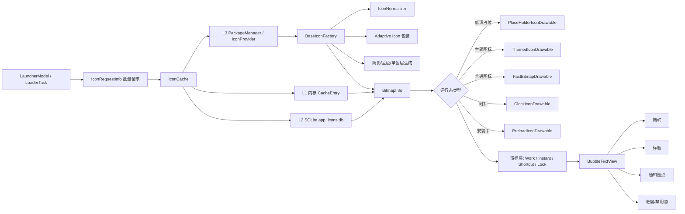

系统可分为五层：

| 层次 | 主要职责 | 代表类 |
|-|-|-|
| 模型层 | 枚举桌面项、All Apps、快捷方式并组织批量请求 | `LoaderTask`、`LauncherModel`、`IconRequestInfo` |
| 获取与缓存层 | 多级命中、批量查库、资源读取、缓存失效 | `IconCache`、`BaseIconCache`、`IconProvider` |
| 规范化层 | 尺寸、视觉面积、蒙版、阴影、主色、单色层 | `BaseIconFactory`、`IconNormalizer` |
| 表达层 | 把 `BitmapInfo` 转成可绘制对象并叠加身份徽标 | `FastBitmapDrawable`、`ThemedIconDrawable`、`ClockDrawableWrapper` |
| 视图层 | 图标、文本、圆点、下载进度和异步升级 | `BubbleTextView`、`PreloadIconDrawable` |

### 2.1 核心对象关系

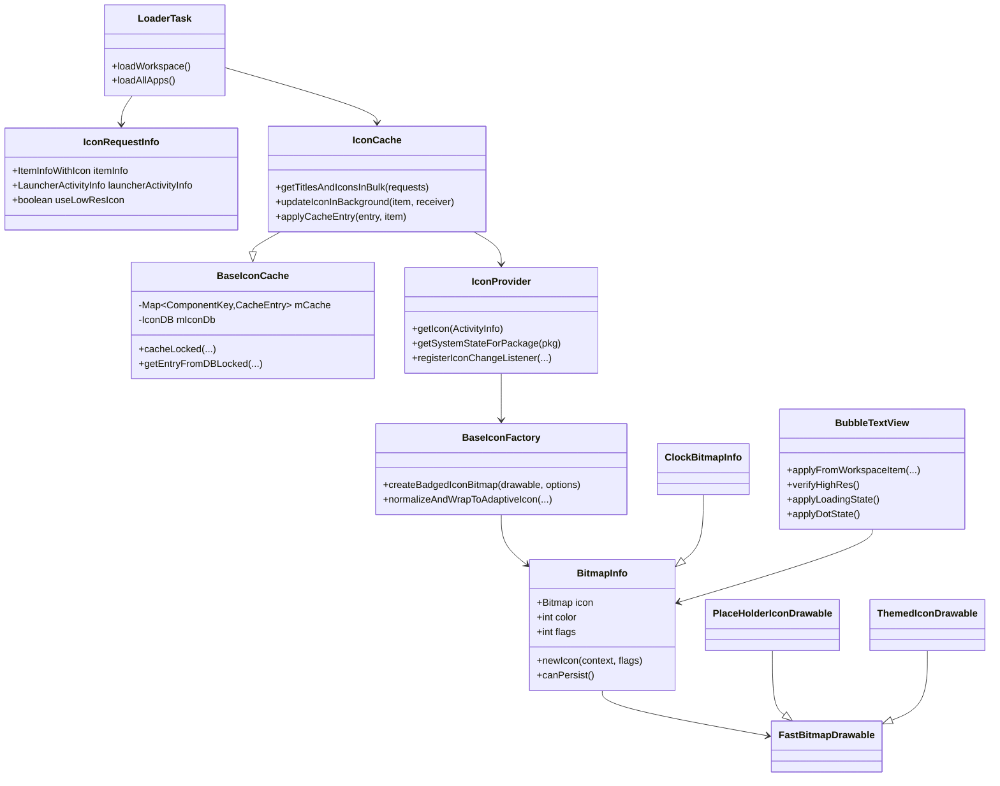

---

## 3. 完整加载流程

### 3.1 Launcher 启动阶段

`LauncherAppState` 初始化 `LauncherIconProvider` 和 `IconCache`，并注册图标变化监听。随后 `LoaderTask` 分别加载 Workspace、All Apps、Widgets 和快捷方式。Workspace 与 All Apps 默认启用批量图标加载，以避免逐项访问数据库和 PackageManager。

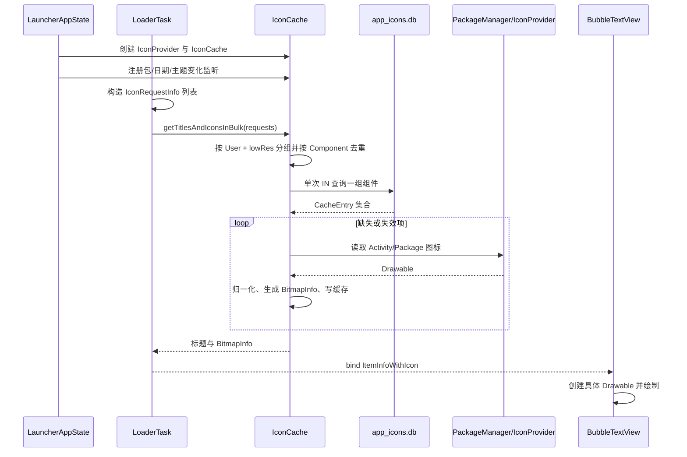

### 3.2 批量加载的精妙之处

批量接口不是简单循环，而是做了三次收敛：

1. **按用户和清晰度分组**：不同用户的徽标、权限和资源空间不同；低清与高清的数据库读取列也不同。
2. **按 ComponentName 去重**：同一个应用可能同时出现在多个桌面页、文件夹或预测位置，只查一次，再把同一条 `CacheEntry` 分发给多个请求。
3. **一组一次 SQL `IN` 查询**：将大量单点 SQLite I/O 合并为少量批量查询。

深度快捷方式不会直接复用应用级批量结果，因为快捷方式可能具有独立标题和图标。该边界避免了“优化命中率却显示错内容”的典型问题。

### 3.3 三级缓存与降级顺序

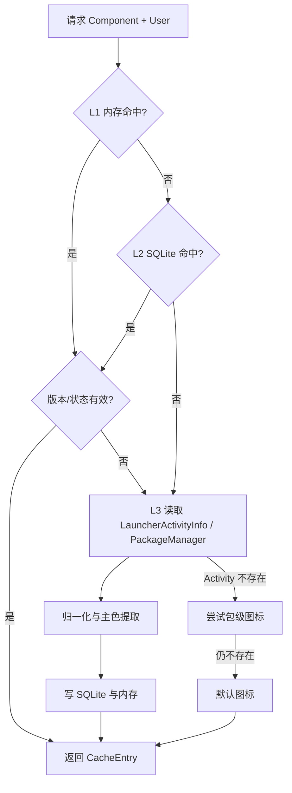

缓存有效性不是只看包名，而是综合：

- `versionCode`；
- `lastUpdateTime`；
- 当前系统图标状态；
- 用户/资料空间；
- 图标尺寸对应的数据库版本。

系统图标状态至少包含语言区域和 SDK；主题开关还会追加 `with-theme/no-theme`。日历包会追加当天日期，因此跨日后即使 APK 没升级，缓存也会自然失效。

### 3.4 低清占位与高清升级

`BitmapInfo.LOW_RES_INFO` 使用一个极小的哨兵位图表达“信息存在，但尚未加载高清位图”。这不是一张要展示的低分辨率图，而是一种状态编码。

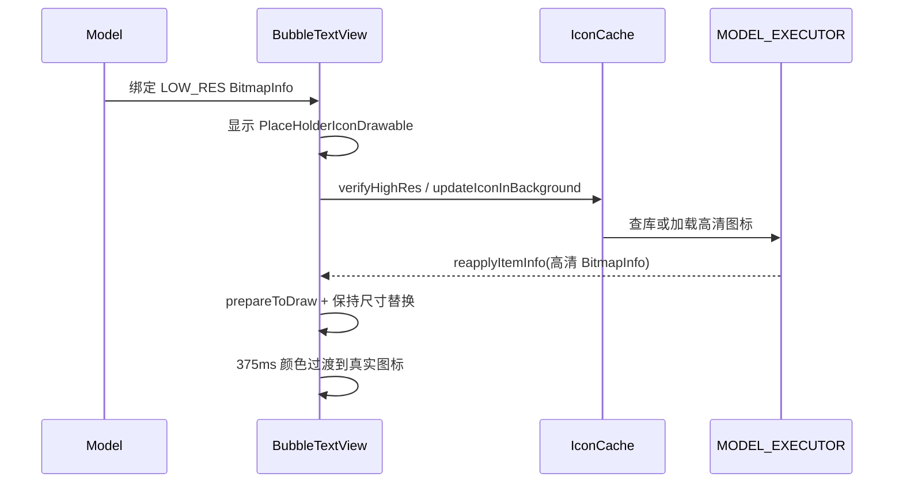

这里有两个值得保留的细节：

- 占位图与最终图标具有相同布局尺寸，替换时不触发重新测量，降低桌面抖动；
- 高清位图在进入 UI 前调用 `prepareToDraw()`，提前准备 GPU 上传，降低首帧卡顿。

---

## 4. 图标规范化与统一视觉

不同应用提交的图标可能是圆形、方形、透明边距很大或内容铺满。如果只按 Bitmap 外框缩放，会导致图标视觉大小不一致。

### 4.1 视觉面积归一化

`IconNormalizer` 的核心不是比较宽高，而是分析 Alpha 可见区域：

1. 将 Drawable 绘制到临时 Alpha Bitmap；
2. 逐行扫描左右可见边界；
3. 对边界做凸包修正，消除凹凸噪声；
4. 估算真实可见面积与边界面积；
5. 根据视觉占比计算缩放系数；
6. 对非 Adaptive Icon 判断形状是否接近目标蒙版，否则包装进 Adaptive Icon 背景。

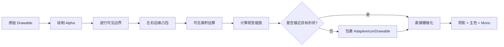

这套算法的精妙之处在于：它统一的是“人眼看到的重量”，而不是文件尺寸。

### 4.2 `BitmapInfo`：把静态数据与运行态表达分开

`BitmapInfo` 同时保存：

- 主位图；
- 主色；
- Mono 单色蒙版；
- Work/Instant 等标志；
- 可选的嵌套徽标信息。

真正创建 Drawable 时才决定：

- 低清状态 → `PlaceHolderIconDrawable`；
- 开启主题且存在 Mono → `ThemedIconDrawable`；
- 其他情况 → `FastBitmapDrawable`；
- 最后再应用 Work、Instant 或嵌套来源徽标。

因此同一份缓存数据能够服务多个界面状态，而不必为深色、浅色、主题色分别保存完整 Bitmap。

---

## 5. 各类动态图标的现有机制与设计方案

### 5.1 动态类型总表

| 类型 | 驱动源 | 当前实现 | 缓存策略 | 推荐刷新粒度 |
|-|-|-|-|-|
| 动态日历 | 日期 | 每日资源数组 + 日期状态键 | 可持久化，跨日失效 | 天 |
| 动态时钟 | 系统时间 | Adaptive Icon 分层实时绘制 | 背景可缓存，动态对象不可持久化 | 分钟 |
| 主题图标 | 主题/壁纸颜色 | Mono 蒙版运行时着色 | 缓存 Mono，不缓存每种颜色成品 | 主题变化 |
| 安装进度 | PackageInstaller 会话 | 环形路径 + 缩放/淡出动画 | 不持久化运行态 | 进度事件 |
| 通知圆点 | NotificationKeyData | 独立 DotRenderer 图层 | 不进入图标位图 | 通知事件 |
| 工作/Instant 徽标 | 用户和应用属性 | `BitmapInfo.flags` 运行时叠加 | 缓存语义标志 | 属性变化 |
| 深度快捷方式徽标 | 来源应用 | 嵌套 `badgeInfo` | 可缓存来源信息 | 快捷方式变化 |
| 应用锁徽标 | 锁定列表/全局开关 | 当前直接合成新 Bitmap | 当前成本偏高 | 锁状态变化 |
| 文件夹动态图标 | 文件夹内容/圆点 | 分层 Picture/Bitmap 组合 | 视图状态生成 | 内容变化 |
| 最近任务图标 | TaskDescription/Activity | 独立 LRU Cache | 独立生命周期 | 任务/密度变化 |

### 5.2 动态日历

#### 客户体验

日历图标始终展示当天日期；进入次日、切换时区或手工校时后自动更新，不要求重启 Launcher。

#### 当前源码机制

`IconProvider` 从目标 Activity 的 metadata 中读取 `<package>.dynamic_icons`，该 metadata 指向一个 TypedArray；以“当天日期 - 1”为下标选择对应资源。主题模式还可以读取每日 Mono 资源数组。

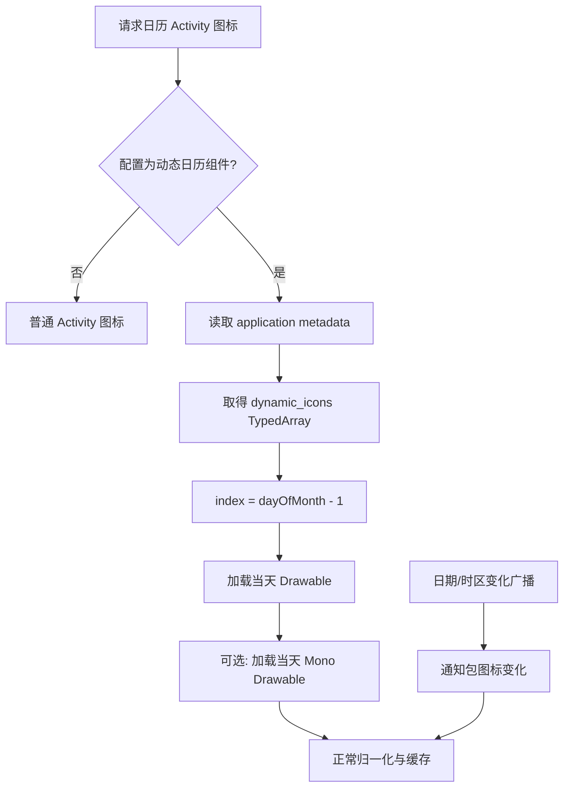

缓存状态中额外加入当天日期，使旧日历图标即使仍在 SQLite 中也不会被误认为有效。这是“事件通知 + 状态键校验”的双保险：漏掉一次广播时，下次读取仍能发现状态不一致。

#### 推荐扩展

- 支持 `CalendarIconSource` 返回 `Drawable + Mono`；
- 日期索引、资源读取和失效策略封装在 Source 内；
- 渠道仅通过 overlay 指定组件与资源，不在共享代码判断客户名；
- 若应用没有 31 张资源，允许使用模板底图 + 数字矢量层，减少资源体积。

### 5.3 动态时钟

#### 当前源码机制

`ClockDrawableWrapper` 读取 Adaptive Icon 的前景/背景和 metadata 中的时针、分针、秒针层索引，再按默认时刻与当前时刻的差值设置 `LayerDrawable` 的 level。

当前实现禁用秒针动态更新，每分钟刷新一次，显著降低桌面常驻动画的功耗。刷新只在 Drawable 可见时调度，并对齐到下一分钟边界。

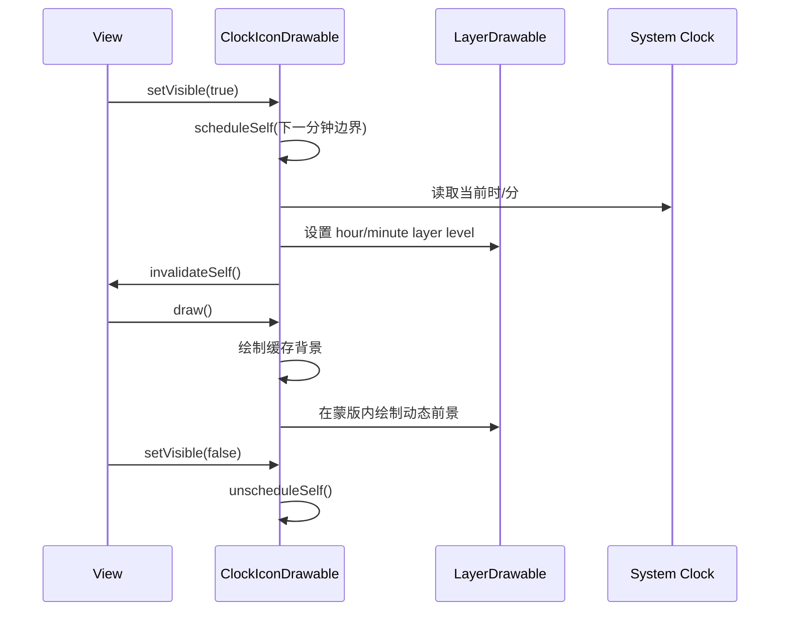

#### 最精妙的缓存边界

`ClockBitmapInfo.canPersist()` 返回 `false`。原因是时钟不是一张静态 Bitmap，而是带有时间计算和定时调度行为的对象。如果将完整对象扁平化写入磁盘，读取后只会得到过期时刻。

同时，时钟仍把与时间无关的背景扁平化缓存，只让前景指针保持动态。它不是“完全不缓存”，而是准确区分静态层与动态层。

#### 推荐扩展

- 保持默认分钟级刷新，秒针只在明确产品需求下开启；
- 使用 `SystemClock.uptimeMillis()` 对齐调度，避免持续帧动画；
- 界面不可见、Launcher 停止或图标离屏时取消任务；
- 主题模式只改变 Mono 前景/背景色，不重建时间逻辑。

### 5.4 主题动态图标

主题图标本质上不是“另一套彩色 PNG”，而是以 Mono 蒙版表达形状，运行时结合系统/壁纸主题色生成背景色和前景色。

`LauncherIconProvider` 可从 `grayscale_icon_map.xml` 读取包名到单色资源的覆盖映射；Adaptive Icon 自带 Mono 时则可直接使用。主题开关变化会进入系统图标状态，触发缓存失效或重绑定。

推荐组合顺序：

```text
原始图标/动态图标源
  → 视觉归一化
  → 生成或读取 Mono
  → 按主题着色
  → 叠加身份徽标
  → 叠加通知/进度等运行态效果
```

身份徽标不应先被染进 Mono 蒙版，否则 Work、Instant、锁标识会失去独立颜色与语义。

### 5.5 安装、下载和恢复进度

`PreloadIconDrawable` 用 Adaptive Icon 蒙版路径作为进度轨道，而不是固定圆环，因此圆形、圆角矩形等图标都能获得一致的轮廓进度视觉。

其状态机为：

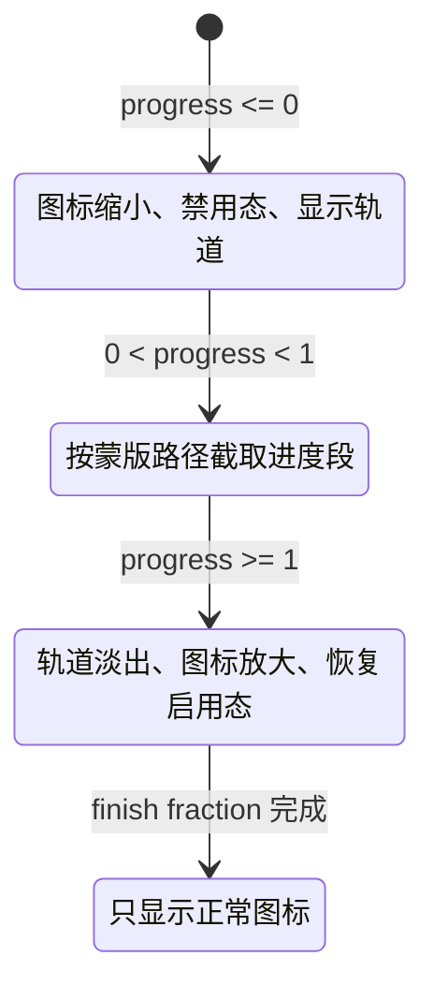

设计建议：

- 安装进度属于 View 运行态，不写入图标数据库；
- 进度倒退时直接跳转，不播放反向动画，避免错误视觉；
- 进度完成后由包变更事件重新获取最终图标；
- “推荐但未下载”和“正在安装”应使用不同状态，不能仅凭 `progress == 0` 混为一类。

### 5.6 通知圆点

通知圆点由 `BubbleTextView` 和 `DotRenderer` 独立绘制，不修改底层 Bitmap。新增/删除通知时仅动画圆点的 scale，避免整张图标重建。无障碍描述同时追加通知数量，使视觉状态和读屏语义一致。

这类短生命周期状态应始终保持“独立图层”，而不是写入磁盘缓存。

### 5.7 工作资料、Instant App 和深度快捷方式徽标

`BitmapInfo.flags` 保存 Work/Instant 等语义；创建 Drawable 时才选择徽标。深度快捷方式可通过嵌套 `badgeInfo` 使用来源应用图标作为徽标。

这种设计优于预先把徽标烘焙进 Bitmap：

- 同一主图可在不同用户下复用；
- 更换主题或徽标资源无需重新解码主图；
- 无障碍和业务逻辑仍能识别徽标语义；
- 徽标的缩放与位置规则可以统一调整。

### 5.8 应用锁徽标

当前 `LockIconHelper` 会把原图复制成软件 Bitmap，扩展画布，再将锁图标直接绘入右下角。`IconCache.applyCacheEntry()` 在应用被锁时执行该合成。

该方案能快速交付，但存在三个结构性问题：

1. 每次应用缓存条目都可能创建新 Bitmap，锁定应用较多时产生额外分配；
2. `BitmapInfo.of(newBitmap, color)` 没有继承原有 Mono、flags 和 `badgeInfo`，可能丢失主题图标及 Work/Instant 语义；
3. 扩大 Bitmap 画布改变了标准图标边界，可能影响归一化尺寸和点击/动画对齐。

推荐将应用锁改成标准语义徽标：

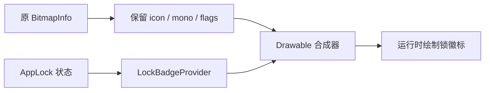

即：不改主 Bitmap，只在 Drawable 层设置 `BadgeSpec(APP_LOCK)`。锁状态变化时重绑定对应图标，无需重解码或重写数据库。

### 5.9 文件夹图标

文件夹图标是组合型动态图标：背景、内部预览项、通知圆点/边框分别绘制。`FolderAdaptiveIcon` 用三个图层表达：

- Background：文件夹底色、阴影、描边；
- Foreground：多个预览图标；
- Badge：通知圆点等覆盖层。

它在后台发起创建，但把依赖真实 `FolderIcon` 状态的绘制命令切回 UI 线程初始化，以规避与 View 绘制的竞态；完成后再把复杂前景转成 Bitmap。这是“短暂跨线程取快照，而不是让后台线程直接读 View”的稳妥实现。

### 5.10 最近任务图标

最近任务使用独立 `TaskIconCache`，而不是直接复用 Launcher 模型缓存。加载优先级为：

1. `TaskDescription` 的内存图标；
2. `TaskDescription` 文件图标；
3. `ActivityInfo` + `IconProvider`；
4. 用户对应的默认图标。

缓存采用资源配置大小的 `TaskKeyLruCache`，并在任务移除、包失效、显示密度变化时清除。独立缓存是合理的，因为 Recents 的 key、生命周期、应用自定义 TaskDescription 和 Launcher 桌面项都不同。

---

## 6. 当前源码默认启用状态

当前 `em-stable` 基线中：

- `calendar_component_name` 为空；
- `clock_component_name` 为空；
- `grayscale_icon_map.xml` 默认没有包映射。

因此源码已经具备动态日历、动态时钟和本地 Mono 覆盖机制，但默认资源没有指定实际组件。是否在某个产品生效，取决于后续产品 overlay、资源合并或应用自身 Adaptive Icon/metadata。介绍这些机制时，应区分“框架已支持”和“当前默认配置已激活”。

---

## 7. 渠道图标设计与隔离

仓库通过不同 source set 保存客户/产品资源，包括 Logo、账户图标、Taskbar 点击反馈形状和默认 Workspace 布局。这是正确的渠道隔离方式。

建议遵守以下规则：

- 共享层只定义业务语义，如 `dynamic_calendar_component`、`enable_app_lock_badge`；
- 默认值保持关闭或兼容原行为；
- 目标渠道在自己的资源 overlay 中设置组件、资源和样式；
- 共享代码不得用 flavor、客户名或包名列表推断渠道；
- 新渠道从基线渠道完整继承 source set，再以独立变更表达差异；
- 验证资源合并结果，并至少构建一个未启用渠道确认默认行为不变。

动态图标配置示例：

```xml
<!-- shared/main: 默认关闭 -->
<string name="dynamic_calendar_component" translatable="false"></string>
<string name="dynamic_clock_component" translatable="false"></string>
<bool name="enable_app_lock_badge">false</bool>

<!-- target source set: 只在目标渠道启用 -->
<string name="dynamic_calendar_component" translatable="false">com.example.calendar/.MainActivity</string>
<bool name="enable_app_lock_badge">true</bool>
```

---

## 8. 统一动态图标扩展架构

现有日历、时钟、主题、进度和锁徽标分别散落在 Provider、BitmapInfo、Drawable 与 View 中。后续扩展天气、倒计时、设备状态等图标时，建议建立统一协议，但不推翻现有缓存体系。

### 8.1 建议模型

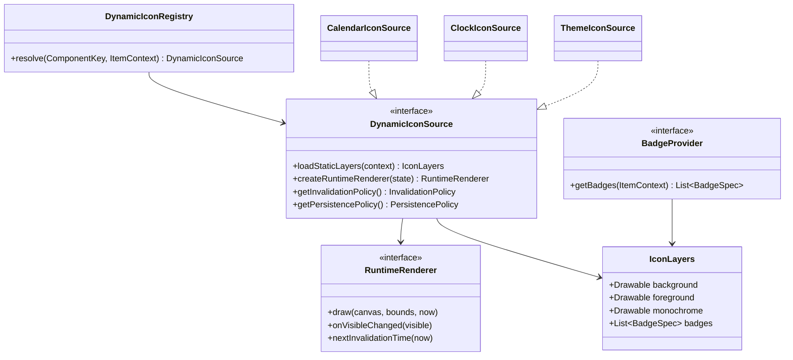

### 8.2 统一渲染顺序

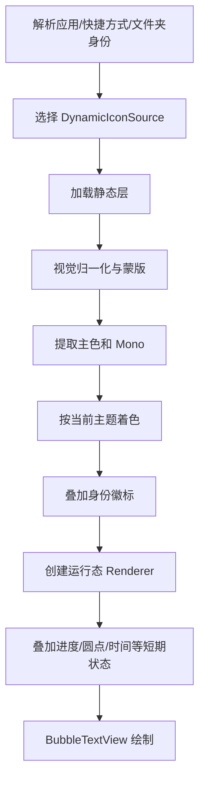

顺序不能随意交换：

- 先归一化再叠徽标，避免徽标参与主图视觉面积计算；
- 先生成 Mono 再叠身份徽标，避免徽标被错误主题化；
- 通知和进度最后绘制，避免短生命周期状态污染缓存；
- 时钟等动态层只持有必要的静态快照，不持久化当前时刻。

### 8.3 失效策略

| 策略 | 触发条件 | 示例 | 动作 |
|-|-|-|-|
| Package | 包安装、升级、移除 | 普通应用图标 | 删除对应包缓存 |
| CalendarBoundary | 日期、时区、时间变化 | 动态日历 | 重算系统状态并更新包 |
| AlignedInterval | 可见且到达对齐时刻 | 动态时钟 | 只刷新 Drawable |
| Theme | 主题/壁纸色变化 | Themed Icon | 重建着色层或重绑定 |
| UserState | 用户/工作资料变化 | Work Badge | 更新对应用户条目 |
| BusinessState | 锁定、受控状态变化 | Lock Badge | 重绑定对应 Component |
| SessionProgress | 安装会话进度 | Preload Icon | 更新 View 运行态 |
| Notification | 通知集合变化 | Dot | 只更新圆点层 |

### 8.4 持久化规则

可持久化的内容：

- 归一化后的静态主图；
- 主色；
- Mono 蒙版；
- 包版本、更新时间和系统状态键；
- Work/Instant 等稳定语义标志。

不可持久化的内容：

- 当前时钟指针位置；
- 安装进度；
- 通知圆点；
- View 的按压、禁用动画进度；
- 与可见性绑定的定时任务；
- 短期业务状态合成后的整张 Bitmap。

---

## 9. 性能设计原则

1. **启动期批量，不逐项查库**：Workspace 和 All Apps 保持批量接口。
2. **重复位置共享数据，不共享错误语义**：应用项可共享 `CacheEntry`，深度快捷方式必须保留独立标题/图标。
3. **低清是状态哨兵，不是模糊大图**：先稳定布局，再异步升级。
4. **动态更新按业务最小频率**：日历每天、时钟每分钟、通知按事件，不使用无意义逐帧动画。
5. **不可见即停**：动态 Drawable 必须在 `setVisible(false)` 后取消调度。
6. **短期状态不写磁盘**：避免写放大、过期数据和缓存抖动。
7. **徽标采用组合而非复制 Bitmap**：减少内存分配，并保留 Mono/flags。
8. **Recents 与 Launcher 模型缓存解耦**：避免 TaskDescription 和桌面图标互相污染。

---

## 10. 测试与验收方案

### 10.1 功能矩阵

| 场景 | 核心检查 |
|-|-|
| 冷启动 | 首屏占位是否稳定、高清是否正确回填、无明显跳动 |
| 热启动 | 内存缓存命中，无重复解码和明显 I/O |
| 包升级 | version/lastUpdateTime 变化后图标及时更新 |
| 跨日 | 23:59 → 00:00 日历更新，旧缓存不复用 |
| 改时区/手工改时 | 日期与时钟一致更新，不需重启 Launcher |
| 时钟离屏 | 不再保留分钟刷新任务 |
| 主题切换 | Mono 着色正确，身份徽标不被错误染色 |
| 安装进度 | 0%、中间值、100% 和失败/回退状态正确 |
| 多用户 | Work Badge、标题和图标按用户隔离 |
| 应用锁 | 开关/单项变化及时更新，Mono 和其他徽标不丢失 |
| 文件夹 | 内容变化、圆点变化、拖拽动画分层正确 |
| 密度变化 | Recents 与 Launcher 图标缓存按新尺寸重建 |
| 渠道回归 | 目标渠道启用，未启用渠道保持原行为 |

### 10.2 性能与稳定性观测

建议增加可控调试指标：

- L1/L2/L3 命中次数；
- 批量请求数、去重前后 Component 数；
- 单次批量 SQL 耗时；
- PackageManager 图标解码耗时；
- 高清升级等待时间；
- 图标 Bitmap 总字节数与应用锁额外分配；
- 动态 Drawable 当前调度数量；
- 因包、日期、主题、密度等原因触发的失效计数。

日志中应使用组件和原因，不记录用户隐私内容；量产版本默认关闭详细日志。

---

## 11. 设计亮点总结

### 11.1 用状态键解决“缓存与动态内容”的矛盾

日历仍可写磁盘缓存，但将日期纳入系统状态；既获得缓存收益，又不会跨日复用旧图。这比完全禁用缓存更高效，也比只依赖广播更可靠。

### 11.2 用对象可持久化能力表达动态边界

时钟通过 `ClockBitmapInfo.canPersist() == false` 明确告诉缓存层：这是带运行行为的对象。静态背景继续复用，动态前景按可见性调度，边界非常清晰。

### 11.3 用 Alpha 视觉面积统一第三方图标

归一化算法关注可见内容而不是图片画布，解决应用图标透明边距和形状差异带来的视觉大小不一。

### 11.4 用低清哨兵换取稳定首屏

模型可以先完成结构加载，View 使用同尺寸占位图，再异步升级高清资源。它将“数据存在”和“像素已准备好”拆成两个阶段。

### 11.5 用运行时组合保留图标语义

主题、Work、Instant、快捷方式和通知分别以 Mono、flags、badgeInfo 和独立图层表达。同一主图可在不同上下文复用，而不是生成大量排列组合位图。

### 11.6 不同容器使用不同生命周期缓存

桌面模型缓存与 Recents 的 TaskKey LRU 分开，说明缓存边界按业务生命周期划分，而不是为了“统一”强行共用一个缓存。

---

## 12. 当前改进优先级

### P0：应用锁徽标改为 Drawable 组合

- 保留原 `BitmapInfo` 的 Mono、flags、badgeInfo；
- 避免每次复制并扩大 Bitmap；
- 锁状态变化只更新相应 Component；
- 统一徽标尺寸、边距和无障碍语义。

### P1：统一动态源与失效策略

- 抽象日历、时钟的 Source 与 Policy；
- 保留现有缓存实现，不做大规模重写；
- 为后续天气、倒计时或设备状态图标提供受控扩展点。

### P1：补充可观测性

- 增加缓存命中、批量去重、解码耗时和动态调度计数；
- 让启动性能和图标未刷新问题能从证据定位，而不是依赖肉眼猜测。

### P2：完善资源声明和渠道验收

- 明确哪些渠道实际配置动态日历/时钟；
- 为 overlay 增加资源合并检查；
- 将目标渠道与未启用渠道的回归纳入测试矩阵。

---

## 13. 源码索引

以下链接固定到本文分析的远端 commit：

- [批量加载开关：FeatureFlags.java](https://gitlab.gz.cvte.cn/OSCore/SeewoOS/OSLauncher3/-/blob/ae97ee43360d19569eb056613f9ec97060343984/src/main/java/com/android/launcher3/config/FeatureFlags.java#L134-148)
- [批量查库、分组与去重：IconCache.java](https://gitlab.gz.cvte.cn/OSCore/SeewoOS/OSLauncher3/-/blob/ae97ee43360d19569eb056613f9ec97060343984/src/main/java/com/android/launcher3/icons/IconCache.java#L340-483)
- [缓存状态与缓存主流程：BaseIconCache.java](https://gitlab.gz.cvte.cn/OSCore/SeewoOS/OSLauncher3/-/blob/ae97ee43360d19569eb056613f9ec97060343984/OSLauncher3IconLoaderLib/src/main/java/com/android/launcher3/icons/cache/BaseIconCache.java#L231-243)
- [动态图标、日历资源与变化监听：IconProvider.java](https://gitlab.gz.cvte.cn/OSCore/SeewoOS/OSLauncher3/-/blob/ae97ee43360d19569eb056613f9ec97060343984/OSLauncher3IconLoaderLib/src/main/java/com/android/launcher3/icons/IconProvider.java#L75-235)
- [时钟分层与刷新：ClockDrawableWrapper.java](https://gitlab.gz.cvte.cn/OSCore/SeewoOS/OSLauncher3/-/blob/ae97ee43360d19569eb056613f9ec97060343984/OSLauncher3IconLoaderLib/src/main/java/com/android/launcher3/icons/ClockDrawableWrapper.java#L55-223)
- [BitmapInfo 与 Drawable 选择：BitmapInfo.java](https://gitlab.gz.cvte.cn/OSCore/SeewoOS/OSLauncher3/-/blob/ae97ee43360d19569eb056613f9ec97060343984/OSLauncher3IconLoaderLib/src/main/java/com/android/launcher3/icons/BitmapInfo.java#L98-185)
- [图标归一化与创建：BaseIconFactory.java](https://gitlab.gz.cvte.cn/OSCore/SeewoOS/OSLauncher3/-/blob/ae97ee43360d19569eb056613f9ec97060343984/OSLauncher3IconLoaderLib/src/main/java/com/android/launcher3/icons/BaseIconFactory.java#L175-214)
- [视觉面积计算：IconNormalizer.java](https://gitlab.gz.cvte.cn/OSCore/SeewoOS/OSLauncher3/-/blob/ae97ee43360d19569eb056613f9ec97060343984/OSLauncher3IconLoaderLib/src/main/java/com/android/launcher3/icons/IconNormalizer.java#L238-346)
- [低清升级与 View 状态：BubbleTextView.java](https://gitlab.gz.cvte.cn/OSCore/SeewoOS/OSLauncher3/-/blob/ae97ee43360d19569eb056613f9ec97060343984/src/main/java/com/android/launcher3/BubbleTextView.java#L830-945)
- [安装进度动画：PreloadIconDrawable.java](https://gitlab.gz.cvte.cn/OSCore/SeewoOS/OSLauncher3/-/blob/ae97ee43360d19569eb056613f9ec97060343984/src/main/java/com/android/launcher3/graphics/PreloadIconDrawable.java#L214-325)
- [主题图标资源映射：LauncherIconProvider.java](https://gitlab.gz.cvte.cn/OSCore/SeewoOS/OSLauncher3/-/blob/ae97ee43360d19569eb056613f9ec97060343984/src/main/java/com/android/launcher3/icons/LauncherIconProvider.java#L35-103)
- [文件夹 Adaptive Icon 分层：FolderAdaptiveIcon.java](https://gitlab.gz.cvte.cn/OSCore/SeewoOS/OSLauncher3/-/blob/ae97ee43360d19569eb056613f9ec97060343984/src/main/java/com/android/launcher3/dragndrop/FolderAdaptiveIcon.java#L77-175)
- [最近任务独立缓存：TaskIconCache.java](https://gitlab.gz.cvte.cn/OSCore/SeewoOS/OSLauncher3/-/blob/ae97ee43360d19569eb056613f9ec97060343984/src/main/java/com/android/quickstep/TaskIconCache.java#L65-194)
- [应用锁徽标实现：LockIconHelper.java](https://gitlab.gz.cvte.cn/OSCore/SeewoOS/OSLauncher3/-/blob/ae97ee43360d19569eb056613f9ec97060343984/src/main/java/com/android/launcher3/icons/LockIconHelper.java#L20-103)
- [动态图标默认资源配置：config.xml](https://gitlab.gz.cvte.cn/OSCore/SeewoOS/OSLauncher3/-/blob/ae97ee43360d19569eb056613f9ec97060343984/OSLauncher3IconLoaderLib/src/main/res/values/config.xml#L27-28)

---

[← Workspace 数据库](workspace-database.md) · [专题目录](README.md) · [与 SystemUI 协作 →](systemui-integration.md)

<sub>整理于 2026-11-20 · [飞书原文](https://cvte.feishu.cn/wiki/WzitwmPx3iPZGTkQ82Yc9L62nwb) · [来源与基线](SOURCES.md)</sub>
