[首页](../../README.md) / [应用设计](../README.md) / [Launcher3](README.md)

[← 与 SystemUI 协作](systemui-integration.md) · [专题目录](README.md)

# OSLauncher3 Overview 实现全景：任务、缩略图、手势与系统动画

> 文档日期：2026-11-20  
> Launcher 源码：`OSCore/SeewoOS/OSLauncher3`  
> Launcher 基线：`em-stable@ae97ee43360d19569eb056613f9ec97060343984`  
> SystemUI 协议基线：仓库内 `system_ui_shared_lib.jar`，Android 13 接口形态  
> SystemUI 远端核对：`OSCore/SeewoOS/OSSystemUI develop@d13bb79a2a11afcc12d6610a465e007ce113d18c`  
> 说明：当前 OSLauncher3 使用 Quickstep Overview；OSSystemUI 仓库中的旧式 Recents 仅作历史边界说明，不与当前实现混写。

<details>
<summary><strong>章节目录</strong></summary>

- [1. Overview 到底是什么](#1-overview-到底是什么)
- [2. 实际源码边界](#2-实际源码边界)
- [3. 双向 Binder 协议](#3-双向-binder-协议)
- [4. 手势输入如何进入 Overview](#4-手势输入如何进入-overview)
- [5. RecentsAnimation：Launcher 如何控制真实应用窗口](#5-recentsanimationlauncher-如何控制真实应用窗口)
- [6. 缩略图完整实现](#6-缩略图完整实现)
- [7. 各种动画的设计与实现](#7-各种动画的设计与实现)
- [8. 状态同步为何比动画本身更难](#8-状态同步为何比动画本身更难)
- [9. 线程与帧同步](#9-线程与帧同步)
- [10. 数据、View 与 Surface 的三条并行管线](#10-数据view-与-surface-的三条并行管线)
- [11. 设计中最精妙的部分](#11-设计中最精妙的部分)
- [12. 当前实现中特别需要注意的点](#12-当前实现中特别需要注意的点)
- [13. 推荐的统一演进方案](#13-推荐的统一演进方案)
- [14. 测试与验收矩阵](#14-测试与验收矩阵)
- [15. 相关文档](#15-相关文档)
- [16. 源码索引](#16-源码索引)

</details>

## 1. Overview 到底是什么

Overview 是 Android 最近任务界面，也是手势导航中应用窗口、桌面、任务切换和分屏之间的连续动画中枢。它不是一个孤立页面，而是横跨 Launcher、SystemUI、WM Shell 和 system_server 的协作系统。

从用户视角，它负责：

- 上滑进入最近任务；
- 左右滑动快速切换任务；
- 点击或下滑任务卡片回到应用；
- 上滑关闭单个任务或清除全部任务；
- 选择两个任务进入分屏；
- 在横竖屏、多窗口、RTL 和不同屏幕尺寸下正确显示任务；
- 在手势全过程中让应用窗口、桌面、状态栏、导航栏、圆角和阴影保持连续。

从系统视角，它同时处理三种对象：

1. **任务数据**：RecentTaskInfo、TaskKey、TaskDescription、分组任务；
2. **静态视觉**：TaskSnapshot 转换得到的 `ThumbnailData`；
3. **活体窗口**：RecentsAnimation 提供的 `RemoteAnimationTarget` 和 `SurfaceControl leash`。

最重要的理解是：**Overview 卡片不等于缩略图。** 对普通历史任务，卡片显示静态 TaskSnapshot；对正在运行且处于 RecentsAnimation 控制中的任务，卡片可以直接绘制真实应用 Surface，即 Live Tile。

---

## 2. 实际源码边界

### 2.1 当前生效架构

OSLauncher3 的 `build.gradle` 以 Android 33 为目标，并引入：

- `system_ui_shared_lib.jar`：`IOverviewProxy`、`ISystemUiProxy`、`ThumbnailData`、`ActivityManagerWrapper` 等；
- `system_ui_animation_lib.jar`：跨进程动画兼容层；
- Launcher 自身的 Quickstep 模块：手势、任务卡片、缓存、Surface 变换和 Overview 状态。

远端 OSSystemUI 的 `develop` 分支包含旧式 `com.android.systemui.recents` 栈式最近任务实现。它与当前 Launcher Quickstep 的 Binder/RemoteAnimation 架构不是同一代实现。因此本文：

- 以 OSLauncher3 Quickstep 源码为主；
- 以 jar 中实际接口签名确认 SystemUI 边界；
- 以 Android 13 framework/SystemUI 一手源码解释 system_server 和 OverviewProxyService 的职责；
- 不把旧 OSSystemUI 的 `TaskStackView`、EventBus 和旧 RecentsActivity 当成当前运行链路。

### 2.2 分层结构

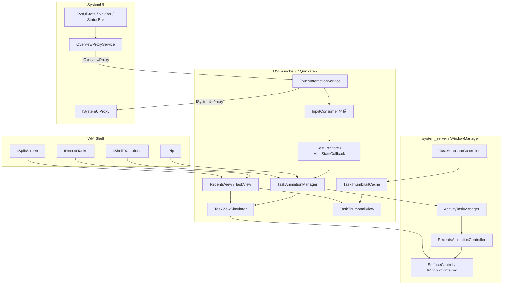

---

## 3. 双向 Binder 协议

### 3.1 SystemUI 到 Launcher：`IOverviewProxy`

SystemUI 绑定 `android.intent.action.QUICKSTEP_SERVICE`，得到 Launcher 的 `TouchInteractionService.TISBinder`。该 Binder 实现 `IOverviewProxy`，接收：

- Overview 显示、隐藏和切换命令；
- SystemUI 状态位变化；
- 导航栏有效手势区域；
- Assistant 可用性和可见度；
- 旋转建议、分屏边界和系统栏属性；
- 屏幕点亮、按钮深色强度等事件。

### 3.2 Launcher 到 SystemUI：`ISystemUiProxy`

SystemUI 在 `onInitialize(Bundle)` 中反向交付多个 Binder：

- `ISystemUiProxy`；
- `IPip`；
- `ISplitScreen`；
- `IOneHanded`；
- `IShellTransitions`；
- `IStartingWindow`；
- `IRecentTasks`；
- `IBackAnimation`；
- 解锁动画控制器。

Launcher 用 `SystemUiProxy` 统一包装这些远端接口，处理 Binder 缺失、RemoteException、状态去重和线程切换。

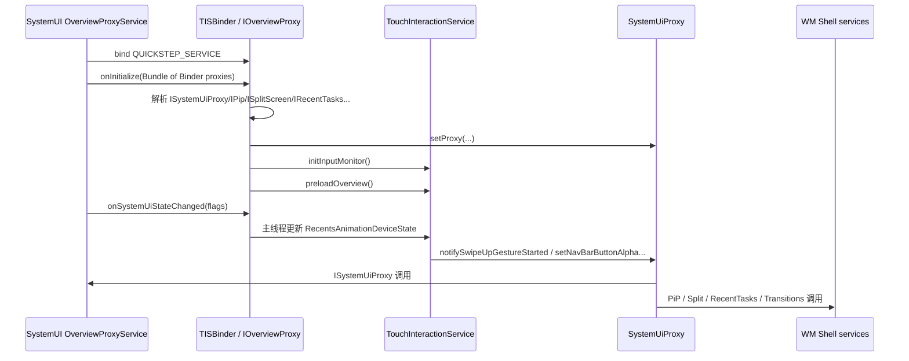

### 3.3 设计精妙之处：对称代理而不是直接依赖

Launcher 和 SystemUI 各自只持有对方的稳定 Binder 接口。SystemUI 不需要知道 `RecentsView` 如何布局，Launcher 也不直接操作状态栏内部 View。这样可以：

- 让 Launcher 与 SystemUI 独立进程、独立生命周期；
- 把导航模式、系统状态和窗口动画的权限留在系统侧；
- 让 Quickstep 在不同厂商 Shell 实现下复用；
- Binder 断开后通过重新绑定恢复，而不是让 UI 对象互相强引用。

---

## 4. 手势输入如何进入 Overview

### 4.1 输入分流

`TouchInteractionService` 创建并注册 Recents Animation Input Consumer。每次新的触摸序列开始时，它读取 SystemUI 状态、导航模式、当前顶层任务、锁屏/固定屏幕/单手模式等条件，选择不同的 `InputConsumer`。

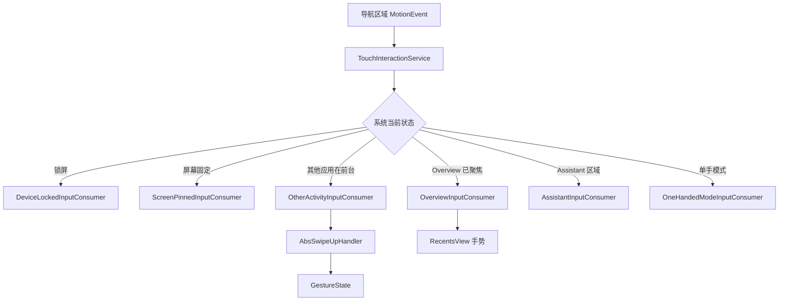

这种“组合式 InputConsumer”避免把所有条件塞进一个巨大手势类。Assistant、单手模式、无障碍等能力可以作为代理消费者包在基础消费者外层，既复用事件流，又保持职责边界。

### 4.2 位移到统一进度

`SwipeUpAnimationLogic` 将主方向拖动距离映射为 `mCurrentShift`：

```text
0.0 = 应用窗口完全全屏
1.0 = 应用窗口与 Overview 任务卡片位置完全重合
>1.0 = 允许一定过拉阻尼
```

它根据 DeviceProfile 和方向策略计算 `mTransitionDragLength`，使手机、平板、横屏和不同导航栏尺寸都能使用同一进度语义。

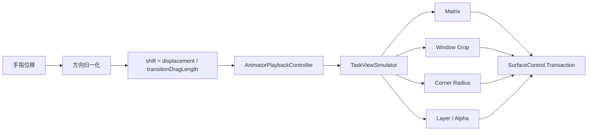

### 4.3 结束目标判定

手指释放时并非只看滑动距离。`AbsSwipeUpHandler.calculateEndTarget()` 综合：

- Y 方向是否构成 fling；
- X/Y 哪个速度占主导；
- 是否已跨过 Overview 阈值；
- 是否发生 Motion Pause；
- RecentsView 当前页是否指向新任务；
- 是否是全手势导航；
- Overview 是否被系统禁用；
- 手势是否取消。

最终目标有四种：

| 目标 | 含义 | 典型条件 |
|-|-|-|
| `HOME` | 回桌面 | 全手势模式快速上滑，或慢拖跨阈值后释放 |
| `RECENTS` | 停在 Overview | Motion Pause、按钮模式进入最近任务 |
| `LAST_TASK` | 回当前/上一个应用 | 未越阈值、下滑取消或系统禁用 Overview |
| `NEW_TASK` | 快速切换到相邻任务 | 横向速度主导并选中另一任务 |

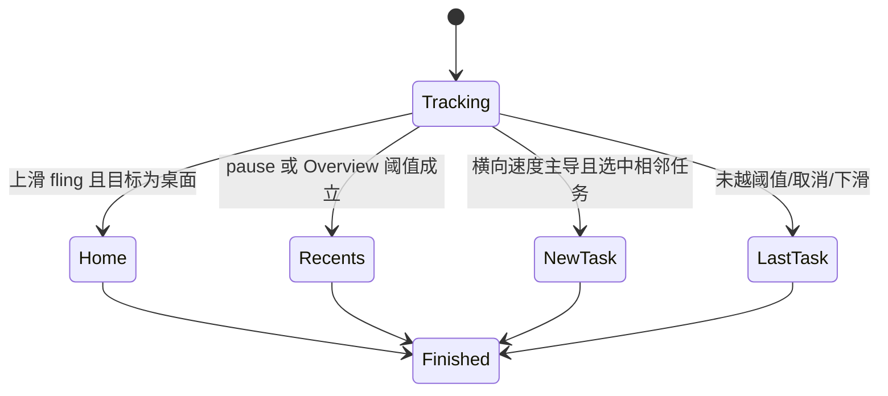

设计亮点在于“意图优先于距离”：快速横划即使垂直位移不大，也会切到新任务；停顿上滑被解释为想查看任务，而不是直接回桌面。

---

## 5. RecentsAnimation：Launcher 如何控制真实应用窗口

### 5.1 启动过程

`TaskAnimationManager` 启动 RecentsAnimation：

1. 结束可能残留的上一次动画；
2. 创建 `RecentsAnimationCallbacks`；
3. 通过 ActivityManagerWrapper 或 Shell RemoteTransition 启动 Overview；
4. system_server 返回 `IRecentsAnimationController` 和一组 RemoteAnimationTarget；
5. 每个 Target 暴露一个临时 `SurfaceControl leash`；
6. Launcher 在动画期间只能操作 leash，不直接拥有应用 Surface；
7. finish/cancel 后 framework 收回 leash 并重新确定任务层级。

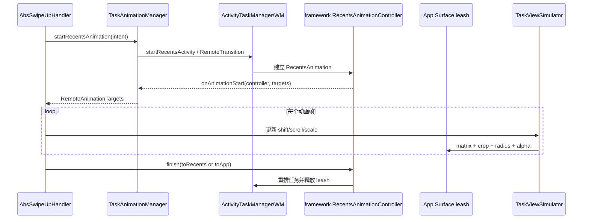

### 5.2 `TaskViewSimulator` 的作用

真正的应用窗口不是 Android View，不能直接调用 `setScaleX()`。`TaskViewSimulator` 在内存中模拟 `TaskView + TaskThumbnailView + RecentsView` 的布局数学，然后把结果转换为 SurfaceControl 参数。

它维护：

- TaskRect 和 Pivot；
- Overview scale、scroll 和主/次方向 translation；
- fullscreen progress；
- snapshot inset/rotation 对应矩阵；
- window crop；
- 当前可见圆角；
- 分屏中的 stage 位置。

每帧应用顺序为：

```text
缩略图内容矩阵
→ 全屏 inset 与缩放
→ TaskView 位置和自身平移
→ RecentsView 滚动、缩放和平移
→ Launcher/Display 旋转映射
→ SurfaceControl matrix/crop/cornerRadius
```

### 5.3 设计精妙之处：View 和 Surface 共用同一套几何语义

如果真实窗口动画和最终 TaskView 布局分别计算，动画结束时极易跳一帧。`TaskViewSimulator` 复用 `PreviewPositionHelper`、DeviceProfile 和方向策略，以与真实 TaskView 相同的几何规则计算 Surface 位置，从而让“活窗口”能无缝落到“静态卡片”。

---

## 6. 缩略图完整实现

### 6.1 framework 生成 TaskSnapshot

framework 的 `TaskSnapshotController` 在任务关闭、隐藏或需要最近任务快照时捕获窗口。根据安全与窗口状态，快照可能是：

- 真实窗口内容；
- 仅应用主题背景和图标的安全快照；
- 无快照。

TaskSnapshot 不只有像素，还带有：

- contentInsets 和 letterboxInsets；
- orientation 和 rotation；
- windowingMode；
- system bar appearance；
- scale；
- 是否真实快照、是否透明、snapshotId。

framework 负责内存缓存和磁盘持久化，并在快照变化时通知任务监听器。

### 6.2 Launcher 的 `ThumbnailData`

`system_ui_shared_lib.jar` 将 `android.window.TaskSnapshot` 包装为 `ThumbnailData`。这层转换非常重要：Launcher 获得的是稳定、面向显示的结构，不直接依赖 framework 内部 snapshot 对象。

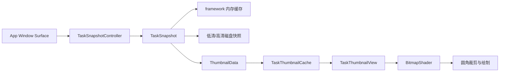

### 6.3 缩略图缓存策略

当前默认配置：

- `recentsThumbnailCacheSize = 3`；
- `config_enableTaskSnapshotPreloading = true`；
- Live Tile 默认开启；
- 低清比例由 framework 的 `config_lowResTaskSnapshotScale` 决定。

`TaskThumbnailCache.HighResLoadingState` 的判定非常克制：

```text
高分辨率加载 = 设备不支持低清快照
                或者（Overview 可见 且 当前没有高速 fling）
```

也就是说：

- Overview 不可见时不抢占 I/O；
- 高速滑动时优先低清，避免为即将离屏的卡片加载大图；
- 停止高速滑动后再升级可见任务；
- 设备关闭低清快照能力时直接使用高清。

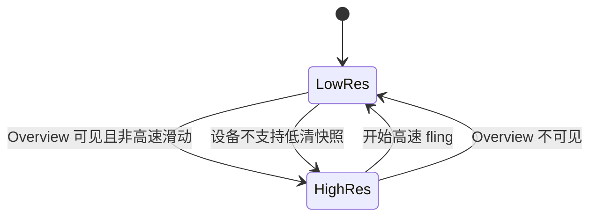

### 6.4 `TaskThumbnailView` 如何把截图放进卡片

`TaskThumbnailView` 使用 `BitmapShader`，不预先裁剪生成新 Bitmap。`PreviewPositionHelper` 计算 Shader local matrix，处理：

- snapshot 自身 scale；
- contentInsets；
- letterboxInsets；
- 当前显示旋转与 snapshot 旋转差；
- 横竖屏变换；
- 多窗口模式；
- 手机与平板的不同裁剪策略；
- RTL 时左右裁剪对齐；
- TaskView 的宽高比。

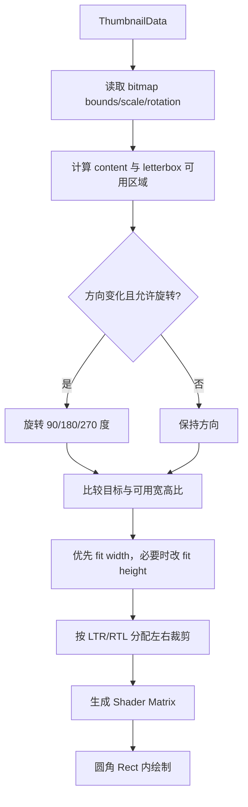

### 6.5 为什么始终先绘制背景

源码无论有没有 Bitmap，都先绘制任务背景色。原因包括：

- 快照可能透明；
- 分屏任务 reparent 后快照可能局部为空；
- 快照尚未加载时需要稳定占位；
- 安全策略或应用锁可能禁止展示真实内容。

当任务被锁、快照不存在或 Shader 尚未准备好时，只显示背景/锁定覆盖层，不泄漏原应用内容。

### 6.6 Live Tile 与静态截图切换

正在运行的任务在 Live Tile 模式下，`TaskThumbnailView` 不绘制快照，只清出圆角区域；真实应用 Surface 由 `TaskViewSimulator` 放在该区域中。

当动画要结束、取消、删除运行任务或转入稳定 Overview 时：

1. `RecentsAnimationController.screenshotTask(taskId)` 同步取得当前帧；
2. 设置 `TaskView.showScreenshot = true`；
3. 将 ThumbnailData 绑定给 TaskThumbnailView；
4. 等待 `postFrameDrawn`，确保静态图已经真正出现在屏幕；
5. 最后 finish RecentsAnimation、释放真实 Surface leash。

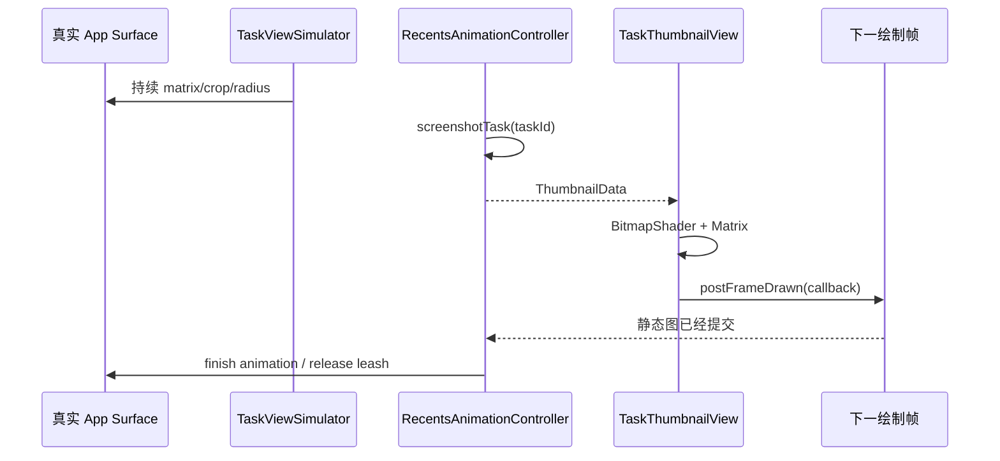

这是消除黑帧和闪烁的关键：不是“先释放窗口再补截图”，而是“截图先完成一次真实绘制，再释放窗口”。

---

## 7. 各种动画的设计与实现

### 7.1 应用进入 Overview

应用全屏态到 Overview 卡片态同时变化：

- Surface scale；
- crop rect；
- corner radius；
- 任务位置；
- RecentsView scale 和 scroll；
- 桌面/Hotseat 显示进度；
- 系统栏控制权。

`TaskViewSimulator.addAppToOverviewAnim()` 将 fullscreen progress 从 1 降到 0，同时将 RecentsView scale 从全屏比例回到 1。所有属性由同一个播放进度驱动，避免各自计时器产生相位差。

### 7.2 Overview 返回应用

`createTaskLaunchAnimation()` 执行反向几何变化，并补充：

- 相邻任务卡片平移，保持分页空间连续；
- DepthController 过渡到后台应用深度；
- 达到阈值后切换状态栏/导航栏明暗；
- 成功阈值处产生触觉反馈；
- Live Tile 任务直接 finish 到应用，历史任务通过 startActivityFromRecents 启动。

### 7.3 回桌面弹簧动画

回桌面不是普通 ValueAnimator，而由 `RectFSpringAnim` 控制：

- X 中心：fling + spring；
- Y：根据目标位于屏幕顶部、中部或底部，追踪 top/center/bottom；
- 宽高缩放：独立 SpringAnimation；
- 用户释放速度经过阻尼后作为初速度；
- 圆角、alpha、crop 和 Matrix 每帧同步更新。

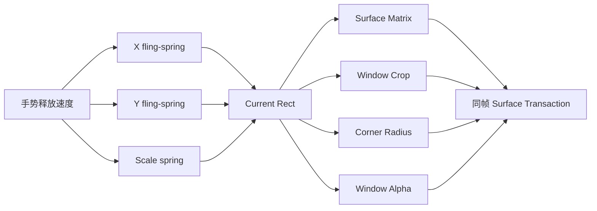

为什么 X/Y/Scale 分开：用户的横向速度、纵向速度和尺寸收缩并不具有相同物理意义。强行用单个插值器会让轨迹机械；分轴弹簧既保留手势动量，又保证最终准确落到桌面图标或目标区域。

### 7.4 快速切换任务

横向滑动时，RecentsView scroll 与运行窗口 transform 同步。手势结束后：

- 若目标页不同且横向速度占主导 → `NEW_TASK`；
- 若仍是原任务 → `LAST_TASK`；
- 动画期间若实际出现的任务改变，会修正 end target，避免 finish controller 后恢复错任务。

### 7.5 单任务关闭动画

关闭动画不是只把卡片上移：

- 被关闭卡片沿次方向离场；
- 相邻卡片补位；
- Grid 模式重新平衡行列；
- Clear All 与末尾间距重新计算；
- 只有动画成功才真正 `removeTask`；
- 若关闭的是 Live Tile 运行任务，先结束 RecentsAnimation，再删除任务。

“动画成功后再删任务”保证取消或中断动画时系统状态不会提前改变。

### 7.6 全部清除

Clear All 使用统一 PendingAnimation 调度任务离场，再调用 framework 清除最近任务。动画和业务动作分离，避免按下按钮瞬间数据消失而 View 还在执行动画。

### 7.7 分屏选择动画

进入 Split Select 时：

- 选中任务卡片转成 FloatingTaskView；
- 卡片移动到左/上或右/下占位区域；
- 其余任务重新排列；
- 启动第二任务时将两个 Remote Target 分别映射到 staged split bounds；
- Divider 等非应用 Surface 作为辅助 target 单独处理。

### 7.8 屏幕旋转动画

Overview 使用 `RecentsOrientedState` 将触摸方向、显示方向和 RecentsActivity 方向分开。旋转时可以：

- 原位更新任务方向；
- 对子 View 做淡出/淡入，隐藏布局瞬变；
- 对 Live Tile 使用同一旋转后的 Surface Matrix；
- 在 Grid/多窗口场景禁止不合适的 snapshot 旋转。

### 7.9 PiP 动画

当应用允许自动进入 PiP，HOME 目标会切换到专用 `SwipePipToHomeAnimator`。Launcher 计算目标区域并通过 `PictureInPictureSurfaceTransaction` 把最终 Surface 状态移交给系统；finish 前还需要通知 SystemUI 和 Shell，避免 Surface leash 被释放时闪烁。

### 7.10 动画总线：`PendingAnimation`

Overview 大量动画通过 `PendingAnimation` 聚合，而不是各 View 自行启动 Animator。它可以把 View 属性、AnimatedFloat、Surface frame callback、结束业务动作和取消恢复统一到一条时间轴。

---

## 8. 状态同步为何比动画本身更难

Overview 同时等待：

- RecentsActivity/Launcher 创建并绑定；
- RecentsAnimation controller 返回；
- Remote targets 到达；
- 手势结束目标确定；
- RecentsView 滚动停稳；
- 目标动画结束；
- snapshot 绘制完成；
- framework finish 回调。

这些事件可能以不同顺序到达。`GestureState` 和 `MultiStateCallback` 使用状态位组合表达“满足哪些条件后才能执行一次动作”。

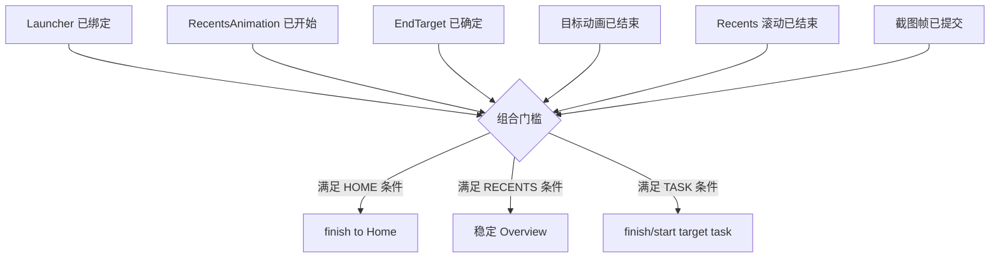

设计亮点是避免到处写“如果 A 已完成并且 B 也完成”的嵌套回调。状态位使迟到事件、重复回调和动画中断都有统一收敛点。

---

## 9. 线程与帧同步

| 线程/执行器 | 主要工作 |
|-|-|
| Binder Thread | 接收 SystemUI/WM 回调，不直接修改复杂 UI |
| MAIN_EXECUTOR | View、GestureState、RecentsView 和动画状态 |
| UI_HELPER_EXECUTOR | ActivityManager、WindowManager、Binder finish 等可能阻塞操作 |
| 后台 Executor | 最近任务、图标、缩略图加载 |
| SurfaceTransactionApplier | 将 Surface 参数同步到 ViewRoot 帧 |

关键原则：

- Binder 回调尽快切到主线程；
- Binder finish 和截图清理放到 helper 线程；
- Bitmap 在绘制前调用 `prepareToDraw()`；
- 真实 Surface 到静态 snapshot 的替换等待 `postFrameDrawn`；
- 动画结束回调使用一次性 RunnableList，防止重复 finish。

`RecentsAnimationController.finishController()` 还显式防止重复 finish：第一次记录目标并发起远端结束，后续调用只追加完成回调。

---

## 10. 数据、View 与 Surface 的三条并行管线

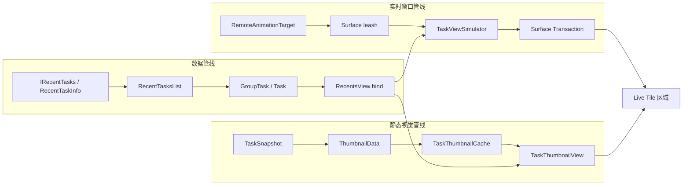

这三条管线必须保持 taskId、userId、windowingMode 和分组关系一致。常见问题不是“图画不出来”，而是：

- 数据列表已经刷新，但缩略图仍属于旧 TaskKey；
- 运行 target 已切换，RecentsView 仍认为旧任务是 running task；
- 分屏两个 target 的 stage 绑定反了；
- snapshot rotation 与当前 activity rotation 不一致；
- live surface 已释放，静态图还没提交。

---

## 11. 设计中最精妙的部分

### 11.1 活窗口与静态截图双轨切换

运行任务用真实 Surface 保证动画连续，历史任务用 snapshot 节省资源；两者在一帧边界完成交接。该方案同时兼顾实时性、性能和稳定性。

### 11.2 用模拟 View 几何驱动系统 Surface

`TaskViewSimulator` 不复制一套近似动画，而是模拟最终 View 的布局规则，再生成 matrix/crop/radius。这使真实窗口最终能像普通卡片一样落位。

### 11.3 缩略图质量随用户速度动态变化

高速滑动期间不浪费高清加载，停止后才升级；用户看到的质量和系统投入的成本随注意力动态匹配。

### 11.4 动画终点是语义状态，不是固定坐标

HOME、RECENTS、LAST_TASK、NEW_TASK 先由意图判定，再映射到对应动画。相同位移在不同速度、导航模式和当前页下可以得到不同结果。

### 11.5 Surface 释放前等待静态帧真正提交

`postFrameDrawn` 解决的是跨渲染管线的时序问题：Java 层 setThumbnail 成功不代表屏幕已出现该帧。只有等待下一帧提交，才安全释放 live surface。

### 11.6 持续手势与原子命令共用动画管理器

手势拖动使用连续 progress，三键导航/Alt-Tab 等命令通过 `OverviewCommandHelper` 排队执行；二者最终都进入 TaskAnimationManager 和统一目标状态，减少分叉实现。

---

## 12. 当前实现中特别需要注意的点

### 12.1 客户定制不可侵入共享动画数学

Overview 属于高度共享链路。客户差异应优先通过：

- source set 资源；
- 语义化默认关闭配置；
- DeviceProfile 参数；
- 独立 overlay；
- 可插拔 TaskOverlayFactory。

不得在 `TaskViewSimulator`、`AbsSwipeUpHandler` 或共享动画中用客户名/flavor 字符串分支，否则极易影响所有渠道的手势和窗口状态。

### 12.2 当前存在特定平台 recent-task key 差异

`TouchInteractionService.onInitialize()` 对特定配置选择不同的 recent-task Binder key。此类兼容逻辑应逐步收敛为语义能力检测，例如“Bundle 中存在新 key 则使用，否则回退旧 key”，避免共享层感知具体平台名。

### 12.3 缩略图缓存容量较小

默认容量为 3，适合低内存和顺序浏览，但在大屏 Grid Overview 中可能频繁回收。是否调整应结合：

- 同屏可见卡片数；
- snapshot 尺寸；
- 低清比例；
- 内存预算；
- 滑动回看命中率。

不应仅凭“缓存越大越快”直接扩大。

### 12.4 应用锁与隐私状态必须在数据和绘制两侧一致

仅在 View 上盖锁图标不够。必须确保锁定任务不会通过截图操作、TaskOverlay、分享/截图快捷操作或 Live Tile 暴露真实内容。

### 12.5 旧 OSSystemUI Recents 不应继续叠加新功能

旧 Recents 和 Quickstep 的数据、动画、输入和生命周期完全不同。新增 Overview 能力应先确认实际产品使用哪条链路，避免在旧 OSSystemUI 中实现后对当前 Launcher 无效。

---

## 13. 推荐的统一演进方案

### 13.1 明确四个稳定接口

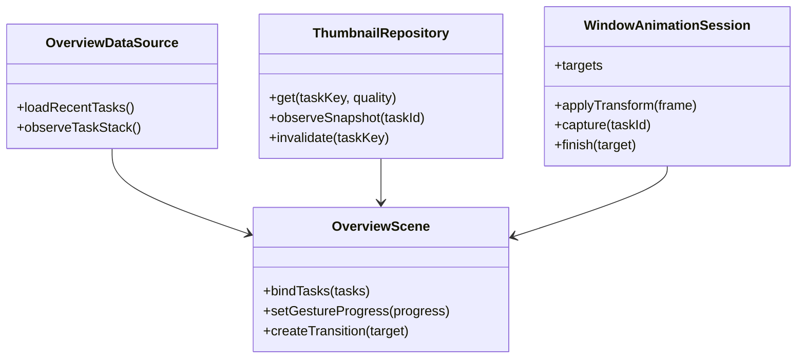

现有代码已经具备这些角色，只是接口散布在多个类中。演进时应优先明确责任和监控点，不建议一次性重写 Quickstep。

### 13.2 建立统一动画帧模型

每帧可描述为：

```text
OverviewFrame {
  progress,
  taskTransforms[],
  windowCrop[],
  cornerRadius[],
  alpha[],
  systemBarAppearance,
  depth,
  inputOwnership
}
```

View 动画和 Surface 动画都消费同一帧语义，减少“View 到了但 Surface 没到”的分裂问题。

### 13.3 增加可观测性

建议记录：

- Overview Binder 连接状态和重连次数；
- InputConsumer 选择原因；
- 手势 end target 及判定因子；
- RecentsAnimation start/target/finish/cancel 时序；
- Live Tile → snapshot 交接耗时；
- 低清/高清缓存命中和升级次数；
- screenshotTask 耗时与失败原因；
- 每帧 Surface transaction 数量；
- 动画 jank CUJ 与丢帧；
- taskId、snapshotId、RemoteTarget 的对应关系。

### 13.4 降级策略

| 失败点 | 正确降级 |
|-|-|
| SystemUI proxy 未连接 | 禁止系统级动作，保留普通 Launcher UI |
| RecentsAnimation 未启动 | 使用静态 Overview/普通 activity transition |
| snapshot 获取失败 | 显示任务背景色和图标，不显示旧截图 |
| Live Tile 交接失败 | 延迟释放或回退背景，不显示黑帧 |
| 高分辨率加载失败 | 保留低清图，不阻塞滑动 |
| 分屏 Binder 缺失 | 隐藏分屏入口，不伪造成功 |
| 旋转数据异常 | 以背景占位并等待下一次有效 snapshot |

---

## 14. 测试与验收矩阵

### 14.1 基础路径

| 场景 | 验收重点 |
|-|-|
| 慢速上滑并停顿 | 进入 RECENTS，卡片与手指连续，无跳帧 |
| 快速上滑 | 进入 HOME，窗口自然收缩到目标区域 |
| 上滑不足后松手 | 回 LAST_TASK，状态栏和窗口恢复正确 |
| 横向快速滑动 | 进入 NEW_TASK，不误回桌面 |
| 三键 Recent | OverviewCommand 排队正确，无重复动画 |

### 14.2 缩略图

| 场景 | 验收重点 |
|-|-|
| 高速 fling | 使用低清/占位，不因高清加载卡顿 |
| 停止滑动 | 可见卡片升级高清且不跳位 |
| 横竖屏快照 | 旋转、裁剪、比例和圆角正确 |
| Letterbox 应用 | 不拉伸，边界裁剪符合目标比例 |
| 透明任务 | 背景色先绘制，无透底异常 |
| 锁定应用 | 无真实内容泄漏，操作入口受限 |
| snapshot 为空 | 使用背景和图标，不复用错误旧图 |

### 14.3 动画与中断

| 场景 | 验收重点 |
|-|-|
| 动画中反向操作 | 旧动画安全结束，新动画接管 |
| Live Tile 切截图 | 无黑帧、无一帧尺寸跳变 |
| 关闭运行任务 | 先完成 Surface 交接再 removeTask |
| 动画中应用重启 | Remote target 更新，不恢复错任务 |
| 进入 PiP | finish transaction 与 Shell 状态一致 |
| 分屏进入/退出 | 两个 stage 与 divider target 正确 |
| 动画中旋转 | Surface、卡片和触摸方向同步 |

### 14.4 性能门槛

- 主线程不直接执行任务截图 Binder I/O；
- 高速 fling 不持续触发高清解码；
- 不可见 Overview 停止高清预加载；
- RecentsAnimation 结束后无遗留 leash、listener 或定时任务；
- repeated finish 不产生多次系统重排；
- Live Tile 和 snapshot 总内存保持在设备预算内。

---

## 15. 相关文档

- [OSLauncher3 图标加载架构与动态图标设计](icon-loading.md)
- [Launcher3 View 层级与状态机架构详解](view-and-state.md)
- [OSLauncher3 与 SystemUI 协作详解：Binder、手势、转场与窗口管理](systemui-integration.md)

---

## 16. 源码索引

### OSLauncher3

- [TouchInteractionService：IOverviewProxy 与输入分流](https://gitlab.gz.cvte.cn/OSCore/SeewoOS/OSLauncher3/-/blob/ae97ee43360d19569eb056613f9ec97060343984/src/main/java/com/android/quickstep/TouchInteractionService.java#L129-330)
- [SystemUiProxy：Launcher 到 SystemUI/WM Shell 的代理](https://gitlab.gz.cvte.cn/OSCore/SeewoOS/OSLauncher3/-/blob/ae97ee43360d19569eb056613f9ec97060343984/src/main/java/com/android/quickstep/SystemUiProxy.java)
- [TaskAnimationManager：RecentsAnimation 生命周期](https://gitlab.gz.cvte.cn/OSCore/SeewoOS/OSLauncher3/-/blob/ae97ee43360d19569eb056613f9ec97060343984/src/main/java/com/android/quickstep/TaskAnimationManager.java#L88-305)
- [AbsSwipeUpHandler：结束目标判定与动画收敛](https://gitlab.gz.cvte.cn/OSCore/SeewoOS/OSLauncher3/-/blob/ae97ee43360d19569eb056613f9ec97060343984/src/main/java/com/android/quickstep/AbsSwipeUpHandler.java#L1024-1380)
- [TaskViewSimulator：View 几何到 Surface 参数](https://gitlab.gz.cvte.cn/OSCore/SeewoOS/OSLauncher3/-/blob/ae97ee43360d19569eb056613f9ec97060343984/src/main/java/com/android/quickstep/util/TaskViewSimulator.java#L55-412)
- [TaskThumbnailCache：高低清策略和 LRU](https://gitlab.gz.cvte.cn/OSCore/SeewoOS/OSLauncher3/-/blob/ae97ee43360d19569eb056613f9ec97060343984/src/main/java/com/android/quickstep/TaskThumbnailCache.java#L34-228)
- [TaskThumbnailView：Shader、旋转、Insets 与裁剪](https://gitlab.gz.cvte.cn/OSCore/SeewoOS/OSLauncher3/-/blob/ae97ee43360d19569eb056613f9ec97060343984/src/main/java/com/android/quickstep/views/TaskThumbnailView.java#L140-700)
- [RecentsView：任务卡片、Live Tile、启动与关闭动画](https://gitlab.gz.cvte.cn/OSCore/SeewoOS/OSLauncher3/-/blob/ae97ee43360d19569eb056613f9ec97060343984/src/main/java/com/android/quickstep/views/RecentsView.java)
- [RectFSpringAnim：回桌面的分轴弹簧](https://gitlab.gz.cvte.cn/OSCore/SeewoOS/OSLauncher3/-/blob/ae97ee43360d19569eb056613f9ec97060343984/src/main/java/com/android/quickstep/util/RectFSpringAnim.java#L47-330)
- [FeatureFlags：Live Tile 默认开启](https://gitlab.gz.cvte.cn/OSCore/SeewoOS/OSLauncher3/-/blob/ae97ee43360d19569eb056613f9ec97060343984/src/main/java/com/android/launcher3/config/FeatureFlags.java#L82-83)
- [Overview 默认缓存配置](https://gitlab.gz.cvte.cn/OSCore/SeewoOS/OSLauncher3/-/blob/ae97ee43360d19569eb056613f9ec97060343984/src/main/res/values/config.xml#L137-207)

### Android 13 SystemUI/framework

- [SystemUI OverviewProxyService](https://android.googlesource.com/platform/frameworks/base/+/refs/heads/android13-release/packages/SystemUI/src/com/android/systemui/recents/OverviewProxyService.java)
- [framework TaskSnapshotController](https://android.googlesource.com/platform/frameworks/base/+/refs/heads/android13-release/services/core/java/com/android/server/wm/TaskSnapshotController.java)
- [framework RecentsAnimationController](https://android.googlesource.com/platform/frameworks/base/+/refs/heads/android13-release/services/core/java/com/android/server/wm/RecentsAnimationController.java)
- [IRecentsAnimationController AIDL](https://android.googlesource.com/platform/frameworks/base/+/refs/heads/android13-release/core/java/android/view/IRecentsAnimationController.aidl)

---

[← 与 SystemUI 协作](systemui-integration.md) · [专题目录](README.md)

<sub>整理于 2026-11-20 · [飞书原文](https://cvte.feishu.cn/wiki/BVgRwi5WYiOuFYkbftschMpCntd) · [来源与基线](SOURCES.md)</sub>
