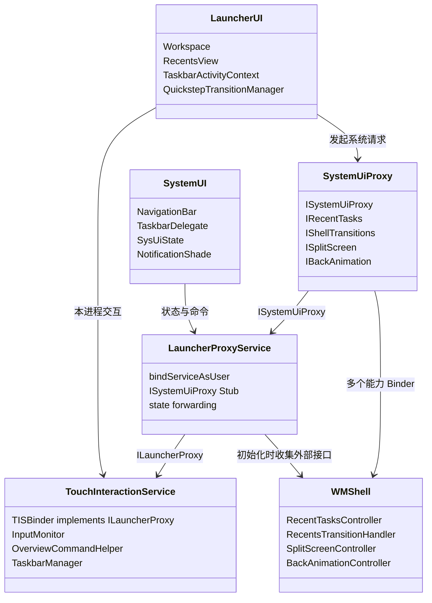
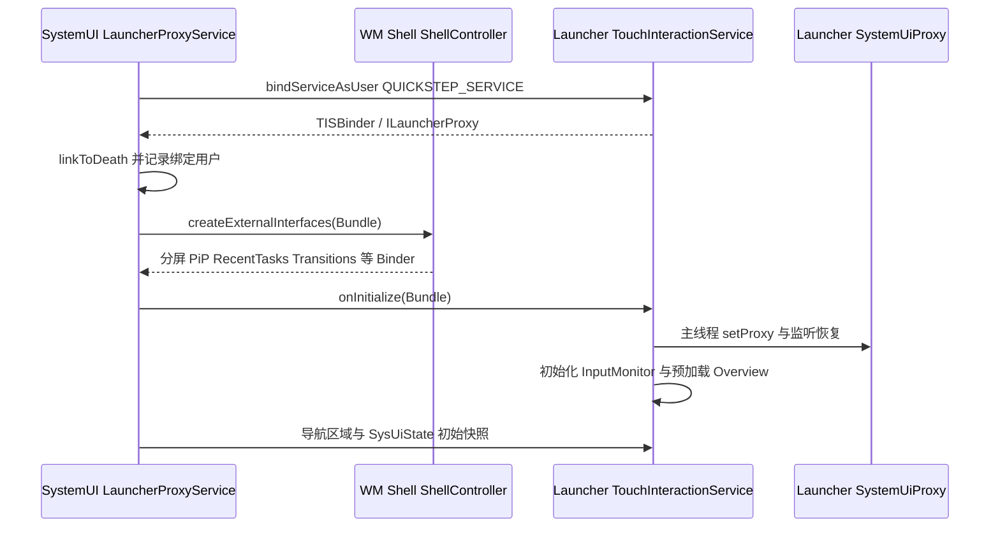
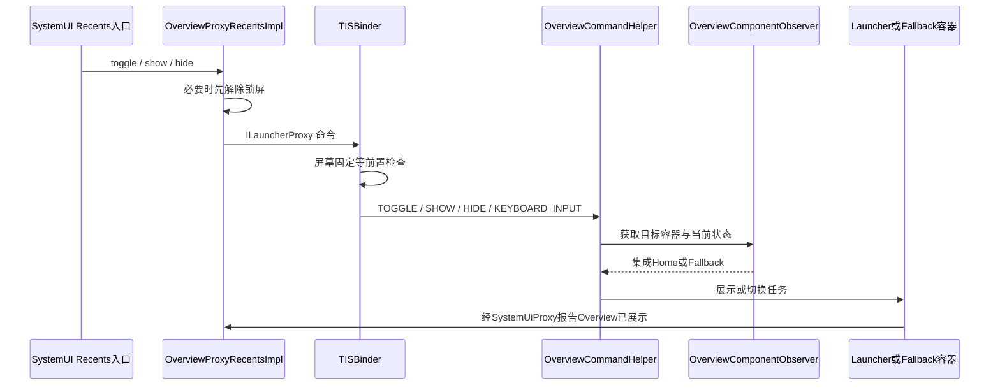
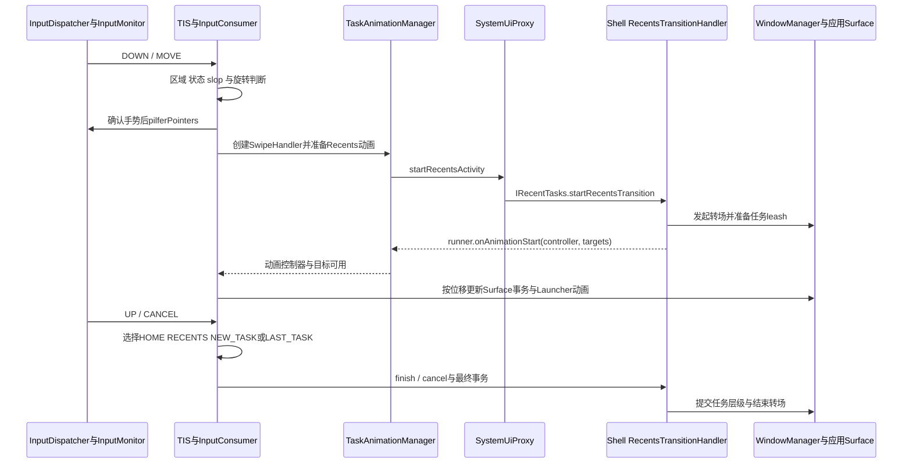
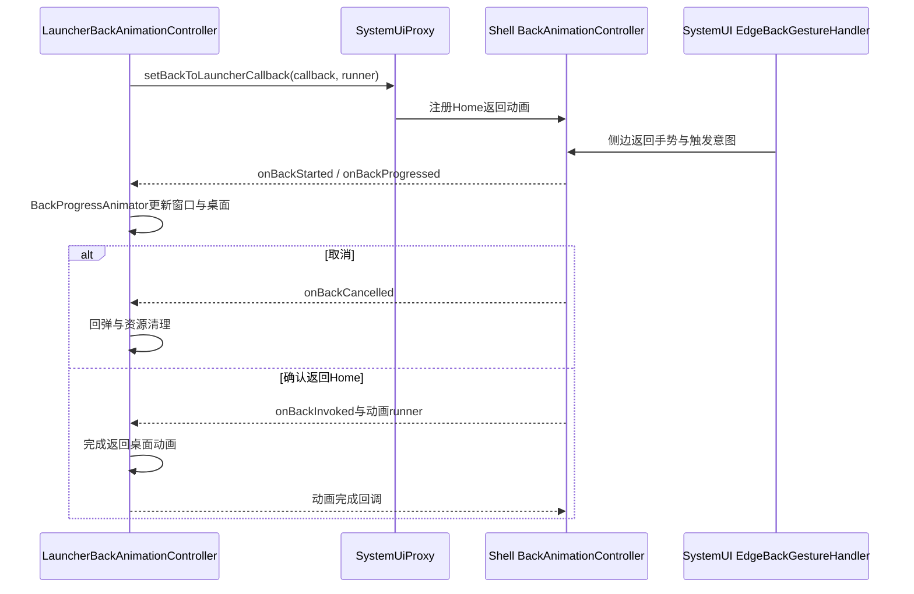

[首页](../../README.md) / [应用设计](../README.md) / [Launcher3](README.md)

[← 图标加载与动态图标](icon-loading.md) · [专题目录](README.md) · [Overview 实现全景 →](overview.md)

# OSLauncher3 与 SystemUI 协作详解：Binder、手势、转场与窗口管理

分析日期：2026-10-19。本文基于固定 commit 的源码阅读，说明职责划分、双向接口、异步时序及 OSLauncher3 定制实现。

<strong>章节目录</strong>

- [1. 源码范围、基线与结论](#1-源码范围基线与结论)
- [2. 三方架构与窗口归属](#2-三方架构与窗口归属)
- [3. 连接建立、能力分发与断线恢复](#3-连接建立能力分发与断线恢复)
- [4. 双向接口契约与系统状态同步](#4-双向接口契约与系统状态同步)
- [5. Overview 命令、任务列表与默认桌面切换](#5-overview-命令任务列表与默认桌面切换)
- [6. 上滑手势：从输入监听到任务 Surface 动画](#6-上滑手势从输入监听到任务-surface-动画)
- [7. 应用启动、返回桌面与预测返回](#7-应用启动返回桌面与预测返回)
- [8. Taskbar 与导航栏：界面和系统控制的分工](#8-taskbar-与导航栏界面和系统控制的分工)
- [9. 通知栏、快捷设置、助手与辅助功能](#9-通知栏快捷设置助手与辅助功能)
- [10. 分屏、三分屏、选屏器与拖拽](#10-分屏三分屏选屏器与拖拽)
- [11. PiP、气泡、解锁和多显示器协作](#11-pip气泡解锁和多显示器协作)
- [12. 生命周期、线程与一致性细节](#12-生命周期线程与一致性细节)
- [13. 架构演进与设计中的精妙之处](#13-架构演进与设计中的精妙之处)
- [14. 场景追踪、源码索引与证据边界](#14-场景追踪源码索引与证据边界)

## 1. 源码范围、基线与结论

OSLauncher3 与 SystemUI 的协作贯穿系统导航、最近任务、应用转场、任务栏和多窗口。源码中的 `com.android.quickstep` 是这项协作的核心：它让 Launcher 既能展示桌面，也能作为系统级任务切换界面和动画执行端。

当前实现可以分成三类职责：Launcher 组织交互、图标与任务卡片并计算动画；SystemUI 管理导航、通知栏、锁屏等系统界面状态，并建立跨进程连接；WM Shell 管理分屏、PiP、最近任务转场与窗口组织。Shell 在常见集成中与 SystemUI 同进程运行，但它有独立的接口、线程与执行职责。分析调用链时需要保留这个模块边界。

| 证据 | 固定基线 | 使用范围 |
|-|-|-|
| OSLauncher3 | `origin/em-stable-16`   `7dddb9d7d38d7ec3ee6cb5be261a8510190d9182` | 2026-10-19 重新 fetch 后读取 Git 对象；Launcher、Quickstep、Taskbar 和定制调用侧 |
| AOSP frameworks/base | `android16-qpr2-release`   `45034f0663f960d9ee5fb0a101a4732b71f6e2f4` | SystemUI、共享 AIDL 与 WM Shell 的公开对照实现 |
| 工程依赖 | `libs/SystemUISharedLib_*.jar` 与 `libs/WindowManager-Shell-shared_*.jar` | 确认 Launcher 使用平台共享契约；本文未对 JAR 做反编译 |

**基线边界。**当前没有取得与该 OSLauncher3 commit 配套的 CVTE frameworks/base manifest 与定制服务端源码。因此，本文对 OSLauncher3 的描述是当前源码事实；对 SystemUI/WM Shell 服务端的描述来自上述 AOSP 对照；三分屏和 `ISplitScreenCustomer` 的实现细节以已读到的调用方为止。两套基线不能被视为已验证的二进制配对。

这种区别有直接证据：OSLauncher3 的 `enterStageSplitFromRunningApp(boolean)` 回调与公开 QPR2 AIDL 中带 `displayId` 的签名不同，Recents animation runner 参数也有版本差异。下文用一致的职责模型解释流程，具体编译和集成必须以同一平台的共享接口为准。

本文是架构分析，没有构建、安装或真机验收结论。已有源码中的条件分支、资源覆盖和 feature flags 决定某项能力是否实际启用。

## 2. 三方架构与窗口归属

最核心的连接是 SystemUI 主动绑定 Launcher 导出的 `TouchInteractionService`。SystemUI 持有它的 `ILauncherProxy`；Launcher 则在初始化时收到 SystemUI 与 Shell 的多个 Binder，并由 `SystemUiProxy` 统一保存和封装。这形成双向连接，而非单向调用关系。

| 界面/对象 | 主要归属 | 协作方式 |
|-|-|-|
| Workspace、图标、文件夹 | Launcher Activity | 提供 Home 目标、图标位置与返回动画终点 |
| Overview 任务卡片 | Launcher/Quickstep 容器 | 使用系统任务信息、缩略图或应用 Surface；窗口形态取决于配置 |
| 大屏 Taskbar | Launcher 的独立窗口上下文 | SystemUI 下发导航状态，Launcher 绘制并回传可见/收起状态 |
| 通知栏、QS、锁屏 | SystemUI | Launcher 发起操作或转交输入，SystemUI 执行 |
| 真实应用 Task 与 Surface leash | 系统窗口管理，Shell 协调 | 向 Launcher 授予动画控制句柄，最终任务组织由服务端提交 |
| 分屏 stage、PiP、跨显示器任务 | WM Shell / 系统窗口管理 | Launcher 调用能力接口并接收状态回调 |

Taskbar 不依附于 Workspace 的 View 树。源码中 `TaskbarActivityContext` 根据导航栏统一开关与主屏身份，使用 `TYPE_NAVIGATION_BAR` 或 `TYPE_NAVIGATION_BAR_PANEL` 建立窗口。因此用户进入其他应用后仍可看到 Taskbar。其实际层级还受窗口类型、Insets、IME 和转场状态控制，不能仅用 Launcher 内部 View 的 Z 值解释。

Recents 中的应用画面也有两种来源：任务快照是静态图像；转场期间系统下发的 leash 可以驱动真实应用 Surface。任务卡片 View 是交互容器，真实应用内容仍属于另一项任务。这是跨进程动画能够看起来连续的基础。

## 3. 连接建立、能力分发与断线恢复

OSLauncher3 Manifest 将 TouchInteractionService 声明为 `exported`、`directBootAware`，绑定权限为 `android.permission.STATUS_BAR_SERVICE`，action 为 `android.intent.action.QUICKSTEP_SERVICE`。这些声明让系统能在 Launcher Activity 尚未创建时建立 Quickstep 服务连接。

AOSP SystemUI 的 `LauncherProxyService` 从 `config_recentsComponentName` 获取系统配置的 Recents 包，构造指定 package 的 QUICKSTEP_SERVICE Intent，然后用当前用户执行 `bindServiceAsUser()`。绑定目标与“当前默认 Home”是两个概念：用户切换默认桌面后，系统配置的 Quickstep 服务仍可能继续负责 Overview。

初始化 Bundle 是一份能力集合。OSLauncher3 按各接口 `DESCRIPTOR` 取出 `ISystemUiProxy`、`IPip`、`IBubbles`、`ISplitScreen`、`IOneHanded`、`IShellTransitions`、`IStartingWindow`、`IRecentTasks`、`IBackAnimation`、`IDesktopMode`、解锁和展开动画接口、`IDragAndDrop`；定制接口另外使用 `extra_shell_split_screen_customer`。

`SystemUiProxy.setProxy()` 先解除旧死亡监听，替换接口，再重新注册 PiP、气泡、分屏、RecentTasks、StartingWindow、返回动画、桌面任务等监听，同时重放已缓存的 RemoteTransition，重新设置共享事务队列。监听可以早于连接创建，连接到达后再补注册。

Shell 的 `ShellController.createExternalInterfaces()` 会先 invalidate 上一批外部 Binder，再生成新实例。因此服务重连不是简单继续使用旧句柄；它代表新的一代能力连接。Launcher 缓存“希望注册什么”，而不是假定旧 Binder 永远有效。

SystemUI 使用死亡监听、空绑定处理、绑定超时和指数退避重试。公开对照源码中的退避初值为 1 秒，上限常量为 10 分钟；相邻旧注释写 5 分钟，本文以执行常量为准。解绑时 SystemUI 调用 `onUnbind(reply)`，OSLauncher3 在同一个主线程任务里销毁 TaskbarManager 后回复，缩小旧窗口尚未清理就创建新窗口的重叠区间。

用户切换还涉及权限上下文。SystemUI 的多数反向接口先核对调用用户是否等于当前绑定用户，再 clear calling identity 并投递主线程；Manifest 权限、绑定用户与服务端调用权限一起形成访问边界，不能只把其中一次 userId 比较视为完整鉴权。

## 4. 双向接口契约与系统状态同步

接口方向最容易混淆。`ILauncherProxy` 的实现位于 Launcher，调用者是 SystemUI；`ISystemUiProxy` 的实现位于 SystemUI，调用者是 Launcher。名称为 SystemUiProxy 的 Kotlin 类则是 Launcher 内部封装，它同时封装 SystemUI 和多个 Shell 接口。

| 方向 | 接口/方法族 | 业务含义 |
|-|-|-|
| SystemUI → Launcher | `onInitialize`、`onUnbind` | 连接能力注入、解绑清理 |
| SystemUI → Launcher | `onOverviewToggle/Shown/Hidden` | Recents 键、Alt-Tab 与系统快捷命令 |
| SystemUI → Launcher | `onSystemUiStateChanged(flags, displayId)` | 系统状态快照 |
| SystemUI → Launcher | `disable`、旋转提议、dark intensity、导航区域、bar mode | Taskbar/导航控件状态与外观 |
| Launcher → SystemUI | `onBackEvent`、`onKeyEvent`、IME、A11y | 执行系统控制或请求系统服务 |
| Launcher → SystemUI | 通知栏/QS、助手、截图、屏幕固定 | 操作由 SystemUI 持有的系统界面与权限能力 |
| Launcher → Shell | `IRecentTasks`、`IShellTransitions`、`ISplitScreen` | 任务查询、转场、窗口组织 |
| Shell → Launcher | RecentTasksListener、动画 runner、分屏/PiP/back listeners | 任务变化、动画控制权和状态回调 |

公开 AIDL 中 `ILauncherProxy` 是 oneway 接口，`ISystemUiProxy` 的多数命令也声明为 oneway。调用返回表示请求已投递，不表示界面已经出现、转场已经结束或任务切换成功。完成状态要看对应回调、动画结束或服务状态。

`SysUiState` 将多个系统条件压缩为 long 位集合。SystemUI 各模块 setFlag 后 commitUpdate，变更时通知 LauncherProxyService，再经 Binder 发送给 TIS。TIS 把状态按 displayId 放进 `RecentsAnimationDeviceState`，继续通知 Taskbar 与任务动画管理器；默认屏还更新 SystemUiProxy 缓存与 Home disabled 状态。

| 状态组 | 典型标记 | Launcher 消费方式 |
|-|-|-|
| 导航能力 | HOME_DISABLED、OVERVIEW_DISABLED、BACK_DISABLED | 决定入口、按钮和手势可用性 |
| 遮挡与锁屏 | KEYGUARD_SHOWING、BOUNCER_SHOWING、DEVICE_DOZING | Taskbar 显隐、动画结束或交互限制 |
| 通知/QS | NOTIFICATION_PANEL_EXPANDED、QUICK_SETTINGS_EXPANDED | 抑制冲突的任务导航手势 |
| 输入法 | IME_VISIBLE、IME_SWITCHER_BUTTON_VISIBLE、BACK_DISMISS_IME | 导航按钮语义、输入法切换入口和布局 |
| 特殊模式 | SCREEN_PINNING、BUBBLES_EXPANDED、ONE_HANDED_ACTIVE | 选择不同 InputConsumer 或限制 Overview |
| 手势控制 | NAV_BAR_HIDDEN、ALLOW_GESTURE_IGNORING_BAR_VISIBILITY、TOUCHPAD_GESTURES_DISABLED | 区分触摸屏与触控板是否允许启动手势 |

这种消息是一份可重新发送的状态快照，适合跨进程恢复。连接成功后 SystemUI 先强制更新系统状态再推送初始值，Launcher 不需要等待每一个历史事件重播才能知道当前处于锁屏、IME 或通知栏状态。

状态判断也有细节：`canStartAnyGesture()` 允许 Home 或 Overview 至少一个可用，而不是要求两者都可用；通知栏、QS、锁屏、Dream、分屏调用或 PiP 动画中的抑制标记会阻止新手势。后续连续手势若已有 Recents 动画，InputConsumer 选择逻辑允许复用当前动画上下文，以保持快速切换连续性。

## 5. Overview 命令、任务列表与默认桌面切换

系统 Recents 入口的典型链路为 `Recents → OverviewProxyRecentsImpl → LauncherProxyService.getProxy() → TISBinder → OverviewCommandHelper`。SystemUI 负责接收系统入口，Launcher 负责判断展示哪一个 Overview 容器，以及如何在当前状态下执行命令。

**Toggle。**AOSP 对照中若锁屏正在显示，SystemUI 通过 ActivityStarter 请求解除锁屏后再发 toggle；Launcher 收到后检查屏幕固定状态，关闭相关系统窗口，然后加入 TOGGLE 命令。OSLauncher3 在加入命令前还有 `RecentHelper.doMiniAllTaskWhenInFreeForm()` 包装。

**Show/Hide。**Alt-Tab 的 show 进入 KEYBOARD_INPUT 路径；普通 show 进入 SHOW；当 Alt-Tab 结束且并非 Home 键触发时，hide 进入 HIDE。TIS 并非把每次 Binder 调用简单翻译成 Activity.start，而是交给命令队列与容器状态一起处理。

**Home 与 Overview 的组合。**`OverviewComponentObserver` 同时观察本应用是否默认 Home、Home 是否被禁用以及独立 Recents 开关。默认 Home 为本 Launcher 且允许时，Overview 可以集成在 QuickstepLauncher；否则使用 FallbackActivityInterface/RecentsActivity，部分 feature flag 路径还支持 RecentsWindowManager。这样第三方默认桌面和系统 Quickstep 服务可以并存。

任务列表来自 Shell 的 `IRecentTasks`。Launcher 的 `RecentTasksList` 注册 IRecentTasksListener，任务变化后使 UI/后台缓存失效，并递增 `mChangeId`。异步加载结果以 requestLoadId 标识代际，UI 可检查结果是否仍对应当前任务集合。分屏任务则可被组合为 GroupTask，而不一定是单独一张普通应用卡片。

因此 Workspace 数据库与 Recents 列表没有同一存储来源。桌面图标来自 Launcher 模型；真实最近任务来自系统；图标、快照和任务卡片缓存只是 Launcher 为展示构建的投影。清除或更新 Workspace 数据不会直接等价于清除系统任务。

## 6. 上滑手势：从输入监听到任务 Surface 动画

OSLauncher3 的上滑导航由 TIS 使用 `InputMonitorCompat` 监听。`initInputMonitor()` 先释放旧 receiver/monitor，再依据导航模式、触控板、平台与 Freeform 条件决定是否重建。它依附服务生命周期，应用处于前台时也能工作。

手指按下后 TIS 先读取 displayId、导航模式和当前任务，应用旋转坐标变换，再根据系统标记与触点区域选择 InputConsumer。常见基础消费者包括 OtherActivityInputConsumer、OverviewInputConsumer、OverviewWithoutFocusInputConsumer、DeviceLockedInputConsumer；助手、TaskbarUnstash、屏幕固定、气泡等可包裹或替换基础消费者。它们组成有优先级的交互策略。

**输入所有权转移。**OtherActivityInputConsumer 在确认系统手势后调用 `pilferPointers()`，将正在进行的触摸序列交给系统手势处理。此前应用仍可能参与接收；之后应用侧会失去这段手势。代码还会启用事件 batching 以减少后续更新负担。识别阈值、接管时机与动画启动准备是相关但不同的阶段。

`TaskAnimationManager.startRecentsAnimation()` 先结束或清理旧回调，建立本次回调集合，然后调用 SystemUiProxy。当前 OSLauncher3 的启动路径通过 `IRecentTasks.startRecentsTransition()` 交给 Shell；Shell 将 controller、应用与壁纸目标返回 runner。Launcher 由这些 targets 获得 Surface leash，结合 RecentsView、SwipeHandler 和本地 View 动画同步更新。

手势结束并不固定等于 Home。速度、位移、停顿检测、横向切换和当前动画状态共同决定终点：HOME、RECENTS、NEW_TASK 或 LAST_TASK。Launcher 计算视觉终点与用户意图，Shell/系统窗口管理落实最后的任务顺序与可见状态。

这里同时存在两台状态机：手势状态机处理 DOWN/MOVE/UP/CANCEL，任务动画状态机处理请求发起、controller 到达、target 到达、取消和 finish。快速连续手势可能在旧动画回调尚未到达时开始，因此代码需要检查回调归属，清理旧动画或复用正在进行的动画。

导航模式在触摸序列中途变化时，TIS 把事件改为 CANCEL；灭屏时也构造取消事件。锁屏状态切入后 TaskAnimationManager 会结束正在运行的 Recents 动画。这些收尾路径保证一次动作不会继续操作已经失效的窗口上下文。

## 7. 应用启动、返回桌面与预测返回

`QuickstepTransitionManager` 负责把 Launcher 的图标位置、桌面状态和窗口级转场联系起来。应用启动时它为启动选项与动画 runner 提供 Launcher 侧动画；应用关闭回 Home 时注册符合条件的 RemoteTransition，系统在匹配到 Home 打开、普通 Task 关闭的转场时调用它。

当前 `registerRemoteTransitions()` 的过滤条件具体包含：Home 类型、Home 顶部组件为本 Launcher、OPEN/TO_FRONT 模式；另有标准应用 CLOSE/TO_BACK 条件，并排除某些独立 task 自定义动画。它还通过 `TRANSIT_FLAG_KEYGUARD_GOING_AWAY` 排除解锁离开锁屏的转场，使普通返回桌面与解锁协议各自处理自己的动画。

客户端拥有过滤器、RemoteTransition 与 runner；Shell 保存注册关系并在转场匹配时调度。SystemUiProxy 缓存这些注册，即使 Launcher Activity 先创建、Binder 后连接，后续 setProxy 仍可重放。Activity 销毁时则注销，避免系统继续回调失效 View。

**共享 Surface 事务队列。**`shareTransactionQueue()` 保存原默认 apply token，再取得 Shell 的 `shellApplyToken` 并设置为本进程 SurfaceControl.Transaction 默认 token。这样 Launcher 与 Shell 需要协调的事务可以在同一应用队列序列上排序，减少独立事务流之间的竞争。它提供队列顺序协调，不自动保证所有 View 与 Surface 在任意情况下完全同帧。

**StartingWindow。**Launcher 通过 IStartingWindow 注册监听，以获得应用启动阶段相关信息，协助衔接图标、启动窗口和真实应用内容。系统启动窗口的创建与管理仍由 Shell/系统承担。

预测返回的服务端入口在 Shell BackAnimation；SystemUI 的 EdgeBackGestureHandler 负责系统侧手势，Launcher 注册 Home 目标的回调和动画 runner。LauncherBackAnimationController 的 Binder callback 使用 WeakReference，并把操作投递到 Handler，避免回调强引用整个 Launcher Activity。

这条路径与底部上滑有不同入口：底部上滑由 TIS InputMonitor 驱动；侧边返回由系统返回导航链路驱动。若预测返回结果是回 Home，Launcher 才作为视觉终点提供者参与。Taskbar 的三键返回则调用 SystemUiProxy.onBackEvent，SystemUI 对有效 KeyEvent 可走预测返回，否则合成普通 Back 按键路径。

## 8. Taskbar 与导航栏：界面和系统控制的分工

Taskbar 是最典型的“界面在 Launcher、系统状态在 SystemUI”的模块。TIS 创建 TaskbarManager，后者管理独立的 TaskbarActivityContext、控制器集合和窗口。Launcher Activity 存在时可接上 LauncherTaskbarUIController，其他场景则采用相应 fallback 控制器。

SystemUI 的 TaskbarDelegate 保留系统侧职责：接收 CommandQueue、导航禁用标记、IME、辅助功能、旋转提议、系统栏模式和明暗强度，再经 ILauncherProxy 转发。TIS 将请求分发至 TaskbarManager，最终更新导航按钮、背景、自动变暗和收起状态。

| 操作或信息 | Launcher 处理 | 系统执行/信息来源 |
|-|-|-|
| Home 点击 | TaskbarNavButtonController → TIS 本地回调 → OverviewCommandHelper HOME | 关闭系统窗口并协调回 Home |
| Recents 点击 | 本地加入 TOGGLE 命令，检查屏幕固定等条件 | 后续 Recents 转场走 Shell |
| Back 点击 | SystemUiProxy.onBackEvent(keyEvent, displayId) | SystemUI/Shell 预测返回或系统按键注入 |
| IME 切换 | SystemUiProxy 转发 | SystemUI 调用 InputMethodManager 系统入口 |
| 辅助功能按钮 | 上报点击/长按 | SystemUI 执行系统辅助功能入口 |
| 通知与 QS | 调用 toggleNotificationPanel / toggleQuickSettingsPanel | SystemUI 展开或折叠系统面板 |
| 旋转、禁用、明暗度、bar mode | 更新本地 View 与 Controller | 由 SystemUI 下发 |
| Taskbar visible/stashed | notifyTaskbarStatus 上报 | SystemUI 消费任务栏状态 |
| 暂停自动隐藏 | notifyTaskbarAutohideSuspend | SystemUI 自动隐藏协议，调用方需成对恢复 |

Taskbar 不需要把所有按钮都绕到 SystemUI 再绕回。Home/Recents 的 UI 与命令处理都在 Launcher 内，可以直接进入本地命令队列；Back、IME、通知、A11y 等则需要系统侧权限或系统界面，因此调用跨进程代理。

状态是双向收敛的：SystemUI 告诉 Launcher 当前应该显示哪些系统控件，Launcher 告诉 SystemUI Taskbar 的实际可见与收起状态。`TaskbarAutohideSuspendController` 则把拖拽、弹层等暂时不应隐藏的原因汇总为 suspend 状态。这种状态上报若缺失，可能出现“系统认为任务栏可隐藏，但 Launcher 仍在使用它”的分歧。

OSLauncher3 在按钮体系中扩展了账号、应用列表、管理员退出等入口。它们直接走账号模块或 EventBus，并不都属于 ISystemUiProxy 能力。能从同一条 Taskbar 发起，不代表它们具有相同系统执行路径。

## 9. 通知栏、快捷设置、助手与辅助功能

桌面下拉通知栏是跨窗口交接输入的具体案例。`StatusBarTouchController` 只在 Launcher NORMAL、无禁止下拉浮层、触点位于底部 Insets 以上且 SystemUiProxy active 时考虑拦截。明显横向移动会退出；向下位移超过放大的 slop 且单指时，才开始转交。

它把当前事件改成对 SystemUI 的 ACTION_DOWN，调用 `onStatusBarTouchEvent()`，再给 Launcher Window 设置 `FLAG_SLIPPERY`。这个 flag 允许触摸中途从 Launcher 窗口滑向相邻系统窗口。UP/CANCEL 时转发结束事件并移除 flag。

AOSP SystemUI 收到事件后开始 notification shade 的 input-focus transfer，记录起始 Y 和时间，在 UP 时计算速度并完成交接，在 CANCEL 时取消。SceneContainer 开启时使用新的远端输入/场景切换路径。由此桌面下拉可以连续拖动通知栏，效果超出了调用一次“展开通知栏”命令。

触控板事件走 `onStatusBarTrackpadEvent()`，SystemUI 对外部触摸事件或 Shade RootView 直接分发。共享 AIDL 的注释明确区分它与手机触摸屏依赖 slippery 的路径，不能把两者合并成同一个输入转发机制。

**助手。**SystemUI 下发 assistant available、visibility 与长按 Home 能力；Launcher 输入消费者上报手势 progress 和完成速度，通过 startAssistant 请求系统助手。Contextual Search 还可调用 `setAssistantOverridesRequested()` 声明接管某些 invocation type，SystemUI 随后通过 `onAssistantOverrideInvoked()` 回调 Launcher。

**屏幕固定。**Launcher 请求 startScreenPinning，由 SystemUI 显示确认与执行系统控制；固定状态经 SysUiState 返回，TIS 与 Taskbar 阻止普通 Overview。Back+Recents 的长按组合最终调用 stopScreenPinning，因此输入识别和系统解锁定操作仍有明确边界。

**截图与辅助功能。**Recents/Launcher 可组织截图请求并交给 SystemUI 的截图处理；辅助功能点击带 displayId 转发给系统。跨进程请求使 Launcher 能提供入口，同时复用系统对话框、权限和服务状态。

## 10. 分屏、三分屏、选屏器与拖拽

标准分屏由 Launcher 提供交互选择与动画，Shell 执行 Task/WindowContainer 组织。SystemUiProxy 封装 `startTasks`、`startIntentAndTask`、`startIntents`、`startShortcutAndTask` 等组合，适配“已有任务 + 已有任务”“新 Intent + 已有任务”“两个新入口”等不同业务形态，并传入启动选项、位置或动画参数。

反方向上，系统快捷键可以经 CommandQueue → LauncherProxyService → ILauncherProxy.enterStageSplitFromRunningApp 到达 Launcher。Launcher 获取当前 Overview 容器，进入 split-select 交互，再通过 Shell 接口完成任务组织。分屏监听器负责把系统 stage 变化反馈给客户端。

OSLauncher3 还扩展了三分屏能力，当前调用侧可确认如下接口。

| 能力 | 当前调用 | 传达的信息 |
|-|-|-|
| 启动分组 | `launchThreeSplitTask` | reason、main/side/cell 三个 package、layoutMode、两条 divider 比例 |
| 保存/退出 | `saveThreeSplitGroup`、`exitThreeSplitScreen` | 分组保存动作与退出请求 |
| 当前状态 | `isThreeSplitActive`、`isTaskInThreeSplitScreen` | 全局三分屏和指定 task 的归属 |
| 布局模式 | `setThreeSplitLayoutMode`、`getThreeSplitLayoutMode` | 布局方向/结构模式 |
| 分区新增/替换 | `startAppToThreeSplitStage`、`replaceAppToThreeSplitStage` | package、stageType、layoutMode 与任务目标 |
| 定制选屏器 | `ISplitScreenCustomer` | isThreeSplitPickerShowing、按 task/package 进入左右分屏 |

三分屏方法主要调用扩展后的 `ISplitScreen`，而 `ISplitScreenCustomer` 通过额外 Bundle key 接入。这两条路径在代码中同时存在。它们的服务端任务布局与 divider 算法不在当前取得的 AOSP 对照范围内，不能从方法名推导为已验证实现。

**选屏器与手势互斥。**`SystemUiProxy.isSplitPickerShowing()` 先限定 FreeformFloatingWindow 模式，再查询三分屏 picker；必要时检查运行任务中的 OSDocked/Picker 组件。TIS 在 ACTION_DOWN 读取该结果以及 SwipeBackHomeHelper 的禁用状态，存入 `mSwipeGestureDisabledForCurrentTouch`。本次序列被禁用后持续到 UP/CANCEL，避免滑动中途条件变化导致半截手势进入 Recents。

**三分屏中的 slop。**`RecentsAnimationDeviceState.getTouchSlop()` 在三分屏 active 时放大手势阈值，使进入 Recents 需要更明确的上滑。这里是 Launcher 根据 Shell 状态改变输入识别策略；Shell 执行窗口组织，Launcher 负责减少与窗口操作冲突的导航输入。

**拖拽。**Taskbar/Launcher 可以发起系统拖拽，Shell 的 drag-and-drop 模块处理跨任务放置与目标窗口组织。`IDragAndDrop.isReadyToHandleDrag` 是用于查询目标已显示并绘制、可以接收拖放的就绪接口；源码明确将它用于测试，不应把一次 ready 查询当作整个拖放流程已成功。

## 11. PiP、气泡、解锁和多显示器协作

**PiP。**上滑回 Home 若涉及支持画中画的任务，Launcher 需要同时完成“回到桌面”和“应用缩入 PiP”的视觉变化。SystemUiProxy 通过 IPip 提供 startSwipePipToHome、stopSwipePipToHome、abortSwipePipToHome，以及 animation type、shelf height、keep-clear 区域和图标尺寸等信息。Launcher 计算手势与视觉轨迹，Shell 提供 PiP 目标与任务切换控制。

Keep-clear 与 shelf 信息使系统窗口避让桌面或任务栏占用区域。这里的位置不是单一 View 的局部坐标；它影响 Shell 对浮动系统窗口的可用空间判断。部分高频设置通过异步消息封装，减少直接阻塞 UI 的跨进程调用。

**气泡。**Launcher 的 BubbleBar 绘制与用户交互通过 IBubbles 接入 Shell 气泡能力，包含 show/collapse、拖拽开始/停止、位置更新、dismiss 和快捷方式/应用气泡启动。TIS 的 InputConsumer 还会考虑 Bubbles expanded 与触点是否落在 BubbleBar 上，避免普通 Home 手势抢走气泡操作。

**解锁与 Smartspace。**SystemUI 在初始化 Bundle 中提供 ISysuiUnlockAnimationController；Launcher 再注册 ILauncherUnlockAnimationController，并主动分发 Smartspace 位置状态。SystemUI 因此能将锁屏与桌面的对应内容衔接起来。普通 Home 转场过滤掉 KeyguardGoingAway，说明解锁动画与普通回桌面在协议上有独立所有权。

**折叠/展开。**IUnfoldAnimation 或相应 feature flag 路径向 Launcher 传播设备展开进度。Launcher 可据此组织桌面与 Taskbar 动画。SystemUiProxy 在连接恢复时会重新注册 unfold listener，未提供接口时则把该 provider 标记为非 active。

**桌面模式。**IDesktopMode 暴露 showDesktopApps、showDesktopApp、moveToDesktop、moveToExternalDisplay、桌面任务监听等能力；部分版本还支持 desk 创建/切换。Launcher 提供最近任务与桌面入口，Shell 组织真正的自由窗口任务。Taskbar 和 Overview 需要消费当前 focus/home visibility，不能只看 Launcher Activity 是否 resumed。

**多显示器。**当前 TIS 的系统状态存储已按 displayId 管理；display removed 会清除对应状态；InputMonitor 可在功能开关下变为按显示器创建；RecentsDisplayModel 提供各屏 TaskAnimationManager。与此同时，源码仍存在 DEFAULT_DISPLAY 分支、默认屏缓存，以及某些功能尚未完全多屏化的 TODO。文档中出现 displayId 不能直接推断所有能力已支持任意外接屏。

## 12. 生命周期、线程与一致性细节

协作中的主要复杂性来自异步生命周期。TIS 可在 Direct Boot 阶段启动，但用户解锁前只初始化必要服务；`onUserUnlocked()` 才连接 OverviewComponentObserver、OverviewCommandHelper、Recents input consumer 与后续任务模型。Activity、Service 和 SystemUI 连接有各自生命周期，谁先创建并不固定。

| 执行域 | 典型工作 | 边界 |
|-|-|-|
| Binder 线程 | 接收 ILauncherProxy、runner 和 listener | 需要切换到主线程或模块执行器后触碰 UI |
| Launcher 主线程 | setProxy、输入分派、Taskbar、View 动画和状态切换 | 需要避免同步慢查询阻塞手势 |
| Launcher 后台执行器 | 任务列表、图标、快照等加载 | 结果回主线程并检查代际/对象有效性 |
| SystemUI Handler | 系统栏、Shade、连接状态与权限上下文处理 | 多数反向 Binder 命令验证后 post |
| Shell Executor | 任务组织、Recents 转场、分屏、Back 等 | 服务端按系统任务权限执行，结束时回调 |
| Surface 事务提交 | leash 的位置、缩放、裁剪和 alpha | 需要处理事务顺序、finish 与资源释放 |

OSLauncher3 已为部分入口显式标注 BinderThread，并将 onInitialize、SystemUiState、Taskbar 更新投递主线程。不同方法的投递位置并不完全相同：例如 Overview 命令还会继续交给命令帮助器。源码中出现注解并不能代替实际执行链检查。

**连接状态。**SystemUiProxy.isActive 只检查 ISystemUiProxy 非空；它不保证每一项可选 Shell 接口都存在。PiP、Desktop、DragAndDrop 或定制接口可能缺失。各包装器常用安全调用、默认 false/null 与异常日志处理这种情形。调用未抛异常也可能只是接口为空而跳过。

**动画归属。**新手势到来时，旧 runner 的 start/cancel 可能尚未返回。TaskAnimationManager 通过清理 callback、保存本次 GestureState 与检查当前 controller 来降低旧消息污染新动画的风险。Shell 也为 runner 死亡和转场取消提供最终 finish 路径。

**资源释放。**TIS.onDestroy 设置 mDestroyed，释放 InputEventReceiver/InputMonitor，清空 SystemUiProxy，注销 EventBus、导航/屏幕监听，销毁 TaskbarManager 与桌面转场注册。initInputMonitor 先检查 mDestroyed，避免销毁后排队回调重新创建输入监听。

**解绑确认。**onUnbind 的清理与回复在一个主线程任务里执行，使 SystemUI 能在旧 Taskbar 已销毁后绑定新服务。SystemUI 另有超时兜底，因此它是有界等待的协调协议，而非永久阻塞。

**同步查询。**三分屏状态和选屏器可见性查询会出现在手势准备阶段。当前调用侧存在 TraceHelper.allowIpcs 标记。它说明该路径被允许跨进程查询，并不等于查询零成本，也不能从调用方推断服务端响应时延。

## 13. 架构演进与设计中的精妙之处

这套架构沿着三个方向演进：Overview 的呈现进入 Quickstep；多窗口与转场能力集中到 WM Shell；系统状态和生命周期逐步扩展到更多显示器与导航形态。这里讲的是已读实现体现的结构变化，不为每次架构迁移赋予未经核验的发布日期。

**代理命名变化。**旧代码与资料常使用 OverviewProxyService/IOverviewProxy；本文取得的公开 Android 16 QPR2 使用 LauncherProxyService/ILauncherProxy，当前 OSLauncher3 的 TIS 同样实现 ILauncherProxy。名称扩大反映它已经服务于 Taskbar、助手、导航栏等多种协作，超出 Overview 一项功能。兼容性仍由共享 AIDL 决定。

**从单个系统代理到能力集合。**早期认知容易将所有系统能力都归到 ISystemUiProxy；当前初始化一次下发多个 Shell Binder。SystemUI 是连接建立者和能力分发入口，后续 Launcher 可直接调用 IRecentTasks、ISplitScreen 等远端能力。

**旧动画与新转场共存。**QuickstepTransitionManager 中还可见 RemoteAnimationDefinition、RemoteAnimationAdapter 等旧路径，同时使用 RemoteTransition、TransitionFilter 与共享 Shell apply token。不同路径共存反映平台迁移和兼容需求，分析具体场景必须追踪实际注册与启动条件。

**大屏导航与 Taskbar 融合。**Launcher 已能持有导航类窗口；SystemUI TaskbarDelegate 继续管理系统命令与状态，Launcher 绘制 Taskbar、应用图标与导航控件。统一开关决定实际窗口类型，不能把大屏实现概括为 SystemUI 完全退出导航栏职责。

**多显示器化。**状态消息携带 displayId，SysUiState 对照实现按显示器提供实例，Launcher 也出现 RecentsDisplayModel 与按屏输入资源。这种演进把“全局单屏状态”逐步拆成“共享连接 + 屏幕局部资源”，但保留中的默认屏分支说明改造仍需逐能力判断。

**定制多窗口。**OSLauncher3 利用既有 Shell 能力分发框架，加入扩展 ISplitScreen 与 ISplitScreenCustomer；三分屏组、选屏器互斥和 slop 变化在 Launcher 侧接入同一 Quickstep 流程，避免另起一套全局手势服务。

精妙之处首先在于协议能恢复：连接后发送完整状态快照，客户端重放监听与转场注册，使进程重启不需要重演全部用户动作。其次在于界面和任务控制各有执行者：Launcher 利用图标、卡片、手势数据计算视觉过程，Shell 利用真实 Task/Surface 上下文执行窗口组织。

第三个细节是把不同时间尺度分开：高频动画通过 Surface 事务运行；系统命令通过 Binder；持久状态通过位集合快照；任务列表通过监听失效与代际检查刷新。它们没有被强行放进同一种同步方式。

第四个细节是保留默认桌面替换能力。系统绑定的 Quickstep 服务继续提供 Overview，而用户选择的 Home 可以独立变化；OverviewComponentObserver 通过集成或 fallback 容器衔接它们。第五个细节是解绑清理确认与 WeakReference callback，让窗口、Activity 和 Binder 三种生命周期能相互解耦。

## 14. 场景追踪、源码索引与证据边界

| 场景 | 主要链路 | 源码中可观察的边界 |
|-|-|-|
| Recents 键无反应 | SystemUI Recents → ILauncherProxy → TIS → OverviewCommandHelper | 绑定状态、屏幕固定、锁屏解除、命令队列与目标容器 |
| 应用中上滑导航 | InputMonitor → InputConsumer → TaskAnimationManager → IRecentTasks | 是否创建 monitor、touch region、SysUiState、slop、runner start/finish |
| 回桌面动画 | TransitionFilter → Shell RemoteTransition → Launcher runner | Home 角色与组件、filter、Keyguard 排除、Surface 事务完成 |
| 预测返回 | SystemUI EdgeBack → Shell BackAnimation → LauncherBackAnimationController | callback 注册、progress/cancel/invoke 与完成通知 |
| Taskbar 显隐或按钮异常 | TaskbarDelegate → ILauncherProxy → TaskbarManager/controllers | disable/IME/bar mode、窗口重建、visible/stashed 上报 |
| 桌面下拉通知 | StatusBarTouchController → ISystemUiProxy → Shade | NORMAL、slop、单指、slippery flag、focus transfer |
| 三分屏与选屏器 | OSLauncher3 → 扩展 ISplitScreen / ISplitScreenCustomer | 可选 Binder、picker 可见状态、序列级手势禁用、Shell 服务端另行取证 |
| 进程重启后能力缺失 | onInitialize → setProxy → listeners/RemoteTransitions 重放 | 死亡监听、能力是否重新提供、初始化快照与可选接口 |

OSLauncher3 的下列路径均相对于 `src/main/java/`。链接固定到本文读取的 commit，方便后续复查。

| 源码 | 阅读重点 |
|-|-|
| [AndroidManifest.xml](https://gitlab.gz.cvte.cn/OSCore/SeewoOS/OSLauncher3/-/blob/7dddb9d7d38d7ec3ee6cb5be261a8510190d9182/src/main/AndroidManifest.xml) | TIS 权限、action、Direct Boot 与系统窗口权限 |
| [TouchInteractionService.java](https://gitlab.gz.cvte.cn/OSCore/SeewoOS/OSLauncher3/-/blob/7dddb9d7d38d7ec3ee6cb5be261a8510190d9182/src/main/java/com/android/quickstep/TouchInteractionService.java) | TISBinder、初始化、系统状态、InputMonitor 与销毁 |
| [SystemUiProxy.kt](https://gitlab.gz.cvte.cn/OSCore/SeewoOS/OSLauncher3/-/blob/7dddb9d7d38d7ec3ee6cb5be261a8510190d9182/src/main/java/com/android/quickstep/SystemUiProxy.kt) | 能力缓存、监听重放、Shell 调用、定制三分屏 |
| `com/android/quickstep/OverviewCommandHelper.kt`   `OverviewComponentObserver.java` | 命令处理、默认 Home 与 fallback 容器 |
| `com/android/quickstep/InputConsumerUtils.kt`   `inputconsumers/OtherActivityInputConsumer.java` | 消费者选择、触摸接管与 SwipeHandler |
| `com/android/quickstep/TaskAnimationManager.java`   `RecentsAnimationCallbacks.java`   `RecentsAnimationController.java` | 动画启动、targets、取消与结束 |
| `com/android/quickstep/RecentsAnimationDeviceState.java`   `RecentTasksList.java` | 手势条件、三分屏 slop、任务缓存代际 |
| `com/android/launcher3/QuickstepTransitionManager.java`   `com/android/quickstep/LauncherBackAnimationController.java` | RemoteTransition filter、共享事务、预测返回 |
| `com/android/launcher3/taskbar/TaskbarManager.java`   `TaskbarActivityContext.java`   `TaskbarNavButtonController.java` | 独立窗口、UI controller、导航系统操作 |
| `com/android/launcher3/uioverrides/touchcontrollers/StatusBarTouchController.java` | 通知栏连续输入转交 |

AOSP 对照源码固定为 `45034f0663f960d9ee5fb0a101a4732b71f6e2f4`：

- [LauncherProxyService.java](https://android.googlesource.com/platform/frameworks/base/+/45034f0663f960d9ee5fb0a101a4732b71f6e2f4/packages/SystemUI/src/com/android/systemui/LauncherProxyService.java)：服务连接、反向系统代理、SysUiState 发送与解绑协议。
- [ILauncherProxy.aidl](https://android.googlesource.com/platform/frameworks/base/+/45034f0663f960d9ee5fb0a101a4732b71f6e2f4/packages/SystemUI/shared/src/com/android/systemui/shared/recents/ILauncherProxy.aidl) 与 [ISystemUiProxy.aidl](https://android.googlesource.com/platform/frameworks/base/+/45034f0663f960d9ee5fb0a101a4732b71f6e2f4/packages/SystemUI/shared/src/com/android/systemui/shared/recents/ISystemUiProxy.aidl)：方向、签名、oneway 与明确注释。
- [OverviewProxyRecentsImpl.java](https://android.googlesource.com/platform/frameworks/base/+/45034f0663f960d9ee5fb0a101a4732b71f6e2f4/packages/SystemUI/src/com/android/systemui/recents/OverviewProxyRecentsImpl.java)：系统 Recents 入口与锁屏解除。
- [TaskbarDelegate.java](https://android.googlesource.com/platform/frameworks/base/+/45034f0663f960d9ee5fb0a101a4732b71f6e2f4/packages/SystemUI/src/com/android/systemui/navigationbar/TaskbarDelegate.java) 与 [SysUiState.kt](https://android.googlesource.com/platform/frameworks/base/+/45034f0663f960d9ee5fb0a101a4732b71f6e2f4/packages/SystemUI/src/com/android/systemui/model/SysUiState.kt)：系统导航状态与按显示器状态实例。
- [ShellController.java](https://android.googlesource.com/platform/frameworks/base/+/45034f0663f960d9ee5fb0a101a4732b71f6e2f4/libs/WindowManager/Shell/src/com/android/wm/shell/sysui/ShellController.java)：外部 Binder 创建与旧连接失效。
- [RecentsTransitionHandler.java](https://android.googlesource.com/platform/frameworks/base/+/45034f0663f960d9ee5fb0a101a4732b71f6e2f4/libs/WindowManager/Shell/src/com/android/wm/shell/recents/RecentsTransitionHandler.java) 与 [BackAnimationController.java](https://android.googlesource.com/platform/frameworks/base/+/45034f0663f960d9ee5fb0a101a4732b71f6e2f4/libs/WindowManager/Shell/src/com/android/wm/shell/back/BackAnimationController.java)：窗口级转场与返回执行。

本文确认了源码调用关系与静态条件；未确认 CVTE 定制 Shell 服务端实现、任一具体客户 overlay 的最终开关值、目标固件二进制契约及真机时序。这些边界已与对应章节关联，后续增加平台源码时可以直接补齐服务端分析。

---

[← 图标加载与动态图标](icon-loading.md) · [专题目录](README.md) · [Overview 实现全景 →](overview.md)

整理于 2026-11-20 · [飞书原文](https://cvte.feishu.cn/wiki/CPgbwBlMiik7Gok3zbvcKHdRnUr) · [来源与基线](SOURCES.md)
