[首页](../../README.md) / [应用设计](../README.md) / [Launcher3](README.md)

[专题目录](README.md) · [Workspace 数据库 →](workspace-database.md)

# Launcher3 View层级与状态机架构详解

> 本文以 OSLauncher3 `em-stable-15` 远端提交 `5af275b915993e0bfa3c414f7bc4ff51281b1614` 为源码基线，重点说明 Launcher3 主窗口中的 View 层级、空间位置、Z 轴覆盖关系、触摸分发，以及 LauncherState/StateManager 如何把同一棵 View 树投影成桌面、全部应用、最近任务、编辑、拖拽和分屏选择等界面状态。

<details>
<summary><strong>章节目录</strong></summary>

- [1. 阅读地图](#1-阅读地图)
- [2. 总体架构与职责边界](#2-总体架构与职责边界)
- [3. 主窗口 View 层级](#3-主窗口-view-层级)
- [4. Z 轴与覆盖关系](#4-z-轴与覆盖关系)
- [5. Workspace 内部结构与布局](#5-workspace-内部结构与布局)
- [6. All Apps 与 Overview 的覆盖模型](#6-all-apps-与-overview-的覆盖模型)
- [7. LauncherState：状态不是页面对象](#7-launcherstate状态不是页面对象)
- [8. StateManager 的运行机制](#8-statemanager-的运行机制)
- [9. 状态属性如何落到 View](#9-状态属性如何落到-view)
- [10. 手势、触摸与状态机](#10-手势触摸与状态机)
- [11. 核心 UML 类图](#11-核心-uml-类图)
- [12. 启动、绑定与首次稳定状态](#12-启动绑定与首次稳定状态)
- [13. 配置变化、Insets 与状态重放](#13-配置变化insets-与状态重放)
- [14. 设计沿革](#14-设计沿革)
- [15. 常见问题的定位方法](#15-常见问题的定位方法)
- [16. 调试观测图](#16-调试观测图)
- [17. 源码索引](#17-源码索引)
- [18. 总结](#18-总结)

</details>

## 1. 阅读地图

Launcher3 的界面不能只按 XML 布局理解。真实运行结构由四个维度共同决定：

1. **静态父子关系**：`launcher.xml` 决定 `LauncherRootView`、`DragLayer`、`Workspace`、All Apps 与 Overview 的基础顺序。
2. **运行时动态节点**：Workspace 页面、图标、Widget、Folder、DragView、弹窗等在绑定或交互时加入。
3. **状态属性投影**：`LauncherState` 不替换整棵 View 树，而是提供目标状态参数；多个 `StateHandler` 同步修改位移、缩放、透明度、可见元素、景深和任务卡片属性。
4. **Window/Surface 合成**：Taskbar 通常是独立系统窗口；最近任务卡片还可能组合任务快照或远端 Surface。它们不一定是 `LauncherRootView` 的普通子 View。

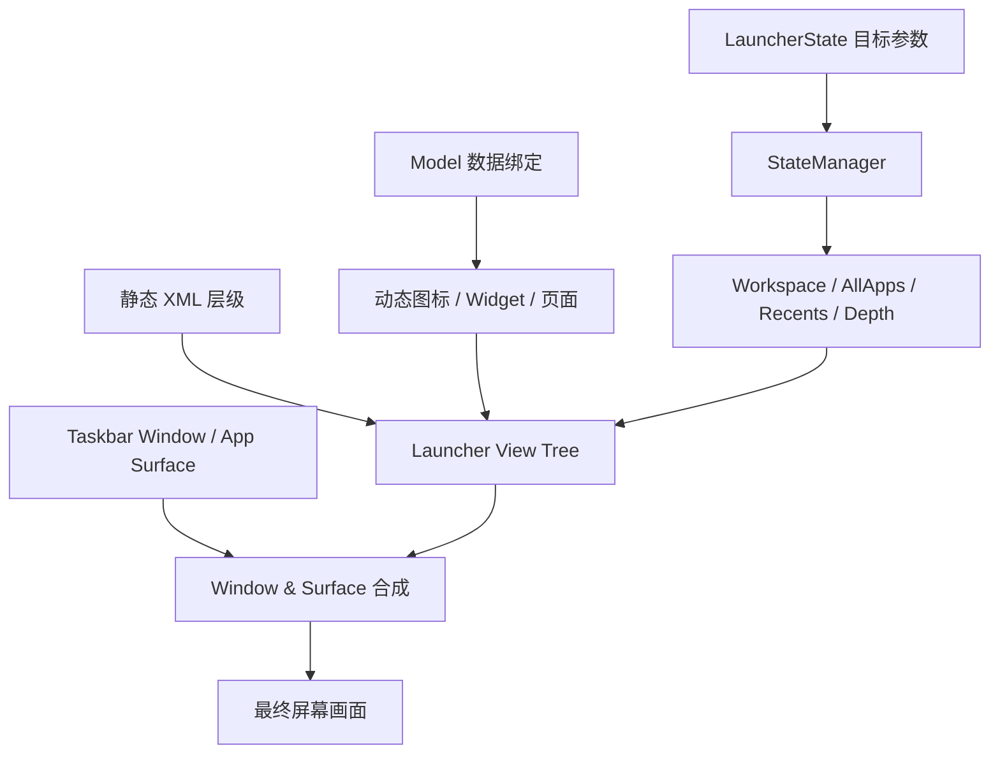

因此，看到某个界面元素“盖住”另一个元素时，应依次判断：它们是否在同一父 ViewGroup、XML/动态加入顺序如何、是否被重新指定 drawing order、当前状态修改了哪些属性，以及它是否来自另一个 Window 或 Surface。

## 2. 总体架构与职责边界

### 2.1 从 Activity 到屏幕像素

`QuickstepLauncher` 继承 `Launcher`。`Launcher.setupViews()` 通过 `inflateRootView(R.layout.launcher)` 创建根布局，再缓存 Workspace、Overview、Hotseat、All Apps、Scrim 和 DropTargetBar 等关键节点。基础 `Launcher` 注册 Workspace 与 All Apps 两个状态处理器；`QuickstepLauncher` 再补充 DepthController 与 RecentsViewStateController。

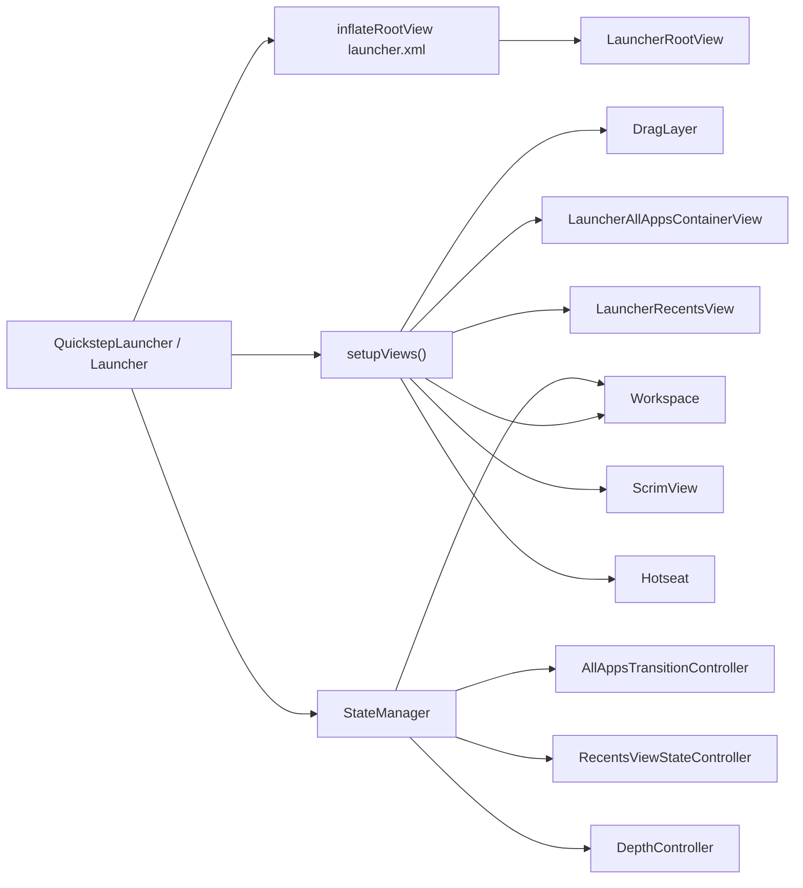

### 2.2 三类层级需要分开理解

| 层级 | 典型对象 | 关键含义 |
|-|-|-|
| Launcher Activity View 层级 | LauncherRootView、DragLayer、Workspace、All Apps、Overview | 同一窗口内按父子关系和 drawing order 绘制 |
| 浮层与拖拽层级 | Folder、Popup、Widget sheet、DragView、DropTargetBar | 多数动态加入 DragLayer，并获得更高触摸或绘制优先级 |
| 系统窗口与 Surface 层级 | Taskbar、导航栏、任务缩略图/远端动画 Surface | 由 WindowManager/SurfaceControl 合成，不能只看 launcher.xml 判断覆盖关系 |

### 2.3 主模块关系图

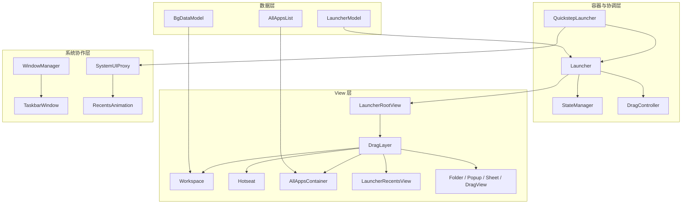

## 3. 主窗口 View 层级

### 3.1 launcher.xml 的直接子节点

源码中的 `LauncherRootView` 是一个 `InsettableFrameLayout`。它的直接子节点按 XML 顺序为：

1. `hotseat_bg_view`
2. `DragLayer`
3. `launcher_custom_content`

在普通 FrameLayout 中，后加入的子节点通常后绘制，因此同级默认 Z 轴顺序是 `hotseat_bg_view` 在底、`DragLayer` 居中、`launcher_custom_content` 在顶。这里的自定义内容容器位于 DragLayer 之外，是 OSLauncher3 相对 AOSP 主交互层的重要扩展点。

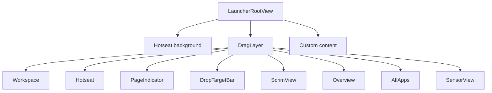

### 3.2 屏幕空间位置示意

下图表达的是逻辑占位，而非固定像素。Workspace、Scrim、Overview 和 All Apps 都接近全屏；Hotseat 自身也可能是全屏容器，只是其内部 CellLayout/图标被 DeviceProfile 摆放在底部或侧边。

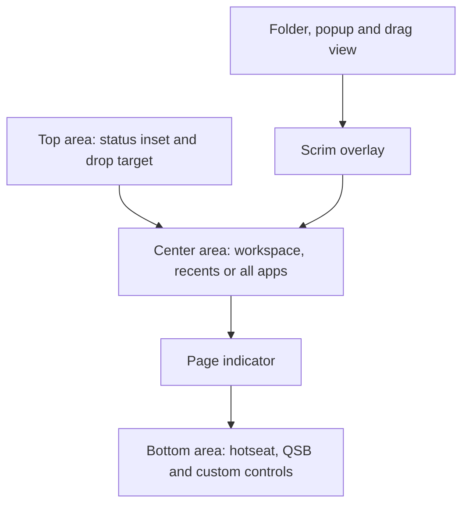

### 3.3 详细父子树

```text
LauncherRootView
├── hotseat_bg_view
├── DragLayer
│   ├── AccessibilityActionsView
│   ├── Workspace
│   │   ├── CellLayout(page 0)
│   │   │   └── ShortcutAndWidgetContainer
│   │   │       ├── BubbleTextView / FolderIcon
│   │   │       └── LauncherAppWidgetHostView
│   │   ├── CellLayout(page 1...n)
│   │   └── PageIndicator（通过引用关联）
│   ├── Hotseat
│   │   └── ShortcutAndWidgetContainer
│   │       └── Hotseat icons / QSB
│   ├── WorkspacePageIndicator
│   ├── DropTargetBar
│   ├── ScrimView
│   ├── LauncherRecentsView
│   │   ├── TaskView × n
│   │   │   ├── TaskThumbnailView
│   │   │   └── IconView / DigitalWellBeingToast 等
│   │   └── ClearAllButton
│   ├── OverviewActionsView
│   ├── overview_action_clear_all
│   ├── LauncherAllAppsContainerView
│   │   ├── 搜索容器
│   │   ├── FloatingHeaderView
│   │   ├── RecyclerView（个人/工作/搜索结果）
│   │   └── FastScroller
│   ├── LauncherSensorView
│   └── 运行时加入的 AbstractFloatingView / DragView
└── launcher_custom_content
    └── 渠道或模式在运行时注入的自定义 View
```

这个树有三个容易误判的地方：

- `overview_panel.xml` 使用 `<merge>`，因此 `LauncherRecentsView`、OverviewActionsView 和 ClearAll 按钮会直接成为 DragLayer 的孩子，而不是再包一层 overview_panel 容器。
- All Apps 的根节点虽然在 launcher.xml 中只是一个全屏 View，但内部内容由 `ActivityAllAppsContainerView` 在构造/初始化阶段继续 inflate `all_apps_content.xml`。
- Folder、弹出菜单和拖拽影子不是 launcher.xml 的固定节点，它们在运行时加入 DragLayer；仅检查 XML 看不到最终层级。

## 4. Z 轴与覆盖关系

### 4.1 DragLayer 内的基础绘制顺序

在没有动态重排时，DragLayer 内的后置节点覆盖前置节点。按主布局可抽象为：

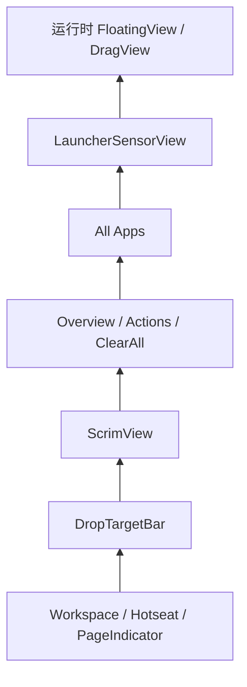

箭头表示更靠近观察者。实际可见结果还受 `visibility`、`alpha`、`translation`、裁剪、Surface 层和 `getChildDrawingOrder()` 影响。

### 4.2 DragView 为何能始终处于上层

`DragLayer` 开启自定义 children drawing order。它会追踪顶层 DragView 的索引，并在 `getChildDrawingOrder()` 中将该节点安排到最后绘制。这样拖拽影子不依赖“恰好最后 addView”才能显示在 Folder、Workspace 或 All Apps 之上。

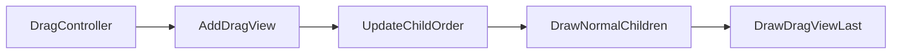

### 4.3 Scrim 不是独立页面

ScrimView 位于 Workspace/Hotseat 之后、Overview/All Apps 之前。状态切换时，它主要通过颜色与透明度改变背景观感，而不是替换底层内容。All Apps 或 Overview 可以继续让 Workspace 保留在树中，只是 Workspace 被缩放、平移、淡出或设为不可访问。

### 4.4 自定义内容层的特殊性

`launcher_custom_content` 是 `LauncherRootView` 的最后一个子节点，默认位于整个 DragLayer 之上。`CustomLayoutManager` 保存这个容器，并在 Workspace/All Apps 状态动画中同步修改缩放、位移、透明度或显示状态。这意味着它不是 Workspace 的普通孩子，却被显式纳入部分状态动画。

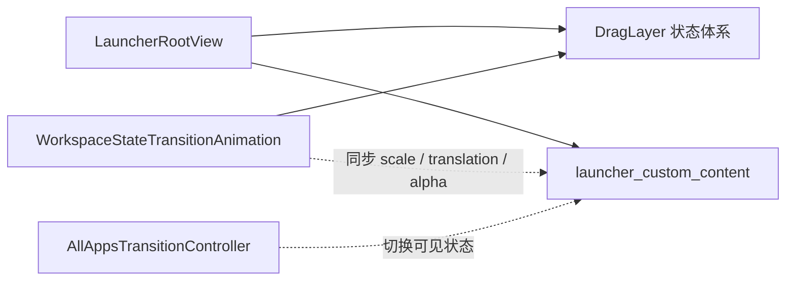

### 4.5 Taskbar 是另一棵树

Taskbar 由 `TaskbarActivityContext` 创建 WindowManager.LayoutParams，并通过 TaskbarManager 管理独立 DragLayer/窗口。它与 Launcher 的 Hotseat 可以视觉对齐、状态联动，但通常不是 LauncherRootView 的子 View。

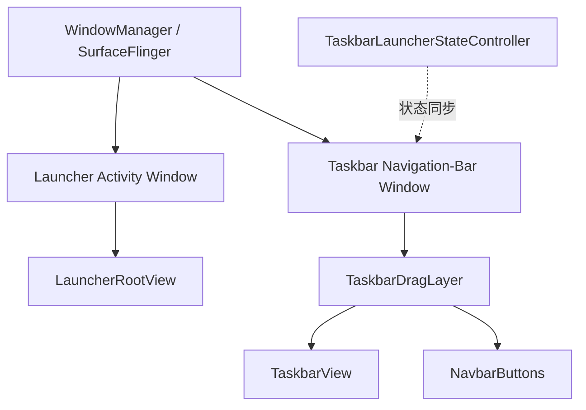

所以“底栏挡住 Launcher 内容”可能是跨 Window 覆盖，不一定能通过调整 launcher.xml 的子节点顺序解决。

## 5. Workspace 内部结构与布局

### 5.1 Workspace 是横向分页容器

`Workspace` 继承 `PagedView`，每一页是一个 CellLayout。CellLayout 内部创建 `ShortcutAndWidgetContainer`，实际图标、文件夹和 Widget 作为这个容器的孩子参与网格布局。

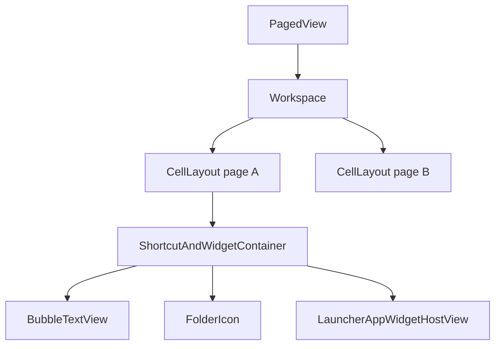

### 5.2 逻辑网格到像素位置

Workspace item 的位置不是直接保存像素坐标，而是由 `cellX/cellY/spanX/spanY` 与 DeviceProfile 的网格参数共同换算。屏幕尺寸、insets、横竖屏、双面板和渠道资源覆盖都会影响最终像素位置。

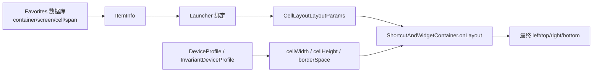

### 5.3 Hotseat 与 Workspace 的关系

Hotseat 与 Workspace 是 DragLayer 的同级节点，而不是 Workspace 的一页。Hotseat 持有自己的 ShortcutAndWidgetContainer，并通过 `setWorkspace()` 与 Workspace 协作。状态动画通常把两者当作一组，但 LauncherState 仍可以分别提供 Workspace 与 Hotseat 的缩放和平移参数。

## 6. All Apps 与 Overview 的覆盖模型

### 6.1 All Apps

All Apps 根节点是 `LauncherAllAppsContainerView`。`AllAppsTransitionController` 使用一个垂直进度值控制它相对屏幕的位置，并同时协调 Scrim、Workspace 缩放/透明度和搜索区域。

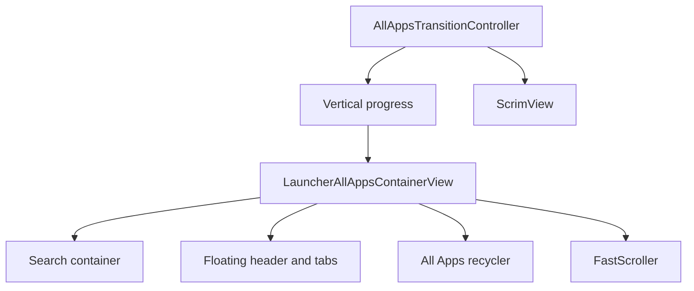

在 `ALL_APPS` 状态，`getVerticalProgress()` 返回 0，表示容器到达打开位置；返回桌面时进度回到关闭位置。手机和平板会采用不同的 Workspace/Hotseat 保留策略：平板 All Apps 状态可以继续显示 Hotseat 图标，手机通常让 Workspace 页面淡出。

### 6.2 Overview

Overview 的核心是 LauncherRecentsView，内部按页管理 TaskView。OverviewState 提供 Recents 是否可见、Workspace 缩放与位移、任务网格模式、景深、Clear All/Actions 可见性等状态参数。

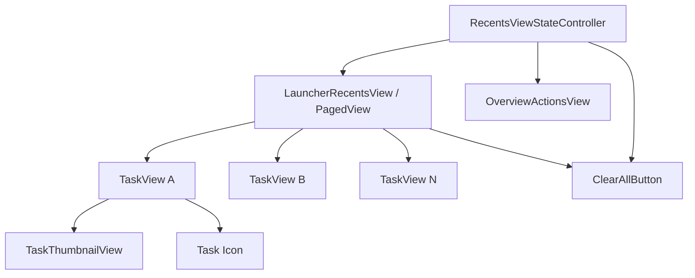

TaskView 看起来像“应用窗口”，但它通常展示任务快照，并在手势/启动动画中与远端应用 Surface 协同。因此 Overview 的最终画面可能同时包含普通 Android View 与系统合成 Surface。

### 6.3 三个主界面的覆盖对比

| 状态 | Workspace | Hotseat | All Apps | Recents | Scrim | 主要输入目标 |
|-|-|-|-|-|-|-|
| NORMAL | 主体，可交互 | 可见 | 关闭位置/不可见 | 不可见 | 低或透明 | Workspace、Hotseat |
| ALL_APPS | 保留但缩放/淡出；手机通常不可见 | 手机隐藏，平板可保留 | 主体 | 不可见 | All Apps 目标色 | All Apps 列表与搜索 |
| OVERVIEW | 缩放、上移并淡出 | 通常不可作为主操作区 | 不可见 | 主体 | Overview 目标色 | TaskView、Actions |
| SPRING_LOADED | 缩放后的拖拽背景 | 随状态变化 | 非主体 | 非主体 | 拖拽相关遮罩 | DropTarget、Workspace |
| EDIT_MODE | 多页/编辑态 Workspace | 由状态决定 | 非主体 | 非主体 | 编辑态遮罩 | 页面编辑与拖拽 |
| OVERVIEW_SPLIT_SELECT | Workspace 不可访问 | 非主操作区 | 非主体 | 任务列表位移并保留占位 | Overview 遮罩 | 第二个分屏任务选择 |

## 7. LauncherState：状态不是页面对象

LauncherState 更接近“目标视觉与交互参数集合”，而不是拥有 View 的页面类。每个状态可提供：

- Workspace/Hotseat 的 scale、translation 与页面 alpha；
- All Apps 的 vertical progress；
- Overview 的 scale、offset、fullscreen progress、modalness；
- Scrim 颜色与深度；
- 可见元素位掩码；
- 可访问性、拖拽能力、弹窗关闭、恢复策略等 flags；
- 进入/退出时长和返回历史状态。

### 7.1 状态全集

源码基线定义了 11 个状态槽位：

| 状态 | 主要用途 | 关键特征 |
|-|-|-|
| NORMAL | 主屏桌面 | Workspace 可拖拽，Hotseat/PageIndicator 可见 |
| SPRING_LOADED | 拖拽悬停/跨页放置 | Workspace 缩放，为 DropTarget 与落点留空间 |
| EDIT_MODE | 桌面编辑 | 多页展示或编辑相关变换 |
| ALL_APPS | 全部应用 | Workspace/Hotseat 不可访问，All Apps 内容可见 |
| HINT_STATE | 手势提示过渡 | 用于接近 Overview 的中间视觉态 |
| HINT_STATE_TWO_BUTTON | 两按钮导航提示态 | 统计与目标行为更接近 Overview |
| OVERVIEW | 最近任务 | Recents 可见，Workspace 淡出/缩放 |
| OVERVIEW_MODAL_TASK | 单任务聚焦 | Task modalness 增大，弱化其它任务 |
| QUICK_SWITCH_FROM_HOME | 快速切换应用 | 手势驱动的短暂 Overview 子状态 |
| BACKGROUND_APP | Launcher 在应用背后 | 为远端动画和返回路径保存状态 |
| OVERVIEW_SPLIT_SELECT | 分屏第二任务选择 | 显示占位并平移任务列表 |

### 7.2 主状态机图

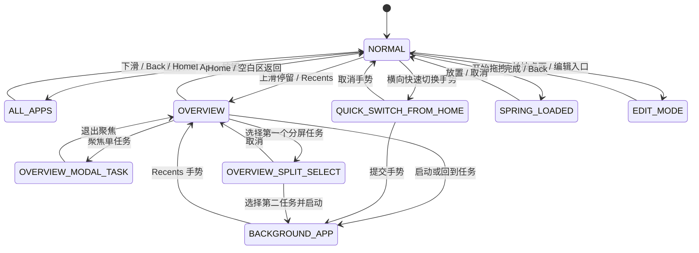

这张图表达典型路径，不表示所有调用点都直接调用 `goToState()`；部分 Quickstep 手势会先创建用户可控动画，再在手势结束时提交目标状态。

## 8. StateManager 的运行机制

### 8.1 核心状态字段

StateManager 同时维护多个状态概念：

| 字段 | 含义 |
|-|-|
| `mState` | 当前逻辑状态；动画开始时就可能切换为目标状态 |
| `mCurrentStableState` | 最近一次完整完成的稳定状态 |
| `mLastStableState` | 上一个稳定状态，用于历史与回退 |
| `mRestState` | 需要时恢复的休息状态 |
| `mConfig.targetState` | 当前动画目标 |
| `mConfig.currentAnimation` | 正在运行的 AnimatorSet/播放控制器 |

区分“逻辑目标已经改变”和“画面已稳定完成”十分重要。动画中断、配置变化或预测返回都可能让这些字段暂时不同。

### 8.2 goToState 时序

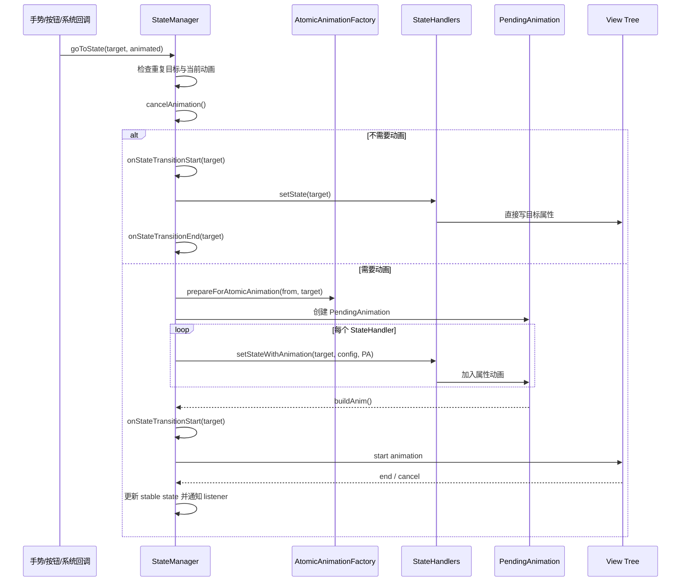

### 8.3 状态处理器的扇出

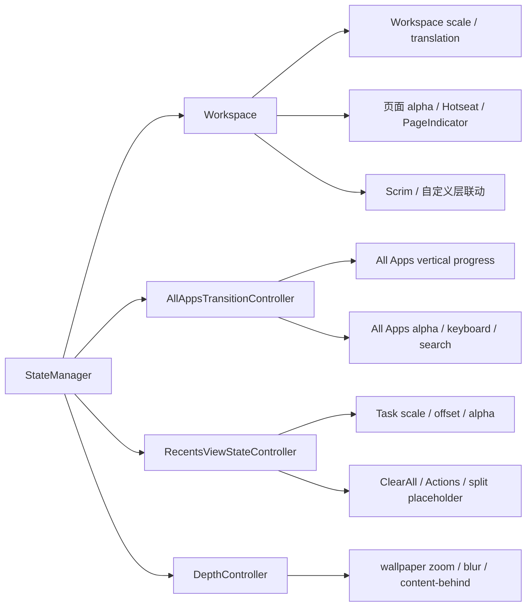

基础 Launcher 的 `collectStateHandlers()` 只加入 AllAppsTransitionController 与 Workspace；QuickstepLauncher 追加 DepthController 和 RecentsViewStateController。这个扩展方式把 Quickstep 能力从基础 Launcher 状态框架中解耦出来。

### 8.4 动画通道

StateAnimationConfig 为不同视觉属性定义独立动画通道，包括：

- Workspace：scale、translate、fade、page translate；
- Hotseat：scale、translate、fade；
- Overview：scale、X/Y translate、fade、modal；
- All Apps：vertical progress、fade、bottom sheet、keyboard；
- 其它：Scrim fade、Depth、Overview Actions、Split Select 占位与说明。

各 StateHandler 从同一个配置中读取对应 interpolator，再向同一个 PendingAnimation 添加动画。最终所有 View 属性在同一时间轴上协调执行。

## 9. 状态属性如何落到 View

### 9.1 Workspace 状态投影

`Workspace.setState()` 与 `setStateWithAnimation()` 都委托给 WorkspaceStateTransitionAnimation。该类读取 LauncherState 的 scale/translation、页面 alpha、Hotseat 参数和可见元素，再更新 Workspace、Hotseat、PageIndicator、Scrim 以及 OSLauncher3 的自定义内容层。

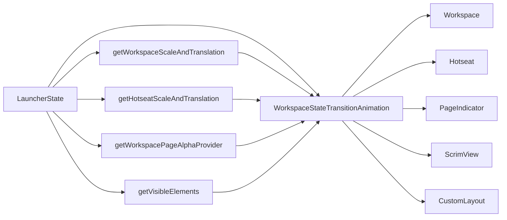

### 9.2 All Apps 状态投影

AllAppsTransitionController 的核心变量是 progress。状态切换和手势都可以驱动这个统一进度：普通状态切换一次性生成目标动画，手势则通过 AnimatorPlaybackController 连续设置进度。

### 9.3 Overview 状态投影

RecentsViewStateController 根据状态设置 Recents 的 scale/offset、content alpha、fullscreen progress、task modalness、ClearAll 和 Actions alpha，并在分屏选择状态中追加 TaskView 平移和 placeholder 动画。

### 9.4 Depth 与背景关系

DepthController 根据状态深度修改壁纸缩放/模糊及 Launcher 后方内容可见策略。Overview 存在任务 Surface 时，会标记“Launcher 后方有内容”，避免系统优化错误遮挡后层。

## 10. 手势、触摸与状态机

### 10.1 DragLayer 是触摸仲裁中心

BaseDragLayer 先检查顶部 AbstractFloatingView 是否拦截事件，再按顺序询问当前 TouchController。Launcher 基础控制器包括 DragController 和 AllAppsSwipeController；Quickstep 还会按导航模式、当前状态与设备形态增加 Overview/快速切换等控制器。

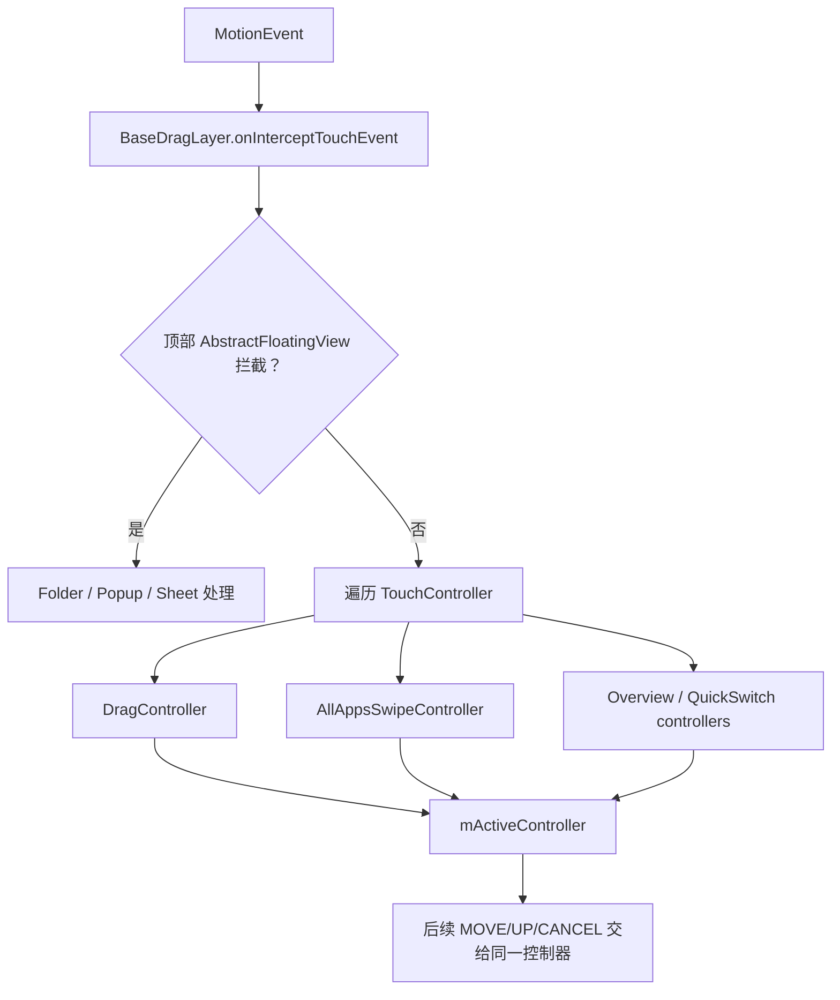

### 10.2 手势驱动动画不是重复造状态机

手势控制器通常仍以 LauncherState 作为起点和终点，但使用用户可控的播放进度。它们不会为每一帧创建新状态，而是创建一次状态动画，将手势位移映射成动画 fraction。

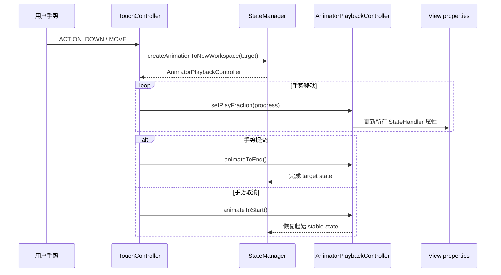

### 10.3 浮层优先规则

顶部 AbstractFloatingView 不仅具有更高绘制层级，也优先参与事件拦截和无障碍节点选择。Folder 打开时，底层 Workspace 仍在树中，但触摸与无障碍焦点被限制到顶部浮层；点击外部区域通常由浮层自身决定关闭行为。

## 11. 核心 UML 类图

```mermaid
classDiagram
    class StatefulActivity~S~ {
        +getStateManager()
        +collectStateHandlers(out)
    }
    class Launcher {
        -Workspace mWorkspace
        -DragLayer mDragLayer
        -AllAppsTransitionController mAllAppsController
        +setupViews()
        +collectStateHandlers(out)
    }
    class QuickstepLauncher {
        -DepthController mDepthController
        +collectStateHandlers(out)
    }
    class StateManager~S,C~ {
        -S mState
        -S mCurrentStableState
        -S mLastStableState
        +goToState(S)
        +createAnimationToNewWorkspace(S,...)
        +reapplyState()
    }
    class LauncherState {
        +getWorkspaceScaleAndTranslation()
        +getVisibleElements()
        +getDepth()
        +getVerticalProgress()
    }
    class StateHandler~S~ {
        <<interface>>
        +setState(S)
        +setStateWithAnimation(S, config, animation)
    }
    class Workspace
    class AllAppsTransitionController
    class RecentsViewStateController
    class DepthController
    StatefulActivity <|-- Launcher
    Launcher <|-- QuickstepLauncher
    Launcher --> StateManager
    StateManager --> LauncherState
    StateManager --> StateHandler
    StateHandler <|.. Workspace
    StateHandler <|.. AllAppsTransitionController
    StateHandler <|.. RecentsViewStateController
    StateHandler <|.. DepthController
```

这个设计的关键是：状态对象描述“目标是什么”，StateManager 负责“什么时候切换、动画如何组织”，StateHandler 负责“某一类 View 属性如何达到目标”。

## 12. 启动、绑定与首次稳定状态

```mermaid
sequenceDiagram
    participant A as Launcher.onCreate
    participant L as Launcher.setupViews
    participant XML as launcher.xml
    participant M as LauncherModel
    participant W as Workspace
    participant SM as StateManager
    A->>L: 初始化
    L->>XML: inflateRootView
    XML-->>L: LauncherRootView / DragLayer / 静态节点
    L->>W: setup(DragController)
    L->>SM: 建立 NORMAL 基础状态
    A->>M: startLoader()
    M-->>A: bindScreens / bindItems / bindWidgets
    A->>W: 创建 CellLayout 并加入图标、文件夹、Widget
    A->>SM: restore 或 reapply state
    SM-->>A: 首次稳定画面
```

XML 只产生空骨架；桌面页数和图标/Widget 是 Model 加载后动态绑定的。调试“某个图标不在 View 树里”时，需要区分布局尚未 inflate、Workspace 尚未 bind、目标页面尚未 attach，以及 item 被过滤/放入其它 container 等阶段。

## 13. 配置变化、Insets 与状态重放

LauncherRootView 接收 WindowInsets 后先更新 DeviceProfile，再向子节点分发。如果 Insets 发生变化，它会调用 StateManager.reapplyState，并可取消当前动画。这样旋转、导航栏形态、状态栏或窗口尺寸变化后，所有 StateHandler 都按新的几何参数重新写入当前状态。

```mermaid
flowchart LR
    Insets["WindowInsets / Configuration"] --> Root["LauncherRootView"]
    Root --> DP["DeviceProfile.updateInsets"]
    DP --> Layout["重新测量与布局"]
    Root --> Reapply["StateManager.reapplyState"]
    Reapply --> Handlers["所有 StateHandler"]
    Handlers --> Current["以新尺寸重建当前状态属性"]
```

这解释了为什么状态动画实现不能只缓存旧像素值：同一个 LauncherState 在不同屏幕尺寸、Insets、横竖屏或双面板模式下会得到不同目标参数。

## 14. 设计沿革

### 14.1 架构演进脉络

Launcher3 的核心演进可以概括为从“单一桌面容器”到“统一状态投影 + 手势连续动画 + 系统 Surface 协作”：

```mermaid
flowchart LR
    A["早期 Launcher<br>Workspace + Hotseat<br>页面切换为主"] --> B["Launcher3<br>PagedView + CellLayout<br>Model/View 分离"]
    B --> C["状态框架<br>LauncherState + StateManager<br>统一属性切换"]
    C --> D["Quickstep 融合<br>Recents 与手势导航<br>远端动画"]
    D --> E["大屏/平板<br>Taskbar、双面板、网格 Overview"]
    E --> F["OSLauncher3 扩展<br>渠道 overlay、自定义内容层<br>底栏与业务入口"]
```

### 14.2 当前仓库可核验的变更节点

| 时间 | 仓库节点 | 架构意义 |
|-|-|-|
| 2023-04 | EDLA 原生 Launcher 定制初始化 | 建立当前产品化 Launcher 基线 |
| 2023-06 | 基于 Bytello OS 定制主页、Hotseat、All Apps 与 Remove 区域 | View 空间与交互开始明显产品化 |
| 2023-09 至 2023-12 | 多客户 Launcher、All Apps、账号入口与底部栏改版 | 渠道 overlay、自定义入口和底栏协作增多 |
| 2024-04 | 更新 Launcher 基线 | 状态与 Quickstep 架构随上游版本演进 |
| 2024-12 | 迁移 Android 15 Launcher3 | 引入当前 Android 15 视图与状态框架基线 |
| 2025-01 以后 | OneScreen/OSD 风格、自定义内容与手势导航适配 | `launcher_custom_content` 与状态动画发生显式联动 |
| 2025-12 | HomeStates 状态记录与通知 | StateManager 除内部渲染外，也承担外部状态可观察性 |

上述节点来自当前仓库对 `launcher.xml`、LauncherState、StateManager 和自定义布局相关路径的提交历史。它们描述本仓库的演进，不等同于完整 AOSP 年表。

### 14.3 为什么状态框架比“切换整个布局”更适合 Launcher

Launcher 的 Workspace、All Apps、Overview、Hotseat、Scrim 和远端任务 Surface 需要在手势中连续过渡。如果每个状态都 inflate 一套页面，跨页面共享的图标、任务卡片和手势进度会难以保持连续。当前架构保留主 View 树，让不同 StateHandler 在同一时间轴上改变属性，能同时满足：

- 手势可逆与随手指连续变化；
- 图标到应用窗口的共享元素动画；
- Overview 任务 Surface 与 Launcher View 协同；
- 平板、折叠屏、双面板和 Taskbar 的参数化适配；
- 配置变化后重放同一状态，而不是重建业务页面。

## 15. 常见问题的定位方法

### 15.1 View 明明存在却看不见

依次检查：

1. `visibility` 是否为 VISIBLE；
2. View 自身及 MultiValueAlpha 各通道是否为 0；
3. 是否被 translation 移出屏幕；
4. 父节点是否裁剪；
5. 是否被 Scrim、All Apps、Overview、自定义层或独立 Window 覆盖；
6. 当前 LauncherState 的 visible elements 与 StateHandler 是否把它淡出；
7. 动画是否取消后停留在非稳定属性。

### 15.2 点击落到错误的层

依次检查顶部 AbstractFloatingView、DragLayer 的 active TouchController、系统手势区域、View 的 clickable/focusable、窗口 flags，以及事件流是否在 ACTION_DOWN 后已经被某个控制器锁定。

### 15.3 状态正确但画面错误

不要只看 `getState() == target`。同时检查 currentStableState、targetState、currentAnimation、动画是否被取消、reapplyState 是否执行，以及各 StateHandler 是否都被 collect 进 StateManager。

### 15.4 只在平板或特定渠道异常

重点比较 DeviceProfile、资源 overlay、launcher.xml 覆盖、Taskbar 是否存在、isTwoPanels/isTablet、导航模式，以及自定义内容是否位于 DragLayer 外部。相同 Java 状态在不同 DeviceProfile 下可以产生完全不同的位置与可见元素。

## 16. 调试观测图

```mermaid
flowchart TB
    Symptom["界面异常"] --> Type{"先分类"}
    Type -->|位置/尺寸| Geometry["DeviceProfile / Insets / LayoutParams / translation"]
    Type -->|被遮挡| Z["父子树 / drawing order / alpha / Window / Surface"]
    Type -->|状态错误| State["mState / stableState / targetState / animation"]
    Type -->|触摸错误| Touch["FloatingView / TouchController / gesture region"]
    Type -->|数据缺失| Bind["Model load / bindScreens / bindItems / container"]
    Geometry --> Dump["View hierarchy + bounds"]
    Z --> Dump
    State --> StateDump["StateManager.dump"]
    Touch --> Input["触摸日志与 active controller"]
    Bind --> ModelDump["LauncherModel/BgDataModel dump"]
```

建议一次问题至少保留四类证据：当前状态字段、目标 View 的 bounds/alpha/visibility/translation、父子树与窗口层级、触摸控制器或绑定数据来源。单张截图只能证明最终像素，无法说明是哪一层造成的。

## 17. 源码索引

| 主题 | 关键文件 |
|-|-|
| Activity 与 View 初始化 | `src/main/java/com/android/launcher3/Launcher.java` |
| Android 15 Quickstep 扩展 | `src/main/java/com/android/launcher3/uioverrides/QuickstepLauncher.java` |
| 根布局 | `src/main/res/layout/launcher.xml` |
| 根 View 与 Insets | `src/main/java/com/android/launcher3/LauncherRootView.java` |
| 触摸与浮层容器 | `src/main/java/com/android/launcher3/views/BaseDragLayer.java`、`dragndrop/DragLayer.java` |
| Workspace | `src/main/java/com/android/launcher3/Workspace.java`、`CellLayout.java` |
| Workspace 状态动画 | `src/main/java/com/android/launcher3/WorkspaceStateTransitionAnimation.java` |
| Launcher 状态定义 | `src/main/java/com/android/launcher3/LauncherState.java` |
| 状态调度 | `src/main/java/com/android/launcher3/statemanager/StateManager.java` |
| 动画通道 | `src/main/java/com/android/launcher3/states/StateAnimationConfig.java` |
| All Apps | `src/main/java/com/android/launcher3/allapps/AllAppsTransitionController.java` |
| Overview | `src/main/java/com/android/launcher3/uioverrides/RecentsViewStateController.java`、`com/android/quickstep/views/RecentsView.java` |
| 景深 | `src/main/java/com/android/launcher3/statehandlers/DepthController.java` |
| Taskbar 独立窗口 | `src/main/java/com/android/launcher3/taskbar/TaskbarActivityContext.java`、`TaskbarManager.java` |
| OSLauncher3 自定义内容 | `src/main/res/layout/launcher_ifp_content_layout.xml`、`com/android/ifpdos/custom/CustomLayoutManager` 相关代码 |

## 18. 总结

Launcher3 的 View 架构核心不是“多个页面互相替换”，而是“一棵长期存在的主 View 树，在状态机控制下形成不同视觉投影”。LauncherRootView 提供窗口根与 Insets，DragLayer 承担主内容、浮层和触摸仲裁，Workspace/All Apps/Overview 分别维护各自复杂子树；LauncherState 描述目标，StateManager 组织时序，多个 StateHandler 将目标分解为可动画的 View 属性。

理解问题时应始终同时画出三张图：父子 View 树、Z 轴/Window 覆盖图、状态转换与属性投影图。只有把这三者叠加起来，才能准确解释某个 View 为什么出现在那个位置、为什么覆盖另一个 View、为什么某次手势后仍然可见，以及为什么同一状态在手机、平板、不同导航模式或渠道 overlay 下表现不同。

---

[专题目录](README.md) · [Workspace 数据库 →](workspace-database.md)

<sub>整理于 2026-11-20 · [飞书原文](https://cvte.feishu.cn/wiki/THR8w93Zii4U9UkaodUcWzfMnKg) · [来源与基线](SOURCES.md)</sub>
