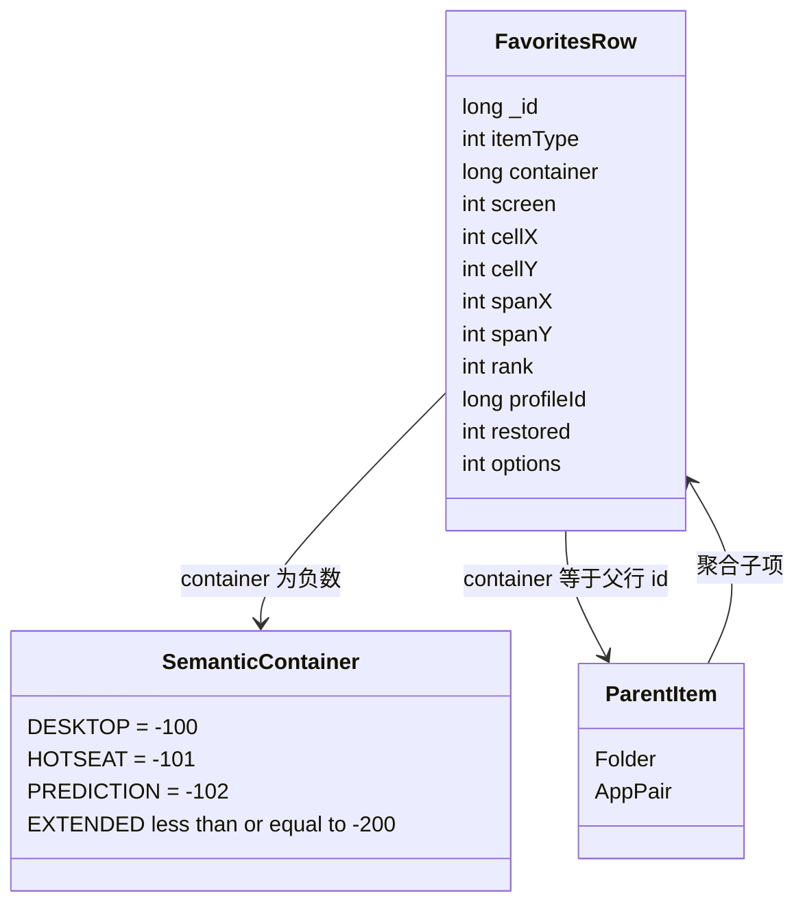
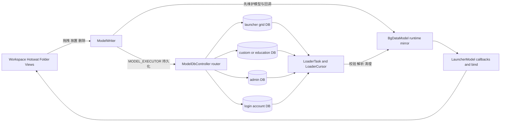
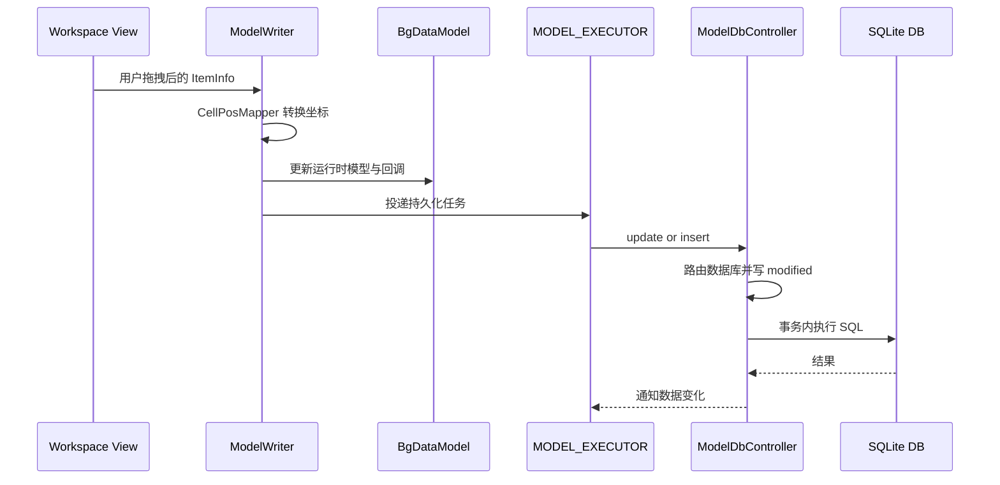
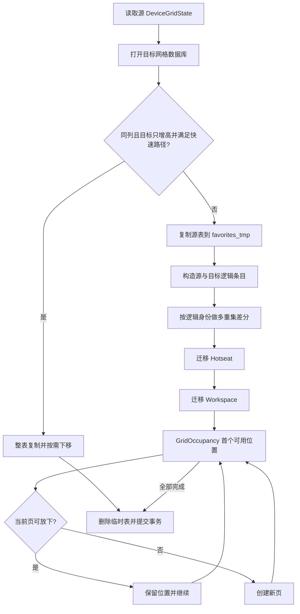
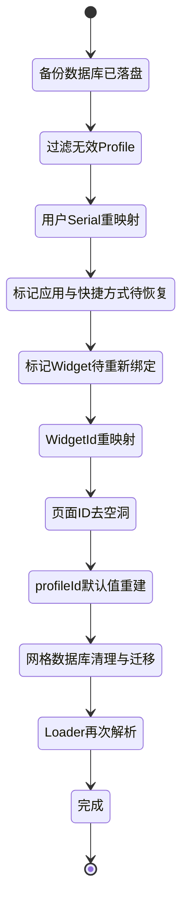
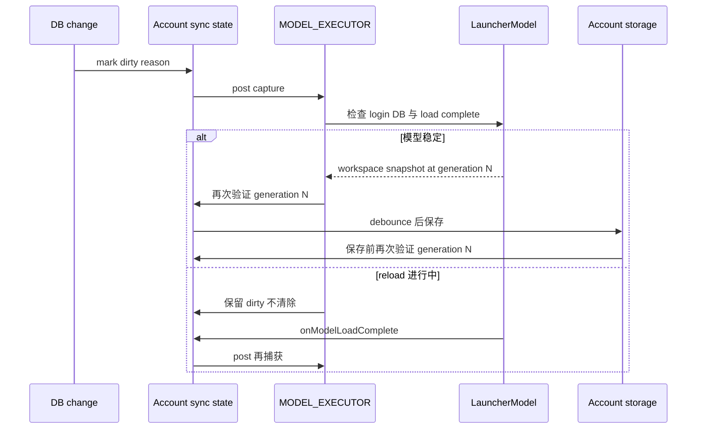
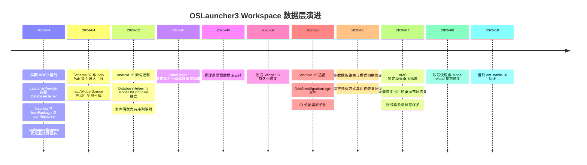

[首页](../../README.md) / [应用设计](../README.md) / [Launcher3](README.md)

[← View 层级与状态机](view-and-state.md) · [专题目录](README.md) · [图标加载与动态图标 →](icon-loading.md)

# OSLauncher3 Workspace 数据库设计：模型、演进与精妙之处

> [!NOTE]
> **源码基线**：本文以 2026-10-19 重新获取的 `origin/em-stable-16` 为主线，commit 为 `7dddb9d7d38d7ec3ee6cb5be261a8510190d9182`；同时对照仓库内 2023—2026 年关键提交，说明 AOSP Launcher3 数据模型及 OSLauncher3 扩展的演进。

<strong>章节目录</strong>

- [1. 阅读范围与核心结论](#1-阅读范围与核心结论)
- [2. Workspace 数据的真实形态：单表、空间树与状态载体](#2-workspace-数据的真实形态单表空间树与状态载体)
- [3. favorites 表的字段语义](#3-favorites-表的字段语义)
- [4. 从数据库到界面：运行时架构](#4-从数据库到界面运行时架构)
- [5. 写入链路、读取链路与一致性边界](#5-写入链路读取链路与一致性边界)
- [6. 页面模型的演变：从 workspaceScreens 到派生页面](#6-页面模型的演变从-workspacescreens-到派生页面)
- [7. Schema 12→32：兼容性迁移的完整路径](#7-schema-1232兼容性迁移的完整路径)
- [8. 多网格数据库与布局迁移算法](#8-多网格数据库与布局迁移算法)
- [9. Restore：数据库恢复其实是一台状态机](#9-restore数据库恢复其实是一台状态机)
- [10. OSLauncher3 的多数据库路由扩展](#10-oslauncher3-的多数据库路由扩展)
- [11. 账号快照同步：一次典型并发一致性演进](#11-账号快照同步一次典型并发一致性演进)
- [12. 设计沿革时间线](#12-设计沿革时间线)
- [13. 设计中最精妙的部分](#13-设计中最精妙的部分)
- [14. 设计边界、关键不变量与源码索引](#14-设计边界关键不变量与源码索引)

## 1. 阅读范围与核心结论

Launcher3 的 Workspace 不是“把桌面图标存进 SQLite”这么简单。它同时承载四类信息：用户选择了什么对象、对象位于哪个空间位置、对象之间如何组成层级、对象在升级/恢复/跨网格迁移过程中处于什么状态。理解它的关键，不是从某个 DAO 或某张表入手，而是把 `favorites` 看成一棵可持久化的空间树，再把 `BgDataModel` 看成这棵树的运行时镜像。

本文阅读范围覆盖 `LauncherSettings.Favorites`、`DatabaseHelper`、`ModelDbController`、`LoaderTask/LoaderCursor`、`ModelWriter`、`BgDataModel`、`GridSizeMigrationLogic`、`RestoreDbTask`，以及 OSLauncher3 的账号、OneScreen、管理员桌面数据库扩展。结论基于当前代码，不把历史注释或旧实现当作当前行为。

> [!TIP]
> **核心结论**：这套设计的中心不是 SQL，而是“逻辑布局模型”。SQLite 负责耐久化；Model 层负责关系、校验和线程顺序；迁移层负责把不同版本、不同网格和不同身份下的数据重新解释为同一个逻辑布局。

- **表结构极简**：核心只有一张 `favorites` 表，没有外键、唯一约束和复杂索引。
- **表达能力很强**：同一行可以表示应用、深链快捷方式、文件夹、App Pair、普通 Widget 或自定义 Widget。
- **空间与层级统一**：负数 `container` 表示语义容器，非负数 `container` 表示父项的 `_id`。
- **页面不再单独存储**：当前页面集合由桌面项的 `screen` 派生，避免页表与内容表双写。
- **迁移比较逻辑身份**：跨网格迁移不依赖行号，而以 Intent、组件、Widget 身份以及文件夹内容的多重集判断同一对象。
- **恢复是分阶段协议**：`restored` 位标记让“数据库已写入但对象尚未完全可用”成为合法中间态。
- **OSLauncher3 增加路由层**：同一套读写 API 可在默认、定制、管理员、登录账号数据库之间切换。

## 2. Workspace 数据的真实形态：单表、空间树与状态载体

`favorites` 表是一张“多态节点表”。`itemType` 决定节点是什么，`container` 决定节点挂在哪里，`screen/cellX/cellY/spanX/spanY/rank` 决定节点在该容器中的空间或顺序。它既像关系表，也像树节点表，还带有二维布局坐标。

### 2.1 一张表如何形成空间树

顶层对象的 `container` 是预定义负数：桌面为 `-100`，Hotseat 为 `-101`。文件夹和 App Pair 本身也是 `favorites` 中的一行；它们的子项把 `container` 写成父行的 `_id`。因此无需单独的 folder_members 或 pair_members 表，自引用就能表达层级。

同一列在不同容器中具有不同语义。桌面项使用 `screen + cellX + cellY + span` 表示分页二维空间；Hotseat 主要把 `screen` 当作槽位；文件夹与 App Pair 子项主要由 `rank` 表达顺序。字段复用减少了表和联接，但解释必须始终结合 `container` 和 `itemType`。

### 2.2 为什么没有 SQL 外键

表定义没有 `FOREIGN KEY(container)`、唯一位置约束或级联删除。关系完整性由 Loader、Model 与清理逻辑维护：加载时删除孤儿项、坏文件夹/坏 App Pair，使用 `GridOccupancy` 检查占位冲突，删除集合时由 `ModelWriter` 先处理成员再处理父项。

这不是“没有约束”，而是把约束从固定 SQL 规则提升为与设备网格、用户配置、恢复状态相关的领域规则。它也让升级、跨设备恢复、父子 ID 重映射和临时不完整状态更容易落地。

## 3. favorites 表的字段语义

当前 `LauncherSettings.Favorites.addTableToDb()` 通过 `LinkedHashMap` 声明列。顺序不仅用于生成 `CREATE TABLE`，还由 `getColumns()` 复用；固定列序使整表复制、恢复和临时表迁移具有稳定的投影顺序。

| **字段** | **类型/默认值** | **语义** |
|-|-|-|
| `_id` | INTEGER PRIMARY KEY | 节点身份；同时可被子项的 `container` 引用 |
| `title` | TEXT | 展示标题；对部分类型可为空或可重建 |
| `intent` | TEXT | 序列化 Intent；应用、快捷方式的主要逻辑身份来源 |
| `container` | INTEGER | 负数语义容器，或父节点 `_id` |
| `screen` | INTEGER | 桌面页 ID；在 Hotseat 中表示位置 |
| `cellX/cellY` | INTEGER | 网格左上角坐标 |
| `spanX/spanY` | INTEGER | 占用跨度，Widget 尤其重要 |
| `itemType` | INTEGER | 0 应用、2 文件夹、4 Widget、5 自定义 Widget、6 深链快捷方式、10 App Pair |
| `appWidgetId` | INTEGER，默认 -1 | 与 AppWidgetHost/系统服务建立绑定 |
| `icon` | BLOB | 需要持久化时保存自定义图标位图 |
| `appWidgetProvider` | TEXT | Widget Provider 组件名 |
| `modified` | INTEGER，默认 0 | ModelDbController 在插入/更新时写入时间戳 |
| `restored` | INTEGER，默认 0 | 位标记；描述对象在恢复/安装/绑定流程中的中间状态 |
| `profileId` | INTEGER，默认当前用户 serial | Android 用户/工作资料隔离；不是简单的进程 userId |
| `rank` | INTEGER，默认 0 | 文件夹/App Pair 内顺序，也用于部分容器排序 |
| `options` | INTEGER，默认 0 | 可扩展位集合，避免每个小能力都改表 |
| `appWidgetSource` | INTEGER，默认 -1 | 记录 Widget 添加来源 |

> [!TIP]
> **阅读字段的顺序**：先看 `itemType`，再看 `container`，再解释位置列，最后结合 `profileId/restored/options` 判断身份和生命周期。孤立地看某一列很容易误判。

### 3.1 itemType 是稳定的类型判别器

表没有为不同节点类型拆表，类型差异通过 `itemType` 判别。旧的普通 Shortcut 类型仍保留编号但已废弃，升级逻辑会把能解析为 Launcher Activity 的旧 Shortcut 转换成 Application，并继续迁移剩余旧快捷方式。这种“保留旧编号、迁移旧语义”的方式避免历史数据因枚举重排而被误读。

### 3.2 restored 与 options 是演进缓冲区

`restored` 和 `options` 都使用整数位集合。前者表达“尚未完全落稳”的对象状态，后者表达长期可选属性。新增一位通常比新增一列更便于向前/向后兼容，也能让同一行在恢复期间带着足够上下文继续被 Loader 解释。

## 4. 从数据库到界面：运行时架构

运行时不是 View 直接查询 SQLite。数据库、内存模型和 View 分成三层：数据库保存耐久状态；`BgDataModel` 保存按 ID、容器和类型组织的内存镜像；Workspace/Hotseat View 只消费绑定结果。读写都经过 Model 层。

### 4.1 DatabaseHelper：一个物理数据库的生命周期

`DatabaseHelper` 负责建表、版本升级/降级、事务、ID 分配、Ghost Widget 清理与空库重建。Android 16 版本把最大 ID 计数器改为 `AtomicInteger`，让多个写入请求分配新 ID 时不依赖非原子的“读取再加一”。它继承 `NoLocaleSQLiteHelper`，避免数据库行为受 locale collation 变化影响。

### 4.2 ModelDbController：逻辑 API 与物理库的分离

`ModelDbController` 对上提供 query/insert/update/delete、事务、默认布局装载和网格迁移，对下选择实际 `DatabaseHelper`。AOSP 中它隔离“哪一个网格数据库”；OSLauncher3 又扩展为隔离“哪一种账号/模式数据库”。上层 Model 不需要把数据库文件名扩散到业务逻辑。

### 4.3 BgDataModel：可查询的运行时真相

`BgDataModel` 用 `itemsIdMap` 和集合关系维护内存结构。它能快速找到父项、成员、Widget、Workspace 页集合，并为 UI 绑定提供稳定快照。数据库是跨进程生命周期的耐久真相，`BgDataModel` 是当前已加载代际中的运行时真相；两者由 Model Executor 串行化保持一致。

## 5. 写入链路、读取链路与一致性边界

### 5.1 写入链路

拖拽或编辑发生后，`ModelWriter` 先把 Presenter 坐标经 `CellPosMapper` 转成 canonical model 坐标，再更新回调和 `BgDataModel`，然后把数据库操作投递到 `MODEL_EXECUTOR`。这样 RTL、双面板或不同呈现坐标不会污染持久化模型。

新增项由 DatabaseHelper 分配 ID，`ItemInfo.onAddToDatabase()` 负责把类型对象编码为 ContentValues，ModelDbController 统一补上 `modified`。删除文件夹或 App Pair 时，成员与父项作为一个关系单元处理；撤销机制把删除动作暂存，到 commit 才真正落库。

### 5.2 读取链路

`LoaderTask` 在 Model Executor 上打开当前路由数据库，`LoaderCursor` 预先定位列索引、解析 Intent、解析 profile/user、恢复 ItemInfo，并记录待删除行与待更新的 restore 状态。主数据库加载还会执行文件夹、App Pair、包状态、Widget 等清理；随后先绑定 Workspace，再加载 All Apps、深链快捷方式等后续数据。

### 5.3 一致性边界

| **边界** | **机制** | **保证** |
|-|-|-|
| 线程边界 | MODEL_EXECUTOR 串行 | Model 更新和 DB 写入具有可推断顺序 |
| 对象身份 | ModelVerifier / checkItemInfoLocked | 防止 UI 持有的旧对象悄悄覆盖新模型 |
| 空间占位 | GridOccupancy | 加载、迁移时检测重叠和越界 |
| 事务边界 | SQLiteTransaction | 升级、迁移、恢复要么整体提交，要么回滚/重建 |
| 数据清理 | Loader 收集后批量删除/修正 | 允许先完整扫描，再统一修复不合法数据 |

## 6. 页面模型的演变：从 workspaceScreens 到派生页面

旧版本使用单独的 `workspaceScreens` 表保存页面 ID 与 `screenRank`。这形成两个必须同步的事实源：页面表说某页存在，favorites 表说某页上有什么。空页、删除页、页面重排和恢复都可能让二者分叉。

Schema v27 的升级先按 `workspaceScreens.screenRank` 读取旧页顺序，把 `favorites.screen` 归一化为连续页面，再删除 `workspaceScreens`。当前 `BgDataModel.collectWorkspaceScreens()` 直接遍历 `container == CONTAINER_DESKTOP` 的项派生页面集合；如果集合为空或首屏 QSB 规则要求，才合成第一页。

| **阶段** | **页面事实来源** | **主要特征** |
|-|-|-|
| 旧模型 | workspaceScreens + favorites | 显式页顺序，但存在双写同步成本 |
| v27 迁移 | 读取旧页表后重写 favorites.screen | 把页顺序压入项目坐标，再删除页表 |
| 当前模型 | 从桌面项派生 | 有内容才有页；特殊首屏由规则合成 |

> [!TIP]
> **精妙点**：页面从“独立实体”变为“布局投影”。这减少了持久化状态数量，也让恢复时的 `removeScreenIdGaps()` 可以专注于重映射真实内容，例如把 0、3、4、6、7 压缩为 0、1、2、3、4。

## 7. Schema 12→32：兼容性迁移的完整路径

当前 `SCHEMA_VERSION = 32`。升级使用 switch fall-through：从旧版本进入后，依次执行之后每个版本的迁移。每一步返回失败都会让升级路径最终落入 `createEmptyDB()`，宁可回到一致的空库和默认布局，也不保留结构半升级的数据。

| **版本** | **迁移内容** | **设计意义** |
|-|-|-|
| 12→13 | 加入 `appWidgetProvider` | Widget 身份不再只依赖 host ID |
| 13→14 | 加入 `modified` | 为同步、审计和变化判断提供时间信息 |
| 14→15 | 加入 `restored` | 把恢复中间态正式建模 |
| 18→19 | 加入 `profileId` | 支持多用户与工作资料 |
| 19→20 | 回填文件夹 `rank` | 从隐式顺序迁移到显式稳定顺序 |
| 21→22 | 加入 `options` | 用位集合承载后续能力 |
| 24→25 | 旧 Shortcut 可解析为 Launcher Activity 时转 Application | 语义升级而非简单改枚举 |
| 26→27 | 按旧 page rank 重映射 screen，删除 `workspaceScreens` | 消除页面双事实源 |
| 27→28 | 加入 `appWidgetSource` | 记录 Widget 来源 |
| 28→29 | 清理旧 Widget 面板页面 -777/-778 | 移除已废弃空间模型残留 |
| 29→30 | QSB 配置变化时清理首行相关项 | 布局数据服从新首屏保留规则 |
| 30→31 | 继续迁移 legacy shortcut | 收敛历史类型 |
| 31→32 | 确认当前结构 | 形成现行版本 |

### 7.1 降级与故障策略

降级由 `DbDowngradeHelper` 读取 `res/raw/downgrade_schema.json`，按版本执行反向语句；源码明确要求每次 schema 变化同步维护该文件。降级失败同样回到空库。`onOpen()` 还执行一次性 Intent 清理并更新 schema 文件，说明兼容性不只发生在 `onUpgrade()`。

### 7.2 为什么选择“失败即重建”

Launcher 布局数据重要，但大部分应用入口可以从 PackageManager、默认布局和账号数据重建。半升级数据库会造成崩溃循环、重叠布局或不可删除孤儿项；相比之下，原子升级失败后重建，是用可重建性换取结构一致性。

## 8. 多网格数据库与布局迁移算法

Launcher 需要适配不同列数、行数、Hotseat 数量和设备类型。`LauncherFiles` 为多个网格维护独立物理数据库，例如 `launcher.db`、`launcher_6_by_5.db`、`launcher_4_by_4.db`、`launcher_2_by_2.db`。`DeviceGridState` 持久化 workspace size、hotseat count、device type、db file 和 grid type；兼容性首先以数据库文件是否相同判断。

独立数据库避免每次网格切换都破坏原布局，也使源布局和目标布局能同时存在。迁移不是“更新 cellX/cellY”，而是把源库的逻辑对象集合重新安放到目标网格。

### 8.1 逻辑身份，不是行 ID

`DbEntry.getEntryMigrationId()` 定义迁移身份：应用以清理后的 Intent/组件为核心，忽略会变化的 `sourceBounds`；Widget 以 provider 与 widget ID 判断；文件夹和 App Pair 以子项逻辑身份排序后的多重集判断。于是即便源库与目标库的 `_id` 不同，也能识别“这是同一个用户对象”。

### 8.2 差分保留目标额外项

算法把源和目标当作逻辑条目的多重集：删除目标中已不应存在的源对应项，加入源中目标缺少的项，同时保留目标独有内容。文件夹/App Pair 作为图单元处理，删除父项时会连同成员纳入计算。

### 8.3 安放策略

Workspace 条目按 screen、row、column 的阅读顺序处理，使用 `GridOccupancy` 以最小跨度进行 first-fit。需要 Smartspace/QSB 时首屏首行被保留；当前页面放不下时创建新页。Hotseat 则保留目标超出源范围的槽位，移除不匹配项，再把新增项放入第一个空槽。

### 8.4 临时表与事务

复杂路径先把源内容复制到目标库的 `favorites_tmp`，让源读视图与目标写视图位于同一事务环境。ID 冲突通过“已用 ID 集合 + 新 ID 分配”解决。成功后删除临时表并提交；异常时事务回滚，避免目标库只迁移了一半。

## 9. Restore：数据库恢复其实是一台状态机

`RestoreDbTask` 表明“恢复数据库”不是简单复制文件。恢复后的包可能尚未安装，Widget host ID 可能已经变化，用户 serial 可能不同，网格也可能不同。代码把这些差异编码成一组有序阶段。

### 9.1 Profile 重映射

恢复会删除无法映射的历史 profile 行，并把旧 serial 映射到当前设备 serial。为避免 A→B、B→A 之类的更新碰撞，过程使用 `Long.MIN_VALUE` 一侧的临时 ID 作为中间值，再落到最终 serial。这是数据库重命名常见的“两阶段换号”技巧。

### 9.2 restored 位标记

应用、快捷方式和 Widget 会被标记为待恢复，而不是假装它们已经可用。Loader 与图标/包管理逻辑之后根据位标记继续处理：包安装后恢复入口，Widget 获得新 host ID 后重新绑定。这样数据库可以先恢复，外部依赖稍后收敛。

### 9.3 修改列默认值

SQLite 不能直接修改既有列的默认值。恢复代码通过重命名旧表、按新 profile 默认值建新表、按稳定列顺序复制数据、再删除旧表完成转换。这也解释了为什么 Favorites 使用有序列声明：它是 schema 重建协议的一部分。

### 9.4 Ghost Widget 清理

`removeGhostWidgets()` 会把 AppWidgetHost 中存在、但数据库中没有引用的 ID 删除。OSLauncher3 版本同时检查当前数据库与登录数据库，避免把另一个身份数据库仍在使用的 Widget 当成幽灵删除。这里体现了多库场景下“外部资源所有权”必须跨库判断。

## 10. OSLauncher3 的多数据库路由扩展

AOSP 的多网格数据库解决“不同设备布局”；OSLauncher3 又加入“不同使用身份/业务模式布局”。当前 `ModelDbController` 同时持有默认、定制、管理员和登录数据库 Helper，上层 CRUD 通过路由选择当前物理库。

| **优先级** | **条件** | **数据库语义** |
|-|-|-|
| 1 | 已登录账号 | `launcher_login.db`，账号布局及云端快照来源 |
| 2 | 企业定制模式 | `custom_launcher.db` 或 OneScreen 教育/企业基库 |
| 3 | 管理员桌面模式 | `admin_launcher.db` |
| 4 | 以上均不成立 | InvariantDeviceProfile 对应的网格数据库 |

`getOpenHelper()` 表达完整优先级；`getUnLoginHelper()` 刻意排除登录库，用于在账号状态切换或恢复逻辑中访问“未登录侧”的实际桌面。注入层只提供语义判断，例如是否处于管理员 Launcher、账号是否登录、是否因账号模式变化需要重置；共享数据库层不需要散落具体业务判断。

### 10.1 每个数据库独立的初始化标记

默认布局是否已装载，不能再用一个全局布尔值。当前实现把 `EMPTY_DATABASE_CREATED` 与数据库文件名组合成独立 key，避免 A 库已初始化导致 B 库误以为自己也已初始化。OneScreen 场景还有对应的特殊处理。

### 10.2 默认布局装载的降级链

空库装载时先尝试外部来源，例如应用限制、指定包或 Partner 布局；若外部布局返回 0 项，则清库并回退内部默认布局。登录路径则重建登录库并装载账号数据。这个流程把“来源选择”和“数据库耐久化”分离，同时保证外部布局不完整时不会留下半空桌面。

### 10.3 模式切换是数据库切换，不是行级打标签

教育、企业、管理员、登录用户各自拥有独立布局，避免在同一表上增加大量 mode 字段和复合过滤条件。切换模式时选择另一物理库并重载 Model，原模式的布局仍可保留。代价是所有旁路操作都必须尊重路由，Widget 清理、事务和恢复尤其需要知道还有哪些库可能持有资源。

## 11. 账号快照同步：一次典型并发一致性演进

账号数据库还要把当前 Workspace 转成云端可保存的快捷方式快照。早期实现收到数据库变化后 debounce，再直接从 Model 取数据；问题在于 DB 变化通知可能早于 `BgDataModel` 更新完成，或恰好撞上完整 reload，最终上传旧快照或不完整快照。

2026 年的实现增加了四个关键状态：`isModelLoadCompleteForAccountSync`、`isLoginDatabaseForAccountSync`、`accountSyncGeneration`、`pendingAccountSyncReason`。

1. 数据库变化先只标记 dirty reason，并用 `MODEL_EXECUTOR.post` 排到当前 ModelWriter 更新之后。
2. 只有“已登录、当前加载的是登录库、加载完成、Model 自己也报告 loaded”同时成立，才生成快照。
3. 生成快照前记录 generation；转换完成后再次检查状态与 generation，防止转换期间发生 reload。
4. reload 开始时 generation 递增并保留 dirty；加载完成后再次 post，读取最终稳定模型。
5. 异步保存前再校验快照 generation；旧代际快照被丢弃，并重新留下 dirty 等待下一次稳定捕获。

> [!TIP]
> **这次演进的本质**：不是增加更多锁，而是建立“加载代际”。只有来自当前代际、并在 Model 稳定边界内生成的快照才有资格保存。

## 12. 设计沿革时间线

### 12.1 从 Provider 中心到 Model 中心

2023 年基线中，DatabaseHelper 仍内嵌在 LauncherProvider，数据库也保留 `iconPackage/iconResource`、备份/预览表常量和更明显的 ContentProvider 接口色彩。到 Android 15/16，数据库生命周期被拆到 `model` 包，`ModelDbController` 成为统一入口，Provider 不再是内部数据访问的唯一中心。

### 12.2 表结构稳定，架构继续演进

从 2024 年之后，schema 版本长期保持 32，但系统仍持续演进：变化主要发生在数据库路由、迁移算法、恢复协议、账号同步以及并发边界。稳定的行模型为上层演化提供了兼容地基；新能力尽量通过解释方式、位标记、不同数据库文件和 Model 层协议实现。

## 13. 设计中最精妙的部分

### 13.1 用一个 container 同时表达空间和树

负值是系统语义空间，非负值是父节点身份。一列完成“放在哪个区域”和“属于哪个集合”两种关系，数据库行天然能组成 Workspace—Folder/App Pair—Child 的树。

### 13.2 页面是内容的投影

删除 `workspaceScreens` 后，页面不再是容易失真的第二事实源。页面集合从项目位置推导，空布局的首屏由规则合成，模型更接近用户真正关心的“有哪些项目、它们在哪”。

### 13.3 逻辑身份跨越物理行号

跨网格迁移比较的是清理后的 Intent、组件、Widget provider/ID 和集合内容，不是 `_id`。这让两个独立数据库仍能进行语义差分，也避免临时坐标信息被误当成对象身份。

### 13.4 有序 schema 声明兼任复制协议

`LinkedHashMap` 不只是代码写法：它让建表、列清单、临时表复制、profile 默认值重建共享同一顺序，降低 schema 演进中“列错位”的风险。

### 13.5 把恢复不确定性变成显式状态

`restored` 允许行先存在、依赖后到位。相比一次性要求包、Widget、profile 和网格全部准备好，分阶段协议能容纳真实设备恢复中的异步性。

### 13.6 canonical model 坐标隔离展示差异

`CellPosMapper` 把 RTL、双面板和不同呈现方式留在映射层；数据库保存统一坐标语义。UI 形态变化时，持久化数据不必跟着反复翻转。

### 13.7 物理分库隔离不可兼容的布局上下文

多网格、企业模式、管理员模式、登录账号使用不同数据库，避免在一张表里叠加模式列和复杂复合条件。ModelDbController 把选择集中在路由点，上层继续使用一致 API。

### 13.8 失败关闭而不是保留半正确布局

升级、降级、迁移和恢复都以事务为边界；无法确认结构一致时回到可重建空库。对于可从包、默认布局或账号恢复的大多数 Launcher 数据，这是可用性优先的取舍。

### 13.9 代际校验优于仅靠 debounce

账号快照的修复说明：异步系统里“晚一点执行”不等于“一定读到新状态”。generation、load-complete、database-selected 与 model-loaded 共同定义有效快照边界。

### 13.10 小表不等于简单系统

SQL 层很薄，复杂性被有意识地放在 Loader、ModelWriter、迁移和恢复代码中。这使规则能理解设备网格、用户资料、Widget 生命周期和业务模式，而不是被数据库静态约束限制。

## 14. 设计边界、关键不变量与源码索引

### 14.1 关键不变量

- 每个持久化节点有唯一 `_id`；新 ID 必须避开当前库与迁移过程中的占用集合。
- 顶层 Workspace/Hotseat 项使用语义容器；集合子项的 `container` 必须能解析到父节点。
- 位置解释必须同时考虑容器；同一个 `screen` 数值在 Desktop 与 Hotseat 中含义不同。
- 任何 View 坐标写入数据库前必须转换为 model 坐标。
- 数据库路由切换后必须通过完整 Model reload 建立新的运行时代际。
- 迁移/恢复过程中允许 `restored != 0`，但 Loader 必须继续收敛或清理该状态。
- Widget host 资源的清理必须考虑所有可能持有引用的活动数据库。

### 14.2 设计边界

没有 SQL 外键意味着离线脚本或旁路 Provider 写入若绕过 Model 规则，可能制造孤儿项和位置冲突；多数据库路由意味着任何直接持有 `mOpenHelper` 的代码都必须明确它要访问“当前路由库”还是“基础库”；分阶段恢复意味着看到一行存在，并不能直接推断对应图标或 Widget 已可用。

这些边界不是独立缺陷，而是这套架构把灵活迁移与运行时校验置于静态数据库约束之上的结果。判断数据是否正确，必须同时观察物理行、当前路由、Model 加载代际和外部包/Widget 状态。

### 14.3 核心源码索引

| **主题** | **文件** |
|-|-|
| 表字段与常量 | `src/main/java/com/android/launcher3/LauncherSettings.java` |
| 建表、升级、降级、ID 与 Widget 清理 | `src/main/java/com/android/launcher3/model/DatabaseHelper.java` |
| 数据库路由、CRUD、默认布局、迁移入口 | `src/main/java/com/android/launcher3/model/ModelDbController.java` |
| 加载与行解析 | `LoaderTask.java`、`LoaderCursor.java` |
| 运行时模型与页面派生 | `BgDataModel.java` |
| 写入与坐标映射 | `ModelWriter.java`、`CellPosMapper.java` |
| 跨网格迁移 | `GridSizeMigrationLogic.kt`、`GridSizeMigrationDBController.java`、`DbEntry.java` |
| 备份恢复 | `RestoreDbTask.java` |
| 网格数据库定义 | `LauncherFiles.java`、`DeviceGridState.java` |
| OSLauncher3 路由注入 | `com/ifpdos/launcher3Inject/ModelDbController_Inject.kt` |
| 账号数据库与快照同步 | `com/ifpdos/launcher/account/LauncherAccountDataHelper.kt` |

> [!TIP]
> **总结**：OSLauncher3 Workspace 数据层的成熟之处，在于用稳定而小的 schema 承载用户布局，把设备差异、版本变化、身份模式和恢复不确定性封装在 Model、路由与迁移协议中。真正的“数据库设计”因此横跨表结构、内存模型、线程模型和恢复状态机，而不只是一份建表 SQL。

---

[← View 层级与状态机](view-and-state.md) · [专题目录](README.md) · [图标加载与动态图标 →](icon-loading.md)

整理于 2026-11-20 · [飞书原文](https://cvte.feishu.cn/wiki/A81hwfpBwifc8CkK5S3cvb8tnUc) · [来源与基线](SOURCES.md)
